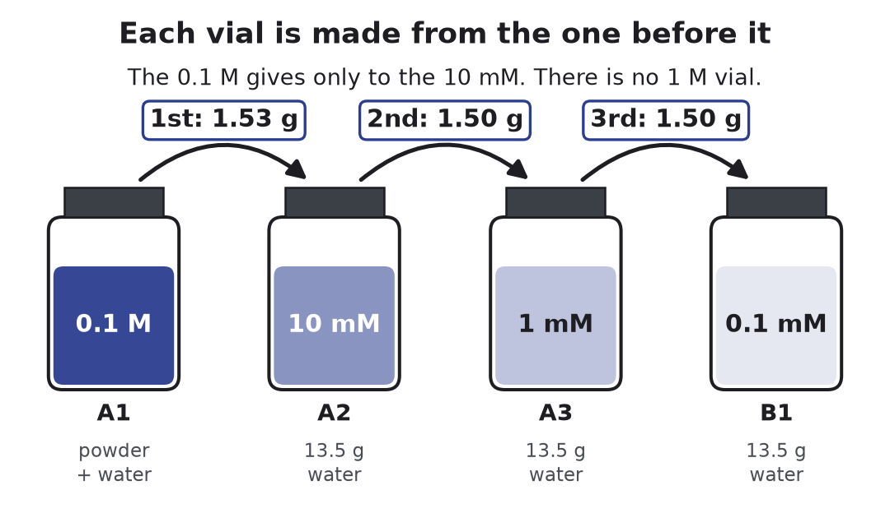

# Barium sulfate plate run: a 3-D animated SOP

Asked on [issue 80](https://github.com/vertical-cloud-lab/digital-wetlab/issues/80) by @sgbaird on 2026-11-02. It shows
what Tim and Michael do for the next barium chloride and sodium sulfate plate, from scratch:
- where each step happens: CB 154, or Chris Dillon's lab (EB B125) with the fume hood; and inside the hood or next to it;
- which containers are opened, and where;
- weighing the powders;
- loading the OT-2;
- the 72 h record from the lid camera.

**Materials for each step, and the hazards that could realistically hurt someone:**
[`materials-and-safety.md`](materials-and-safety.md) (asked on 2026-11-05).

**What to buy for the dry run and plate A, with catalogue numbers and prices:** [`shopping-list.md`](shopping-list.md)
(asked on 2026-11-11).

**Updated 2026-11-06** ([PR 84](https://github.com/vertical-cloud-lab/digital-wetlab/pull/84), @sgbaird):
- **The stocks are in the lab's 20 mL VOA vials** (27 mm across, 55 mm tall), made up by weight, in **two printed
  6-vial holders** for the OT-2. [`cad/`](cad/README.md) has the holder's STEP and STL and its Opentrons labware
  definition.
- **The plate sits on the heater-shaker in slot 7**, on its 96 flat-bottom adapter, under the **lid camera**. The deck
  shots now keep the camera in frame.
- **The colour sensor and its charging station are the Acceleration Consortium's own CAD**, parked in slot 10.
- **The OT-2 goes in the fume hood** (Sterling's call), carried by two people. PPE: nitrile gloves, a lab coat,
  safety glasses, long pants and closed-toe shoes. The videos still show the OT-2 in CB 154; what happens on the deck
  is the same. See [Does the OT-2 need to be in the hood?](#does-the-ot-2-need-to-be-in-the-hood)

**Updated 2026-11-11:** Tim calipered the vials at **27 mm** across, 1 mm under Fisher's 28 mm. The holder (now
28.2 mm pockets), its labware definition and the animation's vial are rebuilt for 27 mm. The videos and step clips
were rendered with 28 × 57 mm vials and haven't been re-rendered; the next render picks up 27 × 55 mm. Later the same
day Tim measured the height, **55 mm**, and the holder's labware definition now has the vial tops at 58 mm above the
deck. One holder is sliced for the lab's A1 mini in [`cad/print-a1mini/`](cad/print-a1mini/README.md), not yet
printed.

**Updated 2026-11-16** (asked by @timothy-commins on [PR 84](https://github.com/vertical-cloud-lab/digital-wetlab/pull/84)):
the videos now use the amounts for what the lab has.
- **The barium chloride is anhydrous,** so 2.5-2.11 weigh about 312 mg, not the dihydrate's 366 mg
  ([below](#the-barium-chloride-anhydrous-or-dihydrate)).
- **The dilutions are made by weight, with disposable transfer pipettes.** The lab has no 100-1000 µL hand pipette,
  and Chem Stores doesn't sell one ([Tim, 11-16](https://github.com/vertical-cloud-lab/digital-wetlab/pull/84#issuecomment-6927828161)).
  Each 1.5 mL goes in with a new transfer pipette, and each vial is weighed before and after, so the balance measures
  every transfer: three in the hood (2.12) and three at the bench (2.16)
  ([below](#the-dilutions-by-weight-with-transfer-pipettes)). This replaces the hand-pipette steps added earlier that day.
- **Parts 2a and 2b, their step clips, their GIFs and the full video are re-rendered** with these numbers and with
  the 27 × 55 mm vials, and again that afternoon with the transfer pipette and the weighings (2.2, 2.3, 2.12, 2.13,
  2.16). The other parts still have 28 × 57 mm vials, which look the same at that size. No other amount changed.
- **All ten vials are labelled at the start of 2.2, before any of them is weighed** ([the names](#the-vial-labels)).
  The 0.1 M sodium sulfate and 5 M NaCl vials are weighed empty there too, since 2.15 and 2.16 work out their water
  from that weight.
- **No vial is tared, and the steps name the balance's key.** The HR-100A has no TARE key: its RE-ZERO key is the
  tare ([Tim, 11-16](https://github.com/vertical-cloud-lab/digital-wetlab/pull/84#issuecomment-6929807985)). Every
  vial is now weighed with RE-ZERO pressed on the empty pan first, including the 0.1 M barium chloride vial, which 2.4
  used to tare. Only the weigh boats are tared ([the balance](#the-balance-re-zero-and-what-tare-means)). Parts 2a and
  2b are re-rendered for this, and their 2.2 and 2.13 captions now have the labels going on at 2.2.
- **At 2.2, only the six dilution vials get water:** the 10, 1 and 0.1 mM of each salt, about 13.5 g each, added
  after they're weighed empty. The other four stay dry until their salt is in
  ([Tim, 11-16](https://github.com/vertical-cloud-lab/digital-wetlab/pull/84#issuecomment-6930467122)). The 2.2
  caption said "then the six with about 13.5 g of DI water" without saying to add it, so part 2a is re-rendered with
  "Then add about 13.5 g of DI water to the six dilution vials only", and the six vials now start empty and fill
  during 2.2 instead of being full from the start of the chapter.
- **2.12 and 2.16 are a chain, and now say so with the units.** Each dilution vial is made from the one before it:
  the 0.1 M into the 10 mM vial, the 10 mM into the 1 mM, and the 1 mM into the 0.1 mM
  ([Tim, 11-16](https://github.com/vertical-cloud-lab/digital-wetlab/pull/84#issuecomment-6932399070)). The old
  wording, "then 10 into 1, then 1 into 0.1 mM", could be read as a 1 M vial. Part 2b is re-rendered with captions
  that name both vials of each transfer and its grams, and [a diagram of the chain](#step-212-one-transfer-at-a-time)
  is in this README and on the player page.

**Updated 2026-11-17** (asked by @timothy-commins on
[PR 84](https://github.com/vertical-cloud-lab/digital-wetlab/pull/84#issuecomment-6933584876)): the 5 M NaCl and the
DI water vials are written out step by step, with the readings to aim for
([Step 2.16: the 5 M NaCl and the DI water vials](#step-216-the-5-m-nacl-and-the-di-water-vials)), and on the player
page under 2.16. Until then they had one line at the end of 2.16 and a row each in the per-vial table.
- **Vial 9:** 4.383 g of NaCl, weighed in the vial ("with salt"), then 13.40 g of DI water, 17.78 g above the empty
  reading in all, shaken until clear.
- **Vial 10:** now weighed empty and filled to about 15 g of DI water, from a bottle that has only held DI water.
- **Both are made in fresh gloves,** with a spatula, boat and funnel that haven't touched the sodium sulfate.
- **The NaCl's grade and lot go in the log.** ACS NaCl may carry enough sulfate to matter on plate A
  ([the NaCl's own sulfate](#the-nacls-own-sulfate)).
- The clips aren't re-rendered. 2.16's caption still has the short version, which is right as far as it goes.

The procedure is the one already written down:
- [`docs/baso4-extended-monitoring.md`](https://github.com/vertical-cloud-lab/digital-wetlab/blob/ad0b513/docs/baso4-extended-monitoring.md)
  (11-02): plate A, the stocks, the seal, the stills schedule, and the run record;
- the [10-30 practice plate](https://github.com/vertical-cloud-lab/digital-wetlab/blob/127e1db/docs/lead-pbs-materials-and-steps.md#barium-sulfate-practice-plate):
  the stock recipes and the PHREEQC saturation indices;
- the 10-23 lead plan's rule to weigh by difference in a capped vial when the balance is outside the hood;
- the hood threads: [powder-doser 141](https://github.com/vertical-cloud-lab/powder-doser/issues/141) (barium chloride
  in the hood, sodium sulfate on the bench, work 15 cm inside the sash) and
  [byu-vcl 195](https://github.com/vertical-cloud-lab/byu-vcl/issues/195) (Dillon's rules for the room).

It is built the way the lab's other animations are (byu-vcl's `viz3d`, used for the rePowder training, the lid camera and
the vertical lift module): CadQuery and vendor STEP models, rendered off-screen in PyVista, text drawn with PIL, and
written as MP4 and GIF.

Chapters 2 and 3 are in two parts each, so every GIF stays under the ~5 MB GitHub shows inline. For the same reason part 2a's GIF runs at 4 fps and 2b's at 3 fps; every MP4 has all its frames.

| Part | GIF (800 × 450, 10 fps) | MP4 (1280 × 720, 15 fps) |
| --- | --- | --- |
| **1. Where each step happens**: the two rooms, with the zones coloured: inside the hood (red), next to it (amber), the OT-2 (blue). Then the walk between them | [`out/sop1_where.gif`](out/sop1_where.gif) | [`out/mp4/sop1_where.mp4`](out/mp4/sop1_where.mp4) |
| **2a. Barium chloride, inside the hood**: PPE, the balance beside the hood, loading the hood, and the capped vial weighed empty at the balance, filled in the hood and weighed again | [`out/sop2a_hood.gif`](out/sop2a_hood.gif) | [`out/mp4/sop2a_hood.mp4`](out/mp4/sop2a_hood.mp4) |
| **2b. Dilutions, then the bench**: the 0.1 M vial and its tenfold series in the hood, each vial weighed at the balance; sodium sulfate and its series, and sodium chloride, at the balance; packing the tub and closing the hood | [`out/sop2b_bench.gif`](out/sop2b_bench.gif) | [`out/mp4/sop2b_bench.mp4`](out/mp4/sop2b_bench.mp4) |
| **3a. Loading the OT-2 in CB 154**: the door, the plate on the heater-shaker in slot 7, the tips, the vial holders, uncapping, and the start | [`out/sop3a_load.gif`](out/sop3a_load.gif) | [`out/mp4/sop3a_load.mp4`](out/mp4/sop3a_load.mp4) |
| **3b. The fill and the seal**: water, NaCl, barium chloride, then sodium sulfate last; the seal at the pause; recapping | [`out/sop3b_fill.gif`](out/sop3b_fill.gif) | [`out/mp4/sop3b_fill.mp4`](out/mp4/sop3b_fill.mp4) |
| **4. Watching it for 72 h**: the lid camera's view and stills schedule, daily checks, the end of the run and the waste | [`out/sop4_monitor.gif`](out/sop4_monitor.gif) | [`out/mp4/sop4_monitor.mp4`](out/mp4/sop4_monitor.mp4) |
| **All of it**, one part after another | | [`out/mp4/baso4_sop_full.mp4`](out/mp4/baso4_sop_full.mp4) |

`out/<name>.json` gives the frame range of every sub-step in the MP4, and `out/<name>_still.png` is a still of one
sub-step.


## One MP4 per step

Asked on [issue 80](https://github.com/vertical-cloud-lab/digital-wetlab/issues/80) by @timothy-commins on
2026-11-05, so each step can be paused and replayed on its own. [`out/steps/`](out/steps) has one MP4 per numbered
step, 42 in all, cut from the six part MP4s above by [`split_steps.py`](split_steps.py). Nothing is re-rendered. Each
clip is its step's frames, then its last frame held so the caption stays up long enough to read: at least 15
characters a second, and 2 s past the motion. They come to 11.6 min in all, against 4 min 22 s for the full video.

**To watch them, open the [player page](https://htmlpreview.github.io/?https://github.com/vertical-cloud-lab/digital-wetlab/blob/81a0e0f/docs/baso4-sop-3d/out/steps/player.html).** It has every step in order, each in its own video player
(pause, drag back, replay), with the step's text written under it. The ▶ links below open it at that step.
- GitHub can't play an MP4: its file view only offers "View raw", and raw links download the file. The page is
  [`out/steps/player.html`](out/steps/player.html), shown as a web page by [htmlpreview](https://htmlpreview.github.io/).
  Its videos play GitHub's raw files, pinned to commit `f3316ed`, with jsDelivr as a fallback.
- On 11-05 the page was tested in Chrome: all 42 step videos loaded, played and paused. On 11-16, in headless
  Chrome 157 through htmlpreview, all 42 loaded at the lengths in `index.json`, and the 17 re-cut chapter-2 clips
  played and paused. The same check passed again after that afternoon's re-render (page at `28938e4`). After the
  evening's RE-ZERO re-render (page at `96736ac`, opened from the file in headless Chrome 157), all 42 loaded at
  their lengths, and five of the re-cut clips (2.2, 2.4, 2.9, 2.11, 2.14) played and paused. After that night's 2.2
  re-render (page at `9199495`), in headless Chrome 157 from the file and again through htmlpreview, all 42 loaded at
  their lengths, 2.2, 2.4 and 2.9 played and paused, and 2.2's text was the new one. Not tested in Safari.
- The page at `8902fa0` (11-16, late) has the same clips, with [what goes in each vial](#what-goes-in-each-vial) as a
  table near the top (`player.html#vials`). Loaded through htmlpreview in headless Chrome 157, it had all 42 steps,
  all 49 videos and the table's ten rows; the clips weren't played again. It also fixes the notes' links to this
  README's sections: htmlpreview points every link with a `#` at the page itself, so until then they only reloaded the
  page.
- The page at `2598a45` (11-16, night) has part 2a re-rendered at `242a08b`, with 2.9's caption saying what "for
  another mass, work out its concentration" meant ([the note](#what-goes-in-each-vial)); 2.9's clip is now 31 s. In
  headless Chrome 157, from the file and again through htmlpreview, it had all 42 steps and 49 videos, all 42 step
  clips loaded at their lengths in `index.json`, and 2.9 played and paused with the new text.
- The page at `62e85cc` (11-16, night) has the same clips, with 2.12 written out step by step under its caption
  ([the same steps](#step-212-one-transfer-at-a-time)) and a pointer to it under 2.16. Loaded through htmlpreview
  in headless Chrome 157, it had all 42 steps and 49 videos, every clip still pinned to `242a08b`, and both notes'
  links went to this README's section; the clips weren't played again.
- The page at `7a8f583` (11-16, night) has part 2b re-rendered, with 2.12's and 2.16's captions naming both vials of
  each transfer and its grams, and 2.12's note opening with [the chain](#step-212-one-transfer-at-a-time) and its
  diagram. Its clips and the diagram are pinned to `f3316ed`; 2.12's clip is now 33 s and 2.16's 30 s. Through
  htmlpreview in headless Chrome 157, it had all 42 steps and 49 videos, all 42 clips loaded at their lengths in
  `index.json`, the diagram loaded, and 2.12 and 2.16 played and paused with the new text. At phone width (412 px)
  the diagram's text could still be read. Not tested in Safari or on a phone.
- The page at `81a0e0f` (11-17) has the same clips, with the 5 M NaCl and DI water vials written out step by
  step under 2.16 ([the same steps](#step-216-the-5-m-nacl-and-the-di-water-vials)), and rows 9 and 10 of its
  vial table to match. Through htmlpreview in headless Chrome 157, it had all 42 steps, 49 videos, the table's ten
  rows and both new lists, and the link to this README's section worked. At phone width (412 px) the new box and
  the table fit. The clips weren't played again, since none changed.
- The file links download the MP4, to play in any video player.


**1. Where each step happens**

| Step | What | Where | Length | Watch | File |
| --- | --- | --- | --- | --- | --- |
| 1.1 | The two rooms | overview | 13 s | [▶ play](https://htmlpreview.github.io/?https://github.com/vertical-cloud-lab/digital-wetlab/blob/81a0e0f/docs/baso4-sop-3d/out/steps/player.html#s1.1) | [`1-01_two-rooms.mp4`](out/steps/1-01_two-rooms.mp4) |
| 1.2 | Inside the hood: barium chloride only | overview | 16 s | [▶ play](https://htmlpreview.github.io/?https://github.com/vertical-cloud-lab/digital-wetlab/blob/81a0e0f/docs/baso4-sop-3d/out/steps/player.html#s1.2) | [`1-02_inside-the-hood.mp4`](out/steps/1-02_inside-the-hood.mp4) |
| 1.3 | Next to the hood: balance and the other salts | overview | 18 s | [▶ play](https://htmlpreview.github.io/?https://github.com/vertical-cloud-lab/digital-wetlab/blob/81a0e0f/docs/baso4-sop-3d/out/steps/player.html#s1.3) | [`1-03_next-to-the-hood.mp4`](out/steps/1-03_next-to-the-hood.mp4) |
| 1.4 | Everything travels capped, in the tub | overview | 10 s | [▶ play](https://htmlpreview.github.io/?https://github.com/vertical-cloud-lab/digital-wetlab/blob/81a0e0f/docs/baso4-sop-3d/out/steps/player.html#s1.4) | [`1-04_carry-in-the-tub.mp4`](out/steps/1-04_carry-in-the-tub.mp4) |
| 1.5 | CB 154: uncap only on the OT-2's deck | overview | 16 s | [▶ play](https://htmlpreview.github.io/?https://github.com/vertical-cloud-lab/digital-wetlab/blob/81a0e0f/docs/baso4-sop-3d/out/steps/player.html#s1.5) | [`1-05_cb154-ot2.mp4`](out/steps/1-05_cb154-ot2.mp4) |
| 1.6 | The order of the day | overview | 13 s | [▶ play](https://htmlpreview.github.io/?https://github.com/vertical-cloud-lab/digital-wetlab/blob/81a0e0f/docs/baso4-sop-3d/out/steps/player.html#s1.6) | [`1-06_the-order.mp4`](out/steps/1-06_the-order.mp4) |

**2a. Barium chloride, inside the hood**

| Step | What | Where | Length | Watch | File |
| --- | --- | --- | --- | --- | --- |
| 2.1 | PPE and the SDS | EB B125 | 18 s | [▶ play](https://htmlpreview.github.io/?https://github.com/vertical-cloud-lab/digital-wetlab/blob/81a0e0f/docs/baso4-sop-3d/out/steps/player.html#s2.1) | [`2-01_ppe-and-sds.mp4`](out/steps/2-01_ppe-and-sds.mp4) |
| 2.2 | Check the balance; label the vials, weigh them | EB B125, next to the hood | 34 s | [▶ play](https://htmlpreview.github.io/?https://github.com/vertical-cloud-lab/digital-wetlab/blob/81a0e0f/docs/baso4-sop-3d/out/steps/player.html#s2.2) | [`2-02_balance-check.mp4`](out/steps/2-02_balance-check.mp4) |
| 2.3 | Load the hood, sash down | EB B125, inside the hood | 24 s | [▶ play](https://htmlpreview.github.io/?https://github.com/vertical-cloud-lab/digital-wetlab/blob/81a0e0f/docs/baso4-sop-3d/out/steps/player.html#s2.3) | [`2-03_load-the-hood.mp4`](out/steps/2-03_load-the-hood.mp4) |
| 2.4 | Weigh the empty barium chloride vial | EB B125, next to the hood | 22 s | [▶ play](https://htmlpreview.github.io/?https://github.com/vertical-cloud-lab/digital-wetlab/blob/81a0e0f/docs/baso4-sop-3d/out/steps/player.html#s2.4) | [`2-04_weigh-empty-vial.mp4`](out/steps/2-04_weigh-empty-vial.mp4) |
| 2.5 | Carry the vial into the hood | next to, then inside the hood | 9 s | [▶ play](https://htmlpreview.github.io/?https://github.com/vertical-cloud-lab/digital-wetlab/blob/81a0e0f/docs/baso4-sop-3d/out/steps/player.html#s2.5) | [`2-05_vial-into-hood.mp4`](out/steps/2-05_vial-into-hood.mp4) |
| 2.6 | Uncap the barium chloride and the vial | EB B125, inside the hood | 9 s | [▶ play](https://htmlpreview.github.io/?https://github.com/vertical-cloud-lab/digital-wetlab/blob/81a0e0f/docs/baso4-sop-3d/out/steps/player.html#s2.6) | [`2-06_uncap-bottle-and-vial.mp4`](out/steps/2-06_uncap-bottle-and-vial.mp4) |
| 2.7 | Spatula about 312 mg of barium chloride | EB B125, inside the hood | 13 s | [▶ play](https://htmlpreview.github.io/?https://github.com/vertical-cloud-lab/digital-wetlab/blob/81a0e0f/docs/baso4-sop-3d/out/steps/player.html#s2.7) | [`2-07_spatula-barium-chloride.mp4`](out/steps/2-07_spatula-barium-chloride.mp4) |
| 2.8 | Cap both, wipe the vial | EB B125, inside the hood | 10 s | [▶ play](https://htmlpreview.github.io/?https://github.com/vertical-cloud-lab/digital-wetlab/blob/81a0e0f/docs/baso4-sop-3d/out/steps/player.html#s2.8) | [`2-08_cap-and-wipe.mp4`](out/steps/2-08_cap-and-wipe.mp4) |
| 2.9 | Weigh the capped vial and log it | EB B125, next to the hood | 31 s | [▶ play](https://htmlpreview.github.io/?https://github.com/vertical-cloud-lab/digital-wetlab/blob/81a0e0f/docs/baso4-sop-3d/out/steps/player.html#s2.9) | [`2-09_weigh-the-vial.mp4`](out/steps/2-09_weigh-the-vial.mp4) |

**2b. Dilutions, then the bench**

| Step | What | Where | Length | Watch | File |
| --- | --- | --- | --- | --- | --- |
| 2.10 | Dissolve it in the vial | EB B125, inside the hood | 14 s | [▶ play](https://htmlpreview.github.io/?https://github.com/vertical-cloud-lab/digital-wetlab/blob/81a0e0f/docs/baso4-sop-3d/out/steps/player.html#s2.10) | [`2-10_dissolve-barium-chloride.mp4`](out/steps/2-10_dissolve-barium-chloride.mp4) |
| 2.11 | Weigh it, then into the barium holder | inside, next to, then inside the hood | 18 s | [▶ play](https://htmlpreview.github.io/?https://github.com/vertical-cloud-lab/digital-wetlab/blob/81a0e0f/docs/baso4-sop-3d/out/steps/player.html#s2.11) | [`2-11_weigh-barium-0.1M.mp4`](out/steps/2-11_weigh-barium-0.1M.mp4) |
| 2.12 | Dilute to 10, 1 and 0.1 mM barium chloride, weighing each vial | EB B125, inside the hood, and the balance | 33 s | [▶ play](https://htmlpreview.github.io/?https://github.com/vertical-cloud-lab/digital-wetlab/blob/81a0e0f/docs/baso4-sop-3d/out/steps/player.html#s2.12) | [`2-12_barium-dilutions.mp4`](out/steps/2-12_barium-dilutions.mp4) |
| 2.13 | Wipe the barium vials, check their labels | EB B125, inside the hood | 15 s | [▶ play](https://htmlpreview.github.io/?https://github.com/vertical-cloud-lab/digital-wetlab/blob/81a0e0f/docs/baso4-sop-3d/out/steps/player.html#s2.13) | [`2-13_cap-and-label-barium.mp4`](out/steps/2-13_cap-and-label-barium.mp4) |
| 2.14 | Weigh about 213 mg of sodium sulfate | EB B125, next to the hood | 23 s | [▶ play](https://htmlpreview.github.io/?https://github.com/vertical-cloud-lab/digital-wetlab/blob/81a0e0f/docs/baso4-sop-3d/out/steps/player.html#s2.14) | [`2-14_weigh-sodium-sulfate.mp4`](out/steps/2-14_weigh-sodium-sulfate.mp4) |
| 2.15 | Make up the 0.1 M sodium sulfate | EB B125, next to the hood | 19 s | [▶ play](https://htmlpreview.github.io/?https://github.com/vertical-cloud-lab/digital-wetlab/blob/81a0e0f/docs/baso4-sop-3d/out/steps/player.html#s2.15) | [`2-15_make-up-sodium-sulfate.mp4`](out/steps/2-15_make-up-sodium-sulfate.mp4) |
| 2.16 | Sulfate dilutions (weighed), 5 M NaCl and DI water | EB B125, next to the hood | 30 s | [▶ play](https://htmlpreview.github.io/?https://github.com/vertical-cloud-lab/digital-wetlab/blob/81a0e0f/docs/baso4-sop-3d/out/steps/player.html#s2.16) | [`2-16_sulfate-nacl-water.mp4`](out/steps/2-16_sulfate-nacl-water.mp4) |
| 2.17 | Pack the tub and clean up the hood | EB B125, hood then bench | 18 s | [▶ play](https://htmlpreview.github.io/?https://github.com/vertical-cloud-lab/digital-wetlab/blob/81a0e0f/docs/baso4-sop-3d/out/steps/player.html#s2.17) | [`2-17_pack-and-clean-up.mp4`](out/steps/2-17_pack-and-clean-up.mp4) |

**3a. Loading the OT-2 in CB 154**

| Step | What | Where | Length | Watch | File |
| --- | --- | --- | --- | --- | --- |
| 3.1 | Before the day: calibration, camera, lights | CB 154 | 17 s | [▶ play](https://htmlpreview.github.io/?https://github.com/vertical-cloud-lab/digital-wetlab/blob/81a0e0f/docs/baso4-sop-3d/out/steps/player.html#s3.1) | [`3-01_before-the-day.mp4`](out/steps/3-01_before-the-day.mp4) |
| 3.2 | Open the OT-2's door | CB 154, OT-2 deck | 16 s | [▶ play](https://htmlpreview.github.io/?https://github.com/vertical-cloud-lab/digital-wetlab/blob/81a0e0f/docs/baso4-sop-3d/out/steps/player.html#s3.2) | [`3-02_open-the-door.mp4`](out/steps/3-02_open-the-door.mp4) |
| 3.3 | The plate on the heater-shaker in slot 7 | CB 154, OT-2 deck | 17 s | [▶ play](https://htmlpreview.github.io/?https://github.com/vertical-cloud-lab/digital-wetlab/blob/81a0e0f/docs/baso4-sop-3d/out/steps/player.html#s3.3) | [`3-03_plate-on-heater-shaker.mp4`](out/steps/3-03_plate-on-heater-shaker.mp4) |
| 3.4 | Tips in slot 6 | CB 154, OT-2 deck | 7 s | [▶ play](https://htmlpreview.github.io/?https://github.com/vertical-cloud-lab/digital-wetlab/blob/81a0e0f/docs/baso4-sop-3d/out/steps/player.html#s3.4) | [`3-04_tips-in-slot-6.mp4`](out/steps/3-04_tips-in-slot-6.mp4) |
| 3.5 | The vial holders in slots 4 and 5 | CB 154, OT-2 deck | 16 s | [▶ play](https://htmlpreview.github.io/?https://github.com/vertical-cloud-lab/digital-wetlab/blob/81a0e0f/docs/baso4-sop-3d/out/steps/player.html#s3.5) | [`3-05_holders-in-slots-4-5.mp4`](out/steps/3-05_holders-in-slots-4-5.mp4) |
| 3.6 | Uncap the ten vials | CB 154, OT-2 deck | 12 s | [▶ play](https://htmlpreview.github.io/?https://github.com/vertical-cloud-lab/digital-wetlab/blob/81a0e0f/docs/baso4-sop-3d/out/steps/player.html#s3.6) | [`3-06_uncap-the-vials.mp4`](out/steps/3-06_uncap-the-vials.mp4) |
| 3.7 | Start the capture job, then the protocol | CB 154 | 12 s | [▶ play](https://htmlpreview.github.io/?https://github.com/vertical-cloud-lab/digital-wetlab/blob/81a0e0f/docs/baso4-sop-3d/out/steps/player.html#s3.7) | [`3-07_start-capture-then-protocol.mp4`](out/steps/3-07_start-capture-then-protocol.mp4) |

**3b. The fill and the seal**

| Step | What | Where | Length | Watch | File |
| --- | --- | --- | --- | --- | --- |
| 3.8 | Water into 84 wells | CB 154, OT-2, door closed | 12 s | [▶ play](https://htmlpreview.github.io/?https://github.com/vertical-cloud-lab/digital-wetlab/blob/81a0e0f/docs/baso4-sop-3d/out/steps/player.html#s3.8) | [`3-08_fill-water.mp4`](out/steps/3-08_fill-water.mp4) |
| 3.9 | 5 M NaCl into 64 wells | CB 154, OT-2, door closed | 13 s | [▶ play](https://htmlpreview.github.io/?https://github.com/vertical-cloud-lab/digital-wetlab/blob/81a0e0f/docs/baso4-sop-3d/out/steps/player.html#s3.9) | [`3-09_fill-nacl.mp4`](out/steps/3-09_fill-nacl.mp4) |
| 3.10 | Barium chloride into 72 wells | CB 154, OT-2, door closed | 11 s | [▶ play](https://htmlpreview.github.io/?https://github.com/vertical-cloud-lab/digital-wetlab/blob/81a0e0f/docs/baso4-sop-3d/out/steps/player.html#s3.10) | [`3-10_fill-barium-chloride.mp4`](out/steps/3-10_fill-barium-chloride.mp4) |
| 3.11 | Sodium sulfate last, a new tip per well | CB 154, OT-2, door closed | 14 s | [▶ play](https://htmlpreview.github.io/?https://github.com/vertical-cloud-lab/digital-wetlab/blob/81a0e0f/docs/baso4-sop-3d/out/steps/player.html#s3.11) | [`3-11_fill-sodium-sulfate-last.mp4`](out/steps/3-11_fill-sodium-sulfate-last.mp4) |
| 3.12 | Seal the plate at the pause | CB 154, OT-2 deck | 15 s | [▶ play](https://htmlpreview.github.io/?https://github.com/vertical-cloud-lab/digital-wetlab/blob/81a0e0f/docs/baso4-sop-3d/out/steps/player.html#s3.12) | [`3-12_seal-at-the-pause.mp4`](out/steps/3-12_seal-at-the-pause.mp4) |
| 3.13 | Recap the vials, leave the lights on | CB 154, OT-2 deck | 17 s | [▶ play](https://htmlpreview.github.io/?https://github.com/vertical-cloud-lab/digital-wetlab/blob/81a0e0f/docs/baso4-sop-3d/out/steps/player.html#s3.13) | [`3-13_recap-the-vials.mp4`](out/steps/3-13_recap-the-vials.mp4) |

**4. Watching it for 72 h**

| Step | What | Where | Length | Watch | File |
| --- | --- | --- | --- | --- | --- |
| 4.1 | The lid camera and its stills schedule | CB 154 | 22 s | [▶ play](https://htmlpreview.github.io/?https://github.com/vertical-cloud-lab/digital-wetlab/blob/81a0e0f/docs/baso4-sop-3d/out/steps/player.html#s4.1) | [`4-01_lid-camera-schedule.mp4`](out/steps/4-01_lid-camera-schedule.mp4) |
| 4.2 | What the camera sees | CB 154 | 9 s | [▶ play](https://htmlpreview.github.io/?https://github.com/vertical-cloud-lab/digital-wetlab/blob/81a0e0f/docs/baso4-sop-3d/out/steps/player.html#s4.2) | [`4-02_camera-view.mp4`](out/steps/4-02_camera-view.mp4) |
| 4.3 | The 72 h time-lapse (illustrative) | CB 154 | 16 s | [▶ play](https://htmlpreview.github.io/?https://github.com/vertical-cloud-lab/digital-wetlab/blob/81a0e0f/docs/baso4-sop-3d/out/steps/player.html#s4.3) | [`4-03_timelapse-illustrative.mp4`](out/steps/4-03_timelapse-illustrative.mp4) |
| 4.4 | The daily check | CB 154 | 16 s | [▶ play](https://htmlpreview.github.io/?https://github.com/vertical-cloud-lab/digital-wetlab/blob/81a0e0f/docs/baso4-sop-3d/out/steps/player.html#s4.4) | [`4-04_daily-check.mp4`](out/steps/4-04_daily-check.mp4) |
| 4.5 | At 72 h: last still, weigh, photograph | CB 154 | 12 s | [▶ play](https://htmlpreview.github.io/?https://github.com/vertical-cloud-lab/digital-wetlab/blob/81a0e0f/docs/baso4-sop-3d/out/steps/player.html#s4.5) | [`4-05_end-of-run.mp4`](out/steps/4-05_end-of-run.mp4) |
| 4.6 | Waste and the run record | CB 154 | 18 s | [▶ play](https://htmlpreview.github.io/?https://github.com/vertical-cloud-lab/digital-wetlab/blob/81a0e0f/docs/baso4-sop-3d/out/steps/player.html#s4.6) | [`4-06_waste-and-run-record.mp4`](out/steps/4-06_waste-and-run-record.mp4) |

The six part MP4s and the full video are at the end of the page:
- [▶ 1. Where each step happens](https://htmlpreview.github.io/?https://github.com/vertical-cloud-lab/digital-wetlab/blob/81a0e0f/docs/baso4-sop-3d/out/steps/player.html#wsop1_where)
- [▶ 2a. Barium chloride, inside the hood](https://htmlpreview.github.io/?https://github.com/vertical-cloud-lab/digital-wetlab/blob/81a0e0f/docs/baso4-sop-3d/out/steps/player.html#wsop2a_hood)
- [▶ 2b. Dilutions, then the bench](https://htmlpreview.github.io/?https://github.com/vertical-cloud-lab/digital-wetlab/blob/81a0e0f/docs/baso4-sop-3d/out/steps/player.html#wsop2b_bench)
- [▶ 3a. Loading the OT-2 in CB 154](https://htmlpreview.github.io/?https://github.com/vertical-cloud-lab/digital-wetlab/blob/81a0e0f/docs/baso4-sop-3d/out/steps/player.html#wsop3a_load)
- [▶ 3b. The fill and the seal](https://htmlpreview.github.io/?https://github.com/vertical-cloud-lab/digital-wetlab/blob/81a0e0f/docs/baso4-sop-3d/out/steps/player.html#wsop3b_fill)
- [▶ 4. Watching it for 72 h](https://htmlpreview.github.io/?https://github.com/vertical-cloud-lab/digital-wetlab/blob/81a0e0f/docs/baso4-sop-3d/out/steps/player.html#wsop4_monitor)
- [▶ All of it, 4 min 22 s](https://htmlpreview.github.io/?https://github.com/vertical-cloud-lab/digital-wetlab/blob/81a0e0f/docs/baso4-sop-3d/out/steps/player.html#wbaso4_sop_full)

[`out/steps/index.json`](out/steps/index.json) lists each clip's source frames, its motion and hold, and the full caption.

## The steps, and where each one happens

**Rule of thumb:**
- Barium chloride powder is opened only inside the hood, and a barium solution stays there until its vial is capped.
- The balance, sodium sulfate, sodium chloride, labels and the log are next to the hood. The capped vials fit under
  the balance's breeze-break lid, so every stock is made up by weight.
- Every vial is uncapped again only on the OT-2's deck.
- PPE whenever the barium vials or the plate are handled: nitrile gloves, a lab coat and safety glasses, with long
  pants and closed-toe shoes (Sterling, 11-06).
- The OT-2 goes in a fume hood for this run (Sterling, 11-06). See
  [Does the OT-2 need to be in the hood?](#does-the-ot-2-need-to-be-in-the-hood)

How much powder, water and stock goes in each of the ten vials: [What goes in each vial](#what-goes-in-each-vial).

| # | Where | What | Opened |
| --- | --- | --- | --- |
| 2.1 | EB B125 | Nitrile gloves (two pairs for barium), a lab coat and safety glasses, with long pants and closed-toe shoes. Read the barium chloride SDS; a printed copy goes in the room's SDS binder ([what that is](#the-sds-binder)). Keep every container closed and labelled (Dillon's rule) | - |
| 2.2 | next to the hood | The HR-100A on the bench beside the hood. If it was moved, plug it in at least an hour before weighing: it drifts for about an hour after a move ([powder-doser 157](https://github.com/vertical-cloud-lab/powder-doser/issues/157)). Level it, check it with a check weight. Label all ten 20 mL vials before any of them is weighed ([the names](#the-vial-labels)). Weigh eight of them empty and capped, pressing RE-ZERO with the pan empty before each one, and log each: the six dilution vials (10, 1 and 0.1 mM of each salt), the 0.1 M sodium sulfate and the 5 M NaCl. Add about 13.5 g of DI water to each dilution vial (a water-only transfer pipette for the last drops), cap it and log the reading again. Only these six get water now: the 0.1 M barium chloride, the 0.1 M sodium sulfate, the 5 M NaCl and the DI water vial stay empty until 2.4-2.11, 2.14-2.15 and 2.16. Never press RE-ZERO with a vial on the pan ([the balance's keys](#the-balance-re-zero-and-what-tare-means)) | - |
| 2.3 | inside the hood | Sash up to load: liner, tray, barium waste bottle, a wash bottle of fresh DI water, the barium chloride, the barium vial holder with three of the water vials, three new transfer pipettes and two spares, damp and dry wipes, a spatula, all at least 15 cm (6 in) inside the sash. Sash down to its working-height sticker | - |
| 2.4 | next to the hood | Weigh the empty capped vial for the 0.1 M barium chloride the same way, and log it ("empty"). It isn't tared ([why](#the-balance-re-zero-and-what-tare-means)) | balance lid |
| 2.5-2.8 | inside the hood | Open the barium chloride and the vial, and spatula about 312 mg into the vial. The lab's bottle is anhydrous; a dihydrate bottle would need 366 mg ([below](#the-barium-chloride-anhydrous-or-dihydrate)). Close both, wipe the vial with a damp wipe, then dry it with a dry one: a damp film would be weighed as salt at 2.9 | barium chloride bottle, vial |
| 2.9 | next to the hood | RE-ZERO with the pan empty, weigh the capped vial and log it ("with salt"), with the form, maker and lot from the bottle's label. The salt is this reading minus the 2.4 one. 0.3123 g of anhydrous BaCl₂ (208.23 g/mol) is 1.500 mmol, as is 0.3664 g of the dihydrate (BaCl₂·2H₂O, 244.26 g/mol). It needn't be exact: 0.28-0.33 g of the anhydrous salt is fine, and the stock's real concentration is worked out from the log, as salt × 4.802 ÷ water in mol/kg, both in grams ([how](#what-goes-in-each-vial)) | balance lid |
| 2.10-2.11 | inside the hood, then next to it | About 15 mL of DI water into the same vial; cap and swirl until clear. Wipe it, RE-ZERO with the pan empty, weigh it capped and log it ("with water"). The water is this reading minus the 2.9 one: 1.500 mmol with 15.00 g of water is 0.1000 mol/kg, a reading 15.31 g above the 2.4 one from either form. If the salt isn't 0.3123 g, log it and its real concentration is worked out from the readings, or add 48.0 g of water per gram of anhydrous salt to keep it at 0.1000 mol/kg ([both](#what-goes-in-each-vial)). It goes into A1 of the barium holder | vial |
| 2.12-2.13 | inside the hood, and the balance after each transfer | 1.5 mL down the series, one water vial at a time, each made from the one before it: about 1.53 g of the 0.1 M into the 10 mM vial, then 1.50 g of the 10 mM into the 1 mM vial, then 1.50 g of the 1 mM into the 0.1 mM vial ([why 1.53 g](#what-goes-in-each-vial); [a diagram](#step-212-one-transfer-at-a-time)). A new transfer pipette for each vial, drawn to its 1.5 mL mark. Cap the vial, invert it ten times, wipe it damp and then dry. Then carry it to the balance, RE-ZERO with the pan empty, weigh it and log it, and bring it back before anything is drawn from it. The three pipettes go in the barium solid waste. Step by step, and what to do if a transfer is off: [2.12, one transfer at a time](#step-212-one-transfer-at-a-time) | barium vials |
| 2.14-2.15 | next to the hood | Sodium sulfate in an open weigh boat, tared: the empty boat on the pan, then RE-ZERO, so the display shows only the salt. 213.1 mg (anhydrous, 142.04 g/mol) with 15.00 g of water is 0.1 mol/kg; a decahydrate bottle needs 483.3 mg and 14.73 g of water ([why](#what-goes-in-each-vial)). Through a funnel into its vial, rinse in to about 15 mL, cap, RE-ZERO with the pan empty, weigh and log it. Its water is that reading minus the vial's empty weight (2.2) and the salt | sodium sulfate bottle, vial |
| 2.16 | next to the hood | The same chain for sulfate: about 1.52 g of the 0.1 M into the 10 mM vial, then 1.50 g of the 10 mM into the 1 mM vial, then 1.50 g of the 1 mM into the 0.1 mM vial, with three new transfer pipettes, each vial weighed and logged before the next is drawn from it. Then fresh gloves, and a clean spatula, a new weigh boat and a clean funnel, for the last two vials. The 5 M NaCl: 4.383 g of NaCl in a tared boat, funnelled into its vial and weighed ("with salt"), then 13.40 g of DI water added with the vial and its cap on the pan, and weighed again ("with water"); shake it until no crystals are left. The DI water vial: weighed empty, then filled with about 15 g of fresh DI water (plate A takes 10.0 mL of it). Step by step: [the NaCl and the DI water](#step-216-the-5-m-nacl-and-the-di-water-vials). Ten vials in all | sodium chloride bottle, vials |
| 2.17 | hood, then bench | Wipe the barium vials and their holder, then put both holders in the tub, lid on. Outer gloves off in the hood; liner and wipes into the barium waste. Sash fully down | tub lid |
| 1.4 | between buildings | Carry the tub closed | nothing |
| 3.1 | CB 154 | Before the day: OT-2 calibrated (deck, tip length, pipette offset, Labware Position Check), the heater-shaker in slot 7 with its 96 flat-bottom adapter, the lid camera refocused for the plate on it, Pi 5 on its 27 W supply, camera exposure and white balance locked, rail lights on with no timer, capture job tested. Beside the OT-2: a labelled barium waste bottle, damp wipes and a wash bottle of DI water | - |
| 3.2-3.5 | OT-2 deck | Nitrile gloves, lab coat and safety glasses on before the tub is opened; they stay on until the vials are recapped (3.13). Door open. Black paper cut to the adapter and the plate on the heater-shaker in slot 7, under the lid camera (labware latch closed, lid off now), 300 µL tips in slot 6 (lid off), the barium holder in slot 4, the sulfate holder in slot 5. The colour sensor stays parked in its charging station in slot 10 | plate lid, tip-rack lid |
| 3.6 | OT-2 deck | Uncap the ten vials one at a time; each cap goes top-down on a wipe, in order. A drip or spill: wipe it up while it's wet, wipe into the barium waste, then wipe the spot again with water | vials |
| 3.7 | CB 154 | Close the door. Start the capture job, then the protocol | - |
| 3.8-3.11 | OT-2, door closed | Water, then 5 M NaCl, then barium chloride. Sodium sulfate goes in last, with a new tip per well, dispensed from above | - |
| 3.12-3.13 | OT-2 deck | At the pause: a clear adhesive seal, pressed down well by well; log the time. Recap the vials, close the door, rail lights stay on | door |
| 4.1-4.4 | CB 154 | Stills every 1 min to 30 min after the last sulfate, every 5 min to 6 h, then every 15 min (about 400 in 72 h). Check the stream, the heartbeat and the event log once a day | - |
| 4.5-4.6 | CB 154 | Gloves, lab coat and glasses on again. Last still. Take the plate out, weigh it, and photograph it on black. Wells, leftover stocks and rinses go to barium waste. Wipe the deck with a damp wipe, gloves off, wash your hands. Commit the run record to `experiments/004-baso4-monitoring/<run-id>/` | door, waste |

### The SDS binder

"The binder" in 2.1 is the room's **SDS binder**: a ring binder of printed safety data sheets (SDSs), one for each
chemical used in the room, with a list of those chemicals at the front. An SDS is the maker's sheet for a chemical: its
hazards, first aid, what to do about a spill, the PPE, and how to dispose of it. If something goes wrong, anyone in the
room can read what to do on the spot.

- **Every lab has to keep its SDSs.** BYU Engineering's lab safety plan asks each lab for current SDSs with an
  inventory of its chemicals, on paper or on a USB stick
  ([p. 9](https://github.com/vertical-cloud-lab/byu-vcl/blob/83dd5a1/byu-engineering-lab-safety-plan-chemical-hygiene-plan-2024.pdf)).
  The proposal's safety plan promises a labelled binder at the lab entrance
  ([`safety_explanation.md`](../../drafts/safety_explanation.md)).
- **What goes in it for this run:** the SDSs for the barium chloride, the sodium sulfate and the sodium chloride, each
  for the bottle you're using. The maker and product number are on the label, and the maker's website has the sheet.
  - **The lab has no barium chloride SDS on record.** Its SDSs so far are digital copies from March, on
    [byu-vcl 15](https://github.com/vertical-cloud-lab/byu-vcl/issues/15#issuecomment-3991816640): silver nitrate,
    sodium chloride, sodium sulfate, barium nitrate, lead nitrate and ammonium sulfide. The barium nitrate sheet
    doesn't cover barium chloride.
  - Print the sodium sulfate and sodium chloride sheets from there if the maker on each matches your bottle.
- **Which binder:** each room where the barium is used.
  - **EB B125**, where the powder is opened. Ask the Dillon lab where they keep their SDSs, and add yours there.
  - **The OT-2's room**, if it isn't EB B125, where the stocks and the plate sit for 72 h. Nobody has recorded an SDS
    binder in CB 154. byu-vcl's [punch list](https://github.com/vertical-cloud-lab/byu-vcl/blob/00ca2f1/docs/lab-punch-list.md)
    (10-20) still has it open. If there isn't one, start one by the door, labelled "Safety Data Sheets".
- **Read the barium chloride SDS before you open the bottle**, at least sections 2, 4, 6 and 8: the hazards, first
  aid, spills and PPE.
- The 2.1 clip's caption still just says "the binder".

### What M, mM and mol/kg mean

Asked by @timothy-commins on [PR 84](https://github.com/vertical-cloud-lab/digital-wetlab/pull/84#issuecomment-6929976703)
on 2026-11-16.

- **M means molar: moles of the chemical per litre of solution.** 0.1 M barium chloride has 0.1 mol of barium
  chloride in each litre, which is 0.1 mmol in each mL. A mole is a count, like a dozen: 6.022 × 10²³ of whatever is
  being counted, here units of BaCl₂.
- **The m in mM and mmol is milli, a thousandth.** 10 mM is 0.01 M, 1 mM is 0.001 M and 0.1 mM is 0.0001 M, so each
  vial in a series is a tenth as strong as the one before it. A vial of 0.1 M is a thousand times stronger than one
  of 0.1 mM.
- **The molar mass turns moles into grams.** It's the g/mol in 2.9 and 2.14: a mole of anhydrous barium chloride
  weighs 208.23 g, of sodium sulfate 142.04 g, and of sodium chloride 58.44 g. A vial's stock is about 15 mL, so the
  salt to weigh is the concentration × 15 mL × the molar mass:

| Vial | In 15 mL | Weighed |
| --- | --- | --- |
| Barium chloride, 0.1 M | 0.1 × 15 = 1.5 mmol | 1.5 × 208.23 = 312 mg (2.5-2.9) |
| Sodium sulfate, 0.1 M | 0.1 × 15 = 1.5 mmol | 1.5 × 142.04 = 213 mg (2.14) |
| Sodium chloride, 5 M | 5 × 15 = 75 mmol | 75 × 58.44 = 4.383 g (2.16) |

- **The weaker vials are diluted, not weighed out.** 1.5 mL of a 0.1 M stock in 13.5 g of water is about 15 mL, ten
  times the volume, so it's a tenth as strong: 10 mM. The same step again makes 1 mM, then 0.1 mM. On the plate,
  20 µL of a stock in a 200 µL well is another tenfold: 20 µL of the 10 mM vial makes 1 mM in the well.
- **Why moles, not milligrams.** One barium ion and one sulfate ion make one unit of barium sulfate
  (Ba²⁺ + SO₄²⁻ → BaSO₄). Solutions of the same molarity hold the same number of units per mL, so the two 0.1 M
  stocks match ion for ion, although one takes 312 mg of salt and the other 213 mg.
- **mol/kg** (2.11 and [the dilution arithmetic](#the-dilutions-by-weight-with-transfer-pipettes)) is moles per
  kilogram of water, called molal. The SOP uses it because the water is weighed, not filled to a line. For these dilute
  stocks a kilogram of water makes just over a litre of solution, so 0.1 mol/kg is about 0.0995 M, half a percent
  apart. That doesn't matter here, and the labels say M. The 5 M NaCl is too strong for that (it's 5.6 mol/kg), so its
  recipe is worked out per litre, from its density.

### The vial labels

Asked by @timothy-commins on [PR 84](https://github.com/vertical-cloud-lab/digital-wetlab/pull/84#issuecomment-6929684008)
on 2026-11-16. Label all ten vials at the start of 2.2, before any of them is weighed, so nothing has to be written in
the hood.

| Vial | Name | Concentration | Holder pocket | Made in |
| --- | --- | --- | --- | --- |
| 1 | Barium chloride | 0.1 M | slot 4, A1 | 2.4-2.11 |
| 2 | Barium chloride | 10 mM | slot 4, A2 | 2.12 |
| 3 | Barium chloride | 1 mM | slot 4, A3 | 2.12 |
| 4 | Barium chloride | 0.1 mM | slot 4, B1 | 2.12 |
| 5 | Sodium sulfate | 0.1 M | slot 5, A1 | 2.14-2.15 |
| 6 | Sodium sulfate | 10 mM | slot 5, A2 | 2.16 |
| 7 | Sodium sulfate | 1 mM | slot 5, A3 | 2.16 |
| 8 | Sodium sulfate | 0.1 mM | slot 5, B1 | 2.16 |
| 9 | Sodium chloride | 5 M | slot 5, B2 | 2.16 |
| 10 | DI water | - | slot 5, B3 | 2.16 |

Slot 4's B2 and B3 stay empty. The six dilution vials that get water in 2.2 are vials 2-4 and 6-8. The pockets are the
map in [`cad/`](cad/README.md#on-the-ot-2) and `check_deck.py`; the plate A protocol has to use the same one.

- **On each label:** the name written out, the concentration, the date and your initials, and **TOXIC** on the four
  barium vials. BYU's [chemical safety program](https://chem.byu.edu/documents/1767/byu_chemical_hygiene_plan.pdf)
  asks for the chemical's name and a hazard warning on containers of hazardous chemicals (p. 19), and for a key
  kept in the room if codes are used instead of names (p. 34). Adding the pocket (say, 4-A2) helps each barium vial
  go back in the same pocket after its trip to the balance.
- **Label first, then weigh.** A strip of tape or a paper label weighs roughly 0.1 g (my estimate). Put on after a
  vial's empty weighing, it gets logged as water. On the 0.1 M barium chloride vial, which gets only 0.31 g of salt, a
  label put on after 2.4 would be logged as about a third more barium chloride.
- **Above the holder.** The bottom 2 cm of each vial sits in its pocket, which is only 0.6 mm wider than the vial on
  each side. Keep the label between the top of the holder and the cap, where it can be read with the vial in the
  holder and can't make the vial stick. That band is only about 2 cm tall (my estimate for a 55 mm vial), so use
  labelling tape 1/2 or 3/4 in (13 or 19 mm) wide, or a label no taller. Use a permanent marker, since the barium
  vials are wiped with damp wipes.
- **M or mM** ([what they mean](#what-m-mm-and-molkg-mean)). The 0.1 M and 0.1 mM vials of each salt differ a
  thousandfold, and they sit one behind the other in column 1 of their holder (A1 and B1). Write the units clearly,
  and check those two whenever vials go into a holder.
- **The concentrations are the targets.** The log gives the real ones
  ([the arithmetic](#the-dilutions-by-weight-with-transfer-pipettes)); the labels stay as they are.
- **Mark the holders too.** The two printed holders are identical. Write "BARIUM, slot 4" on the top face of one,
  along an edge, and "slot 5" on the other. The barium one goes into the hood (2.3) and the other one doesn't. The
  top face keeps the marking away from the slot's corner clips.
- By 2.13 the labels are already on, so only check them. The 2.2 and 2.13 clips say so since the 11-16 re-render;
  2.13's file is still named `cap-and-label-barium`.

### What goes in each vial

Asked by @timothy-commins on [PR 84](https://github.com/vertical-cloud-lab/digital-wetlab/pull/84#issuecomment-6931322727)
on 2026-11-16, with the six dilution vials already holding 13.5 g of DI water each.

**Only three vials get powder:** the two 0.1 M stocks and the 5 M NaCl. The six dilution vials get no powder. Each gets
about 1.5 g of the vial before it in its series. The DI water vial gets only water.

| Vial | Powder | DI water | Then | At the end, above its empty reading |
| --- | --- | --- | --- | --- |
| 1. Barium chloride, 0.1 M | 312.3 mg of anhydrous barium chloride, in the hood (2.5-2.8): 0.31 g above empty at 2.9 | 15.00 g (2.10) | - | 15.31 g |
| 2. Barium chloride, 10 mM | none | 13.50 g (2.2) | 1.53 g of vial 1 (2.12) | 15.03 g |
| 3. Barium chloride, 1 mM | none | 13.50 g (2.2) | 1.50 g of vial 2 (2.12) | 15.00 g |
| 4. Barium chloride, 0.1 mM | none | 13.50 g (2.2) | 1.50 g of vial 3 (2.12) | 15.00 g |
| 5. Sodium sulfate, 0.1 M | 213.1 mg of anhydrous sodium sulfate, in a tared boat (2.14) | 15.00 g, rinsing the boat and funnel in (2.15) | - | 15.21 g |
| 6. Sodium sulfate, 10 mM | none | 13.50 g (2.2) | 1.52 g of vial 5 (2.16) | 15.02 g |
| 7. Sodium sulfate, 1 mM | none | 13.50 g (2.2) | 1.50 g of vial 6 (2.16) | 15.00 g |
| 8. Sodium sulfate, 0.1 mM | none | 13.50 g (2.2) | 1.50 g of vial 7 (2.16) | 15.00 g |
| 9. Sodium chloride, 5 M | 4.383 g of sodium chloride, in a tared boat, funnelled in and weighed (2.16): 4.38 g above empty | 13.40 g, added on the pan (2.16) | shake until no crystals are left | 17.78 g |
| 10. DI water | none | about 15 g (15 mL) of fresh DI water, from a bottle that has only held DI water (2.16) | - | about 15 g (14-16 g is fine) |

The last column is the capped vial's final reading minus its empty one. Add it to a vial's logged empty reading to get
the reading to aim for. The NaCl and the DI water vials, step by step:
[Step 2.16](#step-216-the-5-m-nacl-and-the-di-water-vials).

- **Why the dilution vials get no powder.** Made straight from powder, with 13.5 g of water each, they would need
  28.1, 2.81 and 0.281 mg of barium chloride, and 19.2, 1.92 and 0.192 mg of sodium sulfate. The balance reads to
  0.1 mg, so on 0.28 mg one step of the display is a third of the amount, and a spatula can't measure out that little
  anyway. A tenfold dilution by weight is known to better than 0.1 % ([how](#the-dilutions-by-weight-with-transfer-pipettes)).
- **Why 1.53 and 1.52 g.** About 2 % of the 0.1 M barium chloride's weight is the salt itself, and 1.4 % of the
  sodium sulfate's. These amounts make up for it, so the 10 mM vials land on 10.0 mM; a flat 1.50 g makes them 9.82
  and 9.87 mM, which is fine too. In the 10 and 1 mM vials the salt is 0.2 % of the weight or less, so 1.50 g is
  right. Anything from 1.45 to 1.55 g works, as long as each reading is logged
  ([the arithmetic](#the-dilutions-by-weight-with-transfer-pipettes)).
- **If the barium chloride isn't 0.3123 g.** It goes in inside the hood, where the balance can't be seen, so it seldom
  lands exactly. That's fine. Keep the salt between 0.28 and 0.33 g, so the water fits in the vial. Outside that, add a
  little more in the hood, or take some out into the barium solid waste, and weigh it again. Then either:
  - **Log it, and work out the stock's real concentration.** This is what 2.9's old "for another mass, work out its
    concentration" meant ([Tim asked](https://github.com/vertical-cloud-lab/digital-wetlab/pull/84#issuecomment-6931706829),
    11-16). Add about 15 g of water at 2.10, as usual. Then, from the log:
    - the salt is the 2.9 reading minus the 2.4 one, and the water is the 2.11 reading minus the 2.9 one;
    - the concentration, in mol/kg, is **salt × 4.802 ÷ water**, both in grams. 4.802 is 1000 ÷ 208.23, the molar
      mass of anhydrous barium chloride.
    - For example, 0.3051 g of salt with 14.87 g of water is 0.3051 × 4.802 ÷ 14.87 = 0.0985 mol/kg, 1.5 % under
      0.1. With 15.00 g of water it would be 0.0977.
    - Every stock made from it, and the barium in every well, is off by the same share: here the 10 mM vial is
      about 9.85 mM, and so on. The robot's volumes don't change, and the analysis uses the real numbers, so
      nothing else has to be redone. Nobody has to do this sum at the bench: the log is enough.
  - **Or keep the stock at 0.1000 mol/kg** by adding **48.0 g of water per gram of the salt** instead of about 15 g:
    - 0.2800 g of salt takes 13.45 g of water, 0.3000 g takes 14.41 g, 0.3051 g takes 14.65 g, 0.3123 g takes
      15.00 g, and 0.3300 g takes 15.85 g.
    - The 2.11 reading to aim for is then the 2.9 reading plus that water.
    - The water goes in inside the hood, out of sight of the balance, so hitting it takes a top-up: add a little
      less at 2.10, weigh it, then add the rest in the hood with the water-only transfer pipette (1 mL is about 1 g)
      and weigh it again. That's an extra round trip for a barium vial, which is why logging it is the simpler route.
  - The same rule for the sodium sulfate is 70.4 g of water per gram, but in its tared boat it can be weighed to
    0.2131 g directly.
- **Check the sodium sulfate's label.** 213.1 mg is for the anhydrous salt, Na₂SO₄. If the label says decahydrate
  (Na₂SO₄·10H₂O, 322.19 g/mol), weigh 483.3 mg and add 14.73 g of water, because the crystals bring 0.27 g of water of
  their own. The vial still ends 15.21 g above its empty reading.
- **Log readings, not amounts.** The arithmetic subtracts one reading of a vial from another, so after each addition,
  log the number the balance shows for the capped vial. "13.5 g of water added" isn't enough on its own. Log all the
  decimals the display shows: the 0.1 M barium chloride's salt is its 2.9 reading minus its 2.4 one, so an empty
  reading rounded to 0.01 g can put the salt off by up to 5 mg, 1.6 % of 312 mg.

### The balance: RE-ZERO, and what "tare" means

Asked by @timothy-commins on
[PR 84](https://github.com/vertical-cloud-lab/digital-wetlab/pull/84#issuecomment-6929807985) on 2026-11-16: "tare is
not an option on the scale".

The HR-100A has six keys under its display: ON:OFF, CAL, MODE, SAMPLE, PRINT and, on the right, **RE-ZERO** (→0←).
RE-ZERO sets the display to zero. Pressed with something on the pan, it takes that weight off the display, and that's
what "taring" means. The HR-100A has no separate TARE key: "Press the RE-ZERO key to cancel the weight (tare)" (A&D's
[manual](https://www.aandd.jp/products/manual/balances/hr-az_hr-a_manual.pdf) for the HR-AZ and HR-A series, pp. 10
and 14).

**Every vial reading** (2.2, 2.4, 2.9, 2.11, 2.12, 2.15, 2.16):
1. Close the lid with nothing on the pan, press RE-ZERO and wait for 0.0000 g.
2. Lift the lid, put the capped vial in the middle of the pan and close the lid.
3. Wait for the stability mark, the small circle at the left of the display, then log the whole reading, all four
   decimals.

**Never press RE-ZERO with a vial on the pan.** What went into a vial is the difference between two of its readings.
For the 0.1 M barium chloride:

| Reading | Example | So |
| --- | --- | --- |
| 2.4, empty | 14.2051 g | |
| 2.9, with salt | 14.5174 g | salt = 14.5174 − 14.2051 = 0.3123 g |
| 2.11, with water | 29.5174 g | water = 29.5174 − 14.5174 = 15.0000 g, so 0.1000 mol/kg |

The vial's weight here is made up; yours will differ.
- Every reading starts from a fresh zero, which takes out any drift between readings.
- Nothing is lost if someone presses RE-ZERO, or turns the balance off and on, while a vial is away in the hood. On
  the day the balance sits in the Dillon lab's room, where others may use it.
- Until 11-16 the SOP tared the 0.1 M barium chloride vial at 2.4 and read the salt straight off the display at 2.9.
  That tare had to last through two trips into the hood, with the display reading minus the vial's weight while it was
  away, and pressing RE-ZERO before 2.9, as every other reading does, would have lost the salt's weight.

**Only the weigh boats are tared** (the sodium sulfate in 2.14 and the NaCl in 2.16). Put the empty boat on the pan,
close the lid and press RE-ZERO; the display then shows only the salt as you add it. The boat stays on the pan until
the reading is logged.

**On another balance,** if the Dillon lab's own is used, the key may be marked ZERO, →0←, →T← or O/T, and it works the
same way. If you can't find one, post a photo of its keys on the PR.

### The barium chloride: anhydrous or dihydrate

The lab's bottle is anhydrous ([Tim, 2026-11-16](https://github.com/vertical-cloud-lab/digital-wetlab/pull/84#issuecomment-6925620635)).
The SOP was first written for the dihydrate.
- **Once it's dissolved, either form makes the same stock.** Only the mass you weigh changes. For 1.500 mmol, that's
  312.3 mg of the anhydrous salt (BaCl₂, 208.23 g/mol) or 366.4 mg of the dihydrate (BaCl₂·2H₂O, 244.26 g/mol).
  Weighing 366 mg of the anhydrous salt would make the stock 17 % too strong.
- **The concentration is mmol of BaCl₂ per gram of water** (mol/kg). The salt is the 2.9 reading minus the 2.4
  one (the empty vial). With the anhydrous salt, the water is the 2.11 reading minus the 2.9 reading. The dihydrate
  also brings 36 mg of water per mmol, and that counts as water too. With either form, 1.500 mmol and a 2.11 reading
  15.31 g above the 2.4 one is 0.1000 mol/kg.
- **The anhydrous salt takes up water from the air** and slowly turns into the dihydrate
  ([Wikipedia](https://en.wikipedia.org/wiki/Barium_chloride)). The water it has picked up gets weighed as barium
  chloride, so the stock comes out weaker than the log says. It's weaker by about the share of water in what you
  weighed: 15 % if it had all turned to dihydrate.
  - When you open the bottle in the hood, check that it's loose and free-flowing. If it's caked, lumpy or damp,
    don't use it for plate A. Tell Sterling, and buy the dihydrate (it's in the
    [shopping list](shopping-list.md#3-probably-in-the-lab-check-before-ordering)).
  - Close the bottle as soon as the spatula is out (2.8), and keep the cap tight.
- **The hazards are the same:** toxic if swallowed (H301) and harmful if inhaled (H332). Print the SDS for the lab's
  own bottle, from its maker, for the [SDS binder](#the-sds-binder) (2.1).
- **The clips show the anhydrous salt and 312 mg,** since parts 2a and 2b were re-rendered on 11-16, and so do their
  GIFs and MP4s and the full video.

### The dilutions: by weight, with transfer pipettes

The lab has no 100-1000 µL hand pipette, and BYU Chem Stores doesn't sell one
([Tim, 2026-11-16](https://github.com/vertical-cloud-lab/digital-wetlab/pull/84#issuecomment-6927828161)). So each
1.5 mL transfer (2.12, 2.16) goes in with a disposable transfer pipette, and the balance measures it. The pipette only
has to get close to 1.5 mL.
- **It's more accurate than a hand pipette.** The balance reads to 0.1 mg, so each 1.5 g transfer is known to about
  0.01 %, and each tenfold step to better than 0.1 %. A calibrated hand pipette is good to about 1 % a transfer, and
  those errors add up down the series.
- **The stocks won't land exactly on 10, 1 and 0.1 mM, and they don't need to.** Each one's real concentration comes
  from the log, and so does each well's. The robot's volumes stay as planned. Unlike a pipette's error, this one is
  known, so each well's real saturation index is known too.
- **Any pipette works,** since it isn't measuring. Plastic transfer pipettes are the easiest. Glass Pasteur pipettes
  work too, but the barium ones would then be sharps in the barium waste.

**What it takes:**
- **Disposable polyethylene transfer pipettes,** graduated to 3 mL in 0.5 mL steps. One per dilution vial (three in
  the hood, three at the bench), one for water only, and spares: about 10 a run. Sterling's 03-04 Chem Stores list
  bought about 100 "disposable pipettes"
  ([byu-vcl 15](https://github.com/vertical-cloud-lab/byu-vcl/issues/15#issuecomment-3999005476)), so check what's
  left.
- **The balance beside the hood,** reading to 0.1 mg, and the log sheet.

**The weighings.** Log every reading as the balance shows it: press RE-ZERO with the pan empty, then put the vial on
([the balance's keys](#the-balance-re-zero-and-what-tare-means)). Never press RE-ZERO with a vial on the pan.
1. **2.2, before any salt is opened.** Label the vials. For each dilution vial: RE-ZERO with the pan empty, weigh the
   capped vial and log it ("empty"). Add about 13.5 g of DI water: the wash bottle, then the water-only transfer
   pipette for the last drops. Cap it and log the reading ("with water").
   - **Practise once while you're there.** Draw DI water to a pipette's 1.5 mL mark, squeeze it into a spare vial on
     the pan, and read. Two or three tries show you where 1.5 g is on the pipette.
2. **Each transfer** (2.12 in the hood, 2.16 at the bench; step by step:
   [below](#step-212-one-transfer-at-a-time)). Uncap the stronger stock and the next water vial. Draw to the 1.5 mL
   mark with a new pipette and empty it into the water vial, tip against the inside wall. Cap both. Invert the new vial
   ten times, wipe it with a damp wipe and dry it with a dry one.
3. **Weigh it straight away,** before anything is drawn from it. RE-ZERO with the pan empty, weigh the capped vial and log it
   ("with stock"). A vial weighed after it has been drawn from gives the wrong number.
   - **For barium,** that's a round trip: the capped, wiped vial goes out to the balance and back into the hood, as
     the 0.1 M vial did in 2.9-2.11. Three trips in all.
4. **Then the next vial:** 10 mM into 1 mM, then 1 mM into 0.1 mM, each weighed the same way.

**How close to 1.5 g is close enough:**
- 1.45-1.55 g each time keeps the 0.1 mM vials within about 10 % of 0.1 mM.
- 1.4-1.6 g keeps them within about 20 %, which is still fine, because the log has the real number.
- Under 1.4 g, add a few more drops of the same stock with a new pipette and weigh it again
  ([how](#step-212-one-transfer-at-a-time)).
- Over 1.6 g, or if anything spills, redo that vial with a spare one, weighed empty and with water as in 2.2. Any vial
  already made from it has to be redone too; weighing each vial before the next is drawn from it catches this first.

**The arithmetic,** afterwards or on a calculator at the bench:
- water w = "with water" − "empty", and stock s = "with stock" − "with water";
- the new vial's concentration = the concentration it was drawn from × s′ ÷ (w + s′), with s′ = s ÷ f.

f takes the salt's own mass out of the stock you added. It's 1 + (the concentration drawn from, in mol/kg) × (the
salt's molar mass, in kg/mol: 0.20823 for BaCl₂, 0.14204 for Na₂SO₄):

| Drawn from | f, barium chloride | f, sodium sulfate |
| --- | --- | --- |
| 0.1 M | 1.0208 | 1.0142 |
| 10 mM | 1.0021 | 1.0014 |
| 1 mM | 1.0002 | 1.0001 |

For example, 1.530 g of the 0.1000 mol/kg barium chloride into 13.50 g of water: s′ = 1.530 ÷ 1.0208 = 1.4988 g, and
0.1000 × 1.4988 ÷ (13.50 + 1.4988) = 0.00999 mol/kg, or 9.99 mM. Exactly 1.500 g would have made it 9.82 mM, because
2 % of the 0.1 M stock's mass is the salt itself. Like the stocks, these concentrations are per kilogram of water.

### Step 2.12, one transfer at a time

Asked by @timothy-commins on [PR 84](https://github.com/vertical-cloud-lab/digital-wetlab/pull/84#issuecomment-6931962586)
on 2026-11-16: "please elaborate on this", about 2.12's caption. 2.12 makes the 10, 1 and 0.1 mM barium chloride from
the 0.1 M. Each is a tenth as strong as the one before it and is made from it: that's "down the series". All three
transfers are done in the hood. After each one, the vial just added to goes out to the balance and back before anything
is drawn from it. **2.16 is the same three transfers for sodium sulfate,** at the bench next to the balance, so with no
trips in and out of the hood: about 1.52 g from the 0.1 M, then 1.50 g and 1.50 g.

**A chain, not one vial into the other three.** Tim asked on
[PR 84](https://github.com/vertical-cloud-lab/digital-wetlab/pull/84#issuecomment-6932399070) on 2026-11-16 whether
the liquid for the other barium vials all comes from one vial. It doesn't. The 0.1 M vial (there's no 1 M one)
gives liquid once, to the 10 mM vial. The 10 mM vial then gives to the 1 mM vial, and the 1 mM vial to the 0.1 mM
vial. Until then the step table, 2.12's caption and the note under 2.16 on the player page said "then 10 into 1,
then 1 into 0.1 mM", without the units, so the "1" could be read as a 1 M vial. They all spell out the units now.



*Drawn by [`chain_diagram.py`](chain_diagram.py). The blue only shows which vial is stronger: the solutions are colourless.*

**Before the first transfer,** each of the three water vials needs its "with water" reading from 2.2 in the log: the
capped vial on the balance after its water went in. The stock that goes in is worked out from it, so weigh any vial
that hasn't got one before you start.

| Transfer | Draw from | Into | Aim for |
| --- | --- | --- | --- |
| 1st | 0.1 M (pocket A1) | 10 mM (A2) | 1.53 g |
| 2nd | 10 mM (A2) | 1 mM (A3) | 1.50 g |
| 3rd | 1 mM (A3) | 0.1 mM (B1) | 1.50 g |

**Each transfer:**
1. **Read both labels.** Watch M and mM: the 0.1 M and 0.1 mM vials sit one behind the other, in A1 and B1.
2. **Uncap both.** Each cap goes upside down on the liner beside its own vial. Every reading includes the cap, so each
   cap goes back on its own vial.
3. **Draw with a new transfer pipette.** Squeeze the bulb first, then put the tip in the stronger stock and let go
   slowly until the liquid is a little past the 1.5 mL mark. Lift the tip out of the liquid, still inside the vial's
   mouth, and squeeze gently until the liquid is down to the mark; the extra drips back into the same vial.
4. **Empty it into the weaker vial,** with the tip just inside its neck, against the glass above the water. Squeeze the
   bulb all the way and keep it squeezed while you lift the pipette out, or it sucks liquid back up. A drop left in the
   tip is fine.
5. **The pipette goes in the barium solid waste,** never into a second vial.
6. **Cap both.**
7. **Mix:** turn the vial you just added to upside down and back, ten times. If its cap pushes on rather than screwing
   on, hold it on with a thumb.
8. **Wipe it with a damp wipe, then dry it with a dry one.** Both wipes go in the barium solid waste. Water left on the
   outside would be weighed as stock.
9. **Weigh it.** Carry it out to the balance. With the pan empty and the lid closed, press RE-ZERO and wait for
   0.0000 g. Put the vial on, close the lid, wait for the stability mark, and log every digit ("with stock").
10. **Check it:** "with stock" − "with water" is the stock that went in. It should be about 1.5 g (below if it isn't).
11. **Put it back in its pocket in the hood.** Only now is it drawn from, for the next transfer.

After the third transfer, the three used pipettes are in the barium solid waste and the four barium vials are capped in
the holder. Then 2.13.

**If the stock isn't about 1.5 g:**
- **1.40-1.60 g:** carry on, and log it. The log gives the vial's real concentration
  ([the arithmetic](#the-dilutions-by-weight-with-transfer-pipettes)).
- **Under 1.40 g:** with a new pipette, add a few more drops of the same stock, then cap the vial, mix it, dry it and
  weigh it again. The stock is then the new reading minus "with water". Two spare pipettes go into the hood at 2.3 for
  this.
- **Over 1.60 g, or a spill:** make that vial again with a spare vial, labelled, weighed empty and with about 13.5 g of
  water at the balance as in 2.2, then brought into the hood. The overshot vial is poured into the barium liquid waste.

**Why it's done this way:**
- **A series,** because going straight from 0.1 M to 0.1 mM would take 0.015 mL in 15 mL, less than a drop. Each
  tenfold step moves 1.5 mL, enough to draw and weigh.
- **One vial at a time,** because each transfer draws from the vial made just before it. That vial has to be mixed
  first, or the pipette draws from a layer stronger or weaker than the rest. And it has to be weighed first: its "with
  stock" reading is the only record of how much went in, and drawing from it loses that number.
- **A new pipette each time,** because a used one keeps a drop or two of the stronger stock inside. One drop of the
  0.1 M carried into the 1 mM vial would make it about a fifth too strong (a drop of about 0.03 mL, my estimate).
- **Ten inversions,** because the stock that goes in sits in a layer until it's mixed.
- **"The pipette only has to get close,"** because the balance measures what went in. 1.5 mL of these stocks weighs
  about 1.5 g (about 1.52 g for the 0.1 M), so drawing to the mark lands near the target.
- **Dry before weighing,** because a damp film is weighed with the vial. On a 1.5 g transfer it's a small error; on the
  0.31 g of salt at 2.9 it matters more, so the 0.1 M vial is dried too (2.8).

**Two cautions:**
- **Keep phones out of the barium work.** Log the 2.12 readings on paper by the balance, or have a partner type them,
  and copy them into a phone once the gloves are off. A phone touched with barium gloves carries it to hands and mouth
  later ([the hazards](materials-and-safety.md)).
- **Stock on a glove:** change the outer glove in the hood, the old one into the barium solid waste, before carrying
  the vial out, so nothing gets on the balance.

### Step 2.16: the 5 M NaCl and the DI water vials

Asked by @timothy-commins on [PR 84](https://github.com/vertical-cloud-lab/digital-wetlab/pull/84#issuecomment-6933584876)
on 2026-11-17: "you never go over what to do with the di water vial or the sodium chloride vials. actually, you never
say how many grams to put in the sodium chloride vial". Until then these two vials got one line at the end of 2.16 and
a row each in [What goes in each vial](#what-goes-in-each-vial). Both are made at the bench next to the balance, and
neither needs the hood.

**Keep them clean.** The robot puts the water into all 84 wells and the NaCl into 64. That includes the blanks and the
wells that get barium and no sulfate, or sulfate and no barium. A crystal of sodium sulfate, or a drop of a barium
stock, in either vial would end up in those wells.
- **Put on fresh gloves first.** Gloves that have handled the barium or the sulfate vials carry them.
- **Use a clean spatula, a new weigh boat and a clean funnel,** not the ones from the sodium sulfate (2.14-2.15): a
  second funnel, or that one washed in DI water and dried.
- **Or make these two before the sodium sulfate** (2.14), when nothing on the bench has touched sulfate yet. The video
  shows them last.

**Vial 9, sodium chloride, 5 M: 4.383 g of NaCl, then 13.40 g of DI water.** Every reading is the capped vial (or the
vial with its cap beside it on the pan), with RE-ZERO pressed on the empty pan first
([the balance](#the-balance-re-zero-and-what-tare-means)).

| Reading | Above the empty reading | For a vial that weighed 15.39 g empty (Tim's, 11-16) |
| --- | --- | --- |
| empty (2.2) | - | 15.39 g |
| with salt | 4.38 g | about 19.77 g |
| with water | 17.78 g | about 33.17 g |

1. **Weigh the salt.** With the pan empty and the lid closed, press RE-ZERO. Put a new weigh boat on the pan, close the
   lid and press RE-ZERO again: that tares the boat. Spatula NaCl into the boat until the display reads 4.383 g, then
   close the bottle. Anything from 4.36 to 4.41 g is fine. Log the reading, and the bottle's maker, product number,
   grade and lot from its label ([why](#the-nacls-own-sulfate)).
2. **Into the vial.** Uncap vial 9 and set its cap upside down beside it. Put the funnel in the vial's neck, tip the
   salt in, and tap the boat and the funnel until the crystals have gone in. Take the funnel out.
3. **Weigh it, "with salt".** Cap it, put it on the pan, close the lid, wait for the stability mark and log it. It
   should be about 4.38 g above the empty reading.
4. **Add the water on the pan, to a reading.** Uncap the vial and put the vial and its cap side by side on the pan, so
   the display reads what the capped vial would. Add DI water until it reads the "with salt" reading plus 13.40 g: the
   wash bottle, aimed at the inside of the vial, for most of it, then the water-only transfer pipette a few drops at a
   time (1 mL is about 1 g). Put the cap on, close the lid and log the reading ("with water").
5. **Shake it until it's clear.** Cap it tightly and shake hard. 5 M NaCl is about 90 % of the most salt water can
   hold, so the last crystals dissolve slowly: give it a few minutes, then hold it up to the light and look at the
   bottom. The vial gets a little cold as the salt dissolves; that's normal. Don't warm it.
6. **Into the bench holder,** pocket B2.

- **13.40 g of water whatever the salt reading,** from 4.36 to 4.41 g. That keeps it within 0.6 % of 5 M, which is
  plenty for the NaCl, and the log gives the real number: salt × 17.11 ÷ water is the concentration in mol/kg, both in
  grams (4.383 g with 13.40 g of water is 5.60 mol/kg, which is 5.00 M). 17.11 is 1000 ÷ 58.44, the molar mass of NaCl.
- **Where the numbers come from.** 15 mL of 5 M NaCl holds 75 mmol, which is 4.383 g. The solution weighs about
  1.186 g/mL (interpolated from the CRC Handbook's table for NaCl), so 15 mL weighs 17.78 g, and 13.40 g of that is
  water. It's made up by weight because the vial has no 15 mL mark.
- **The robot takes 2.6 mL of it:** 40 µL into each of 64 wells, which makes them 1 M NaCl.

**Vial 10, DI water: about 15 g.** It isn't a stock, so it doesn't need to be exact.
1. **Use DI water from a bottle that has only ever held DI water:** the bench wash bottle, filled from the day's fresh
   DI water. Not the wash bottle that went into the hood at 2.3, and never tap water.
2. **Weigh it empty.** RE-ZERO with the pan empty, put the capped vial on, and log it. It wasn't weighed at 2.2.
3. **Fill it on the pan.** Uncap it, put the vial and its cap side by side on the pan, and add DI water until the
   display reads about 15 g more than the empty reading. 14 to 16 g is fine.
4. **Cap it straight away** and log the reading. It goes in the bench holder, pocket B3.

- **Why 15 g:** the robot takes 10.0 mL from it, 200 µL less the other liquids, into each of the 84 wells (from plate
  A's layout). 15 mL leaves 5 mL over, so the tip never runs short.
- **Nothing is worked out from its readings.** They record that it was filled, and with how much.

When both are done, the bench holder (slot 5) has the 0.1 M, 10, 1 and 0.1 mM sodium sulfate in A1, A2, A3 and B1, the
5 M NaCl in B2 and the DI water in B3 ([the labels](#the-vial-labels)).

#### The NaCl's own sulfate

For Sterling, before the run. Reagent NaCl carries a little sulfate: ACS reagent grade allows up to 0.004 %, for
example Sigma-Aldrich's [S9888](https://www.sigmaaldrich.com/US/en/product/sigald/s9888).
- **At that limit,** 4.383 g carries 1.8 µmol of sulfate: 0.12 mM in the 5 M stock, and 0.024 mM in each well that
  gets 40 µL of it. That's more than plate A's lowest sulfate level, 0.01 mM.
- **What it would do.** Scaling the 10-30 PHREEQC table (my estimate, not a new run), the 3 mM barium wells with no
  sulfate added would sit at a saturation index of about +0.9 and the 1 mM ones at about +0.4: both above 0, where
  barium sulfate can form. The 0.01 mM sulfate wells with NaCl would go up by as much as +0.5.
- **The limit is a ceiling, not what a bottle has.** Each lot's certificate of analysis gives its measured sulfate. So
  log the bottle's maker, product number, grade and lot (step 1 above), and look up the certificate before the run.
- The barium-only wells with NaCl would show it if it's high. The wells without NaCl aren't affected.

## Does the OT-2 need to be in the hood?

Asked on [issue 80](https://github.com/vertical-cloud-lab/digital-wetlab/issues/80) by @timothy-commins on
2026-11-05.

**Decided on 2026-11-06: put it in the hood.** Sterling ([PR 84](https://github.com/vertical-cloud-lab/digital-wetlab/pull/84#issuecomment-6686353276)): either would probably be fine for this
plate, as long as the powder is handled in the hood and the concentrations stay low, but the hood is the safe side.
With that:
- **Two people carry the OT-2 over.** Clear the deck first, lift by the frame (never the door or the windows), and
  mind the lid camera on its top window. Recalibrate the deck afterwards (3.1).
- **PPE:** nitrile gloves, a lab coat and safety glasses, with long pants and closed-toe shoes.
- **Which hood isn't settled yet.** Measure it first ([below](#before-the-ot-2-goes-into-a-hood)): the robot, with
  the lid camera on top, has to fit behind the 15 cm line and under the sash. The videos still show the OT-2 in
  CB 154; what happens on the deck doesn't change.

The 11-05 answer, below, was: not needed for this barium sulfate plate, needed for the lead plates. Its reasons and
sources still stand, and the lead plates need the hood whatever happens here.

A fume hood protects you from what gets into the air. BYU's
[Laboratory & Chemical Safety Program](https://chem.byu.edu/documents/1767/byu_chemical_hygiene_plan.pdf) (Risk
Management, revision 0.0, January 2013; the copy hosted by BYU Chemistry) says, on page 43: "Use the fume hood for
operations that might result in the release of toxic chemical vapors, fumes or dust", and "Bench-top use of
chemicals that present an inhalation hazard is prohibited."

**Why the barium plate could run outside a hood (the 11-05 answer):**
- **Barium chloride powder is an inhalation hazard.** Its dust is harmful if inhaled (H332), and the solid is toxic if
  swallowed (H301). That's why the bottle is opened, and the powder weighed and dissolved, only in the hood (2.3-2.13).
- **Once it's dissolved, nothing comes off it.** Barium chloride doesn't evaporate; only the water does. What's left
  is the risk of swallowing it or getting it on skin or in the eyes. Gloves, glasses or goggles, a lab coat, capped
  vials, the OT-2's closed door, a sealed plate, and no food or drink take care of that.
- **The solutions on the deck are dilute.** The strongest is the 0.1 M stock, about 2.4 % barium chloride dihydrate
  by weight; the rest are 10, 1 and 0.1 mM. Makers' safety data sheets for barium chloride solutions on either side
  of it ask for ordinary ventilation, not a hood:
  - Loba Chemie's [0.05 M solution](https://www.lobachemie.com/lab-chemical-msds/MSDS-BARIUM-CHLORIDE-005M-01N-STANDARDIZED-SOLUTION-traceable-to-NIST-CASNO-R600A-EN.aspx)
    (revised 2026-01-14), half the strength of the 0.1 M stock: "Not classified". Engineering controls: "Ensure good
    ventilation of the work station."
  - AquaPhoenix's [10 % (w/v) solution](https://sds.aquaphoenixsci.com/SDS/Barium%20Chloride%20Solution%2010%20%20(w%20v)%20(BC2010SS)_GHSUnitedStatesSDS_en_2021-02-01.pdf)
    (revised 2021-01-27), 4-5 times stronger: harmful if swallowed or inhaled, and an eye irritant. Engineering
    controls: "Provide adequate ventilation."
  - My estimate by the GHS mixture formula: with an oral LD50 of 150 mg/kg, a 2.4 % solution comes out at about
    6,000 mg/kg, far above the 2,000 mg/kg below which OSHA classes a mixture as harmful if swallowed.
- **It isn't on BYU's list of high-hazard chemicals.** That list (page 5) counts acute toxins by OSHA's former
  "highly toxic" definition, an oral LD50 in rats of 50 mg/kg or less
  ([29 CFR 1910.1200 Appendix A, 2011](https://www.govinfo.gov/content/pkg/CFR-2011-title29-vol6/pdf/CFR-2011-title29-vol6-sec1910-1200.pdf)).
  Barium chloride's is 150 mg/kg ([PubChem, from HSDB](https://pubchem.ncbi.nlm.nih.gov/compound/25204#section=Non-Human-Toxicity-Values)):
  "toxic", not "highly toxic".
- **The other chemicals aren't classed as hazardous:** sodium sulfate, sodium chloride, and the barium sulfate the
  plate makes. Barium sulfate is so insoluble that it is what patients swallow for X-ray imaging.
- **The proposal says the same.** Its [safety plan](../../drafts/safety_explanation.md) puts the OT-2 inside a hood
  for "all sulfide and lead experiments" and doesn't list barium. The 10-30 practice plate was planned for CB 154 for
  this reason ([lead plan](https://github.com/vertical-cloud-lab/digital-wetlab/blob/127e1db/docs/lead-pbs-materials-and-steps.md#barium-sulfate-practice-plate)).

**Where the hood still matters on this run:**
- Anything with barium chloride powder, which the SOP already keeps in the hood.
- A spill: wipe it up while it's wet, so it never dries to a dust.
- Sterling and Risk Management have the last word, and on 11-06 Sterling chose the hood (above). So the OT-2 and its
  lid camera go to a room with one: facilities said in March that CB 154 can't have a fume hood installed
  ([byu-vcl 29](https://github.com/vertical-cloud-lab/byu-vcl/issues/29#issuecomment-4093457224)). In February,
  for silver nitrate with hydrochloric acid, Sterling wrote that "Ideally, the OT-2 should be in a fumehood, or at the
  very least tied into the exhaust" ([issue 1](https://github.com/vertical-cloud-lab/digital-wetlab/issues/1#issuecomment-3925864040)).

**Why the lead plates need the OT-2 inside a hood:**
1. Ammonium sulfide gives off hydrogen sulfide and ammonia. That is an inhalation hazard, so no bench-top use.
2. Lead(II) nitrate is a carcinogen (Category 1B) and a reproductive toxin (Category 1A), so it is a particularly
   hazardous substance. BYU's program (page 21) says to "Use adequate ventilation (such as a fume hood) when
   transferring even a small amount" of one. That covers lead plates without sulfide too. The 11-02
   [first-experiments plan](https://github.com/vertical-cloud-lab/digital-wetlab/blob/10e82b9/docs/first-experiments-v2/README.md?plain=1#L458-L462)
   says aqueous lead salts without sulfide don't need a hood; by this rule they do, unless Risk Management says
   otherwise.

### Before the OT-2 goes into a hood

From [step 14](https://github.com/vertical-cloud-lab/digital-wetlab/blob/127e1db/docs/lead-pbs-materials-and-steps.md?plain=1#L351-L352)
of the lead plan:
- **Measure the hood.** The OT-2 is about 63-66 cm wide and tall and 57 cm deep, with the lid camera on top. Work is
  meant to sit 15 cm (6 in) behind the sash, so the hood needs about 72 cm of clear depth, and a sash that opens
  above the robot and camera.
- **Ask the hood's owner.** A robot running for days takes over the hood.
- **Ask Risk Management to check the airflow with the robot inside.** BYU's program says not to let what's in a hood
  "block vents or airflow", and Risk Management measures hood face velocity.

## The models

| In the scene | Model | Source |
| --- | --- | --- |
| Opentrons OT-2: frame, deck, windows, door, Z gantry, P300 single on the left mount | Opentrons' reference STEP, "Detailed" | **Vendor CAD**, [github.com/Opentrons/ot2](https://github.com/Opentrons/ot2) at `ef9ede1`. Fetched at run time and SHA-256 checked by `models.py`; not committed. Its solids are named, so the door, head, beam and pipette move separately. The X-gantry beam is part of the frame solid in that file, so `models.py` cuts it out so it can move front to back with the head |
| Lid camera: HQ camera, 8-50 mm zoom, C-CS adapter, Pi 5, printed base and deck | `ot2-overhead-camera/lid-mount/exports/assembly.step` | **The lab's own CAD**, [byu-vcl PR 234](https://github.com/vertical-cloud-lab/byu-vcl/pull/234) at `49677cf`, fetched and hash-checked. It sits on the top window over slot 7, where the monitoring plan puts it. The yellow cone is the 140 × 105 mm view it had at a plate on the deck, narrowed to about 123 × 93 mm at the plate on the heater-shaker |
| Opentrons Heater-Shaker (GEN1) with its 96 Flat Bottom Adapter, in slot 7 | `models.py`, `build_heater_shaker` | **Built from Opentrons' own definitions**, since no vendor CAD is published: `heaterShakerModuleV1`, `opentrons_96_flat_bottom_adapter` and the NEST plate's stacking offset in [shared-data at `3260d92`](https://github.com/Opentrons/opentrons/tree/3260d92fe7dcc13f6c3bdf9b1396b4906223e5e0/shared-data) give its outline, the 68.275 mm labware height and the plate's 69.475 mm. The colours and the heights of the housing's parts follow Sterling's 10-13 photo ([byu-vcl 81](https://github.com/vertical-cloud-lab/byu-vcl/issues/81#issuecomment-6157219356)) |
| Wireless colour sensor, parked in its charging station in slot 10 | `Sensor package main enclosure.step`; `Charging Base.step`, `Charging Enclosure A side.step`, `Charging Enclosure B side.step` | **The original CAD**: the Acceleration Consortium's [wireless-color-sensor](https://github.com/AccelerationConsortium/wireless-color-sensor/tree/07efedd7302bd1def93ef81ceadba38e1ae96853/CAD-File/STEP) at `07efedd`, fetched and hash-checked by `models.py` and never committed (that repo has no licence). The lab prints this enclosure with its post rebored to 7.5 mm (byu-vcl's `sensor_package_main_enclosure_7p5mm.step`), the same outside. The sensor sits in the right-hand socket, A2, where byu-vcl's 10-14 colour-sensor README puts it, 16 mm up as the lab's `byu_color_sensor_charging_port` labware has it |
| The stock vials: 20 mL clear VOA, 27 × 55 mm, 24-414 cap; and the 6-vial holder | `lab_models/labware.py`'s 20 mL vial at the size in `VIAL` ([`vial_holder.py`](vial_holder.py) `vial_model`); [`vial_holder.py`](vial_holder.py) | The vials from the electromagnetic capper's bill of materials (Fisher 12-100-112). The 27 mm diameter and 55 mm height are Tim's caliper readings (11-11). The holder is **designed here** for them; [`cad/`](cad/README.md) has its STEP, STL and Opentrons labware definition |
| A&D HR-100A with the FXi-10 breeze break and A&D's lid | `lab_models/labware.py`, `balance(lid="stock")` | byu-vcl `vertical-lab/lab_models` at `516f796` (from byu-vcl 199): built from A&D's drawings and the lab's measurements. The doser's AutoTrickler lid is swapped for the stock one here |
| NEST 96-well plate (200 µL, flat), Opentrons 300 µL tip rack, weigh boat, spatula | `lab_models/labware.py` | Same copy; built from Opentrons' labware definitions and the makers' drawings |
| Fume hood, benches, OT-2 table, rooms | `models.py` | **Modelled here from typical sizes**: a 5 ft bench hood with a vertical sash, 30 in benches. EB B125's hood and both rooms are not measured or photographed on record, so the layout is a stand-in |
| Reagent bottles, waste bottles, wash bottles, a 3 mL disposable transfer pipette, tub, seal, plate lid, stand-in person | `models.py` | Modelled here. The coloured bands on bottles and vials are only for the animation: orange for barium, green for sulfate, grey for NaCl, blue for water |

`lab_models/common.py` and `labware.py`, and `scene.py`, are verbatim copies from byu-vcl at `516f796`, so each
model and the renderer have one source. `animate.py` overrides one method of `scene.Scene`: it resets the camera's
clipping range every frame, which the lid camera's close view needs.

## Assumptions and gaps

- **The balance's place.** The HR-100A sat on the bench beside the EB B125 hood in mid-September
  ([powder-doser 157](https://github.com/vertical-cloud-lab/powder-doser/issues/157)). The 10-23 plan says the doser
  is back in CB 154, and the balance probably went with it, so it may have to be carried over again. If the Dillon lab
  has its own analytical balance beside the hood, use that one instead.
- **Stocks by weight, in the vials.** A capped 20 mL vial (58 mm) fits under the HR-100A's breeze-break lid, which is
  79.4 mm above the pan; a 15 mL tube (120 mm) didn't. So each stock is made up in its own vial and weighed, and its
  concentration comes out per kilogram of water: for the dilute stocks that's within a few percent of per litre. The
  5 M NaCl is 4.383 g with 13.4 g of water, which makes 15 mL at its density of about 1.19 g/mL.
- **The plate won't fit in the breeze break either.** The run plan weighs the plate at the start and the end, so
  that weighing needs another balance, or the breeze break taken off.
- **No hand pipette.** The 10-23 list marked the 100-1000 µL pipette as "get"; on 11-16 Tim found the lab has none
  and Chem Stores doesn't sell one. So the dilutions are by weight, as the monitoring plan allows
  ([how](#the-dilutions-by-weight-with-transfer-pipettes)).
- **Two holders, to print.** Nothing in the lab holds these vials on an OT-2 deck yet (the 9-vial holder is the
  CubXL's). Print two from [`cad/`](cad/README.md). They are built for Tim's 27 mm reading: print one first and check
  that several vials drop in and lift out freely.
- **The heater-shaker moves to slot 7.** Sterling's 10-13 photo has it in slot 1, but the lid camera is fixed over slot
  7, so the plate has to be there. On the heater-shaker the plate's top is 69 mm higher than on the deck: refocus the
  lens. If the zoom stays where it is, the view narrows to about 123 × 93 mm, which still takes in all 96 wells
  (106 × 70 mm). Opentrons allows nothing taller than 53 mm in slot 8, to its right. Whether it shakes the plate after
  the sulfate is decision 4 of the monitoring plan; this SOP doesn't shake it. The black paper goes on the adapter,
  under the plate, if the plate still seats; if not, write down what's under the plate in the run record.
- **The colour sensor stays parked** in its charging station in slot 10. The monitoring plan takes it off the deck for
  this run, and the 10-30 first-experiments plan uses it for sentinel reads. Either way, it doesn't drive the robot
  while the protocol runs.
- **The plate map is one shuffle of plate A:**
  - 48 wells: 16 barium and sulfate pairs in 1 molal NaCl, in triplicate;
  - 16 wells: the same pairs without NaCl;
  - 8 single-salt wells;
  - 8 blanks;
  - 4 positive controls at 10 mM each;
  - 12 wells empty.

  The blank and control counts are my choice; the plan doesn't fix them.
- **The time-lapse is illustrative.** When each well turns white comes from its saturation index (the 10-30 PHREEQC
  table, +1.6 without NaCl), through a made-up curve: SI 2.9 at 1 min, 2.0 at 10 min, 1.0 at 6 h, 0.5 at 48 h, and
  nothing below 0.3. It is not a prediction. That is what the run measures.

## Running it

```bash
pip install cadquery pyvista pillow numpy scipy          # plus ffmpeg and gifsicle on the PATH
python3 vial_holder.py                                    # the holder's STEP, STL, labware JSON and render, in cad/
xvfb-run -a python3 animate.py sop1 sop2a sop2b sop3a sop3b sop4 full   # full joins the six MP4s
PREVIEW=1 xvfb-run -a python3 animate.py sop2              # the last frame of each sub-step, to /tmp
python3 split_steps.py                                    # one MP4 per step from the six parts (ffmpeg and Pillow only)
python3 split_steps.py --page-only --sha <commit>         # out/steps/player.html, for clips committed at <commit>
python3 chain_diagram.py                                  # out/barium_dilution_chain.png, step 2.12 as a chain
```

The first run downloads the six STEP files into `.cache/` and tessellates everything, which takes about 10 s. The
meshes are cached until `models.py`, `vial_holder.py` or `lab_models/` changes. To run chapters in parallel, give each its own display
(`xvfb-run --server-num=N`).

On the 11-06 runner, `animate.py sop2a` failed to open its X display (VTK: "bad X server connection") every time, and
only for that part. So part 2a is the first nine steps of a full `animate.py sop2` render, cut frame for frame, with
its 8 fps GIF made from that cut. On 11-16 both parts rendered directly, each on its own display
(`SOP_GIF_FPS=4 xvfb-run --server-num=N python3 animate.py sop2a`, and the same for `sop2b`); at 6 fps their GIFs came
out at 5.7 and 6.0 MB, so they are 4 fps now. Later that day the weighed dilutions made part 2b about 12 s longer, so
it was rendered with `SOP_GIF_FPS=3`. That evening both were rendered again the same way for the RE-ZERO captions, with
the same frame counts (704 and 943); their GIFs came out at 4.7 and 4.4 MB. Later that evening part 2a alone was
rendered again for the 2.2 caption (only the six dilution vials get water), again with 704 frames and a 4.65 MB GIF,
then `split_steps.py --parts sop2a_hood` and `animate.py full`. Late on 11-16 it was rendered once more, the same way, for the 2.9 caption
(what "for another mass" meant), again with 704 frames and a 4.65 MB GIF. Later that night part 2b alone was rendered
again (`SOP_GIF_FPS=3 xvfb-run --server-num=91 python3 animate.py sop2b`) for the 2.12 and 2.16 captions (the
dilutions as a chain, with the units), again with 943 frames and a 4.49 MB GIF, then `split_steps.py --parts
sop2b_bench` and `animate.py full`. The meshes rendered with their normal shading on that runner (VTK 9.6.2, PyVista
0.49.2).