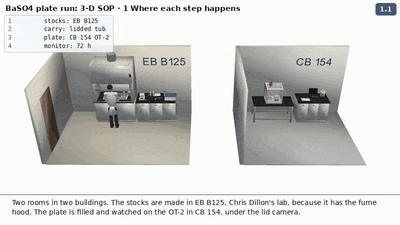
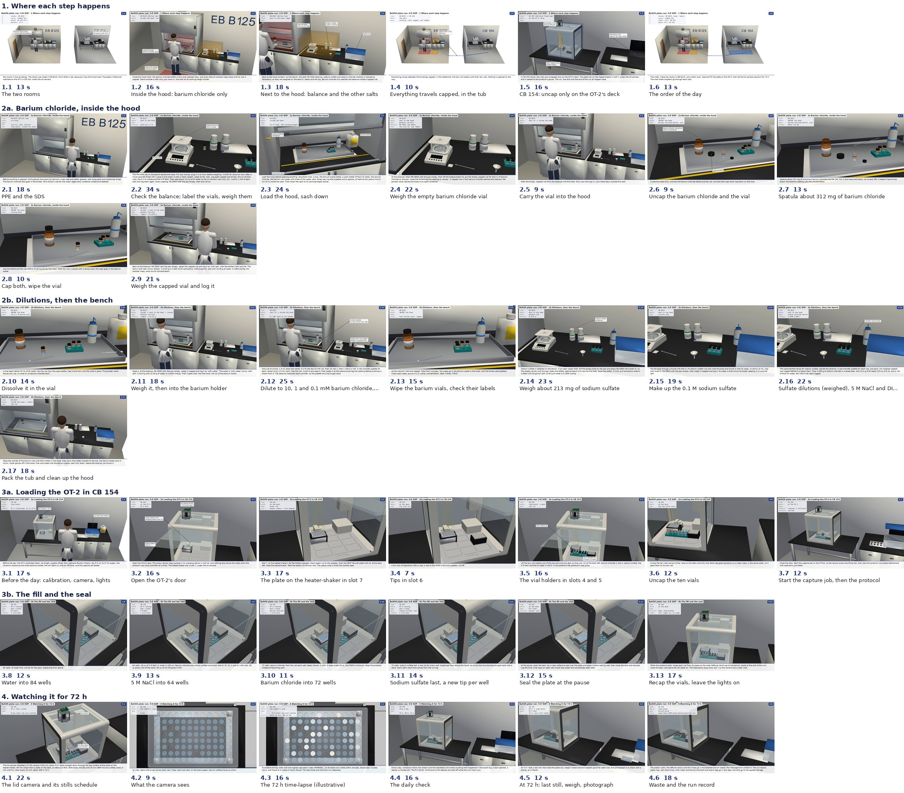

# Barium sulfate plate run: a 3-D animated SOP

Asked on [issue 80](https://github.com/vertical-cloud-lab/digital-wetlab/issues/80) by @sgbaird on 2026-11-02. It shows
what Tim and Michael do for the next barium chloride and sodium sulfate plate, from scratch:
- where each step happens: CB 154, or Chris Dillon's lab (EB B125) with the fume hood; and inside the hood or next to it;
- which containers are opened, and where;
- weighing the powders;
- loading the OT-2;
- the 72 h record from the lid camera.

**Materials for each step, and the hazards that could realistically hurt someone:**
[`materials-and-safety.md`](materials-and-safety.md) (asked on 2026-11-05).

**What to buy for the dry run and plate A, with catalogue numbers and prices:** [`shopping-list.md`](shopping-list.md)
(asked on 2026-11-11).

**Updated 2026-11-06** ([PR 84](https://github.com/vertical-cloud-lab/digital-wetlab/pull/84), @sgbaird):
- **The stocks are in the lab's 20 mL VOA vials** (27 mm across, 55 mm tall), made up by weight, in **two printed
  6-vial holders** for the OT-2. [`cad/`](cad/README.md) has the holder's STEP and STL and its Opentrons labware
  definition.
- **The plate sits on the heater-shaker in slot 7**, on its 96 flat-bottom adapter, under the **lid camera**. The deck
  shots now keep the camera in frame.
- **The colour sensor and its charging station are the Acceleration Consortium's own CAD**, parked in slot 10.
- **The OT-2 goes in the fume hood** (Sterling's call), carried by two people. PPE: nitrile gloves, a lab coat,
  safety glasses, long pants and closed-toe shoes. The videos still show the OT-2 in CB 154; what happens on the deck
  is the same. See [Does the OT-2 need to be in the hood?](#does-the-ot-2-need-to-be-in-the-hood)

**Updated 2026-11-11:** Tim calipered the vials at **27 mm** across, 1 mm under Fisher's 28 mm. The holder (now
28.2 mm pockets), its labware definition and the animation's vial are rebuilt for 27 mm. The videos and step clips
were rendered with 28 × 57 mm vials and haven't been re-rendered; the next render picks up 27 × 55 mm. Later the same
day Tim measured the height, **55 mm**, and the holder's labware definition now has the vial tops at 58 mm above the
deck. One holder is sliced for the lab's A1 mini in [`cad/print-a1mini/`](cad/print-a1mini/README.md), not yet
printed.

**Updated 2026-11-16** (asked by @timothy-commins on [PR 84](https://github.com/vertical-cloud-lab/digital-wetlab/pull/84)):
the videos now use the amounts for what the lab has.
- **The barium chloride is anhydrous,** so 2.5-2.11 weigh about 312 mg, not the dihydrate's 366 mg
  ([below](#the-barium-chloride-anhydrous-or-dihydrate)).
- **The dilutions are made by weight, with disposable transfer pipettes.** The lab has no 100-1000 µL hand pipette,
  and Chem Stores doesn't sell one ([Tim, 11-16](https://github.com/vertical-cloud-lab/digital-wetlab/pull/84#issuecomment-6927828161)).
  Each 1.5 mL goes in with a new transfer pipette, and each vial is weighed before and after, so the balance measures
  every transfer: three in the hood (2.12) and three at the bench (2.16)
  ([below](#the-dilutions-by-weight-with-transfer-pipettes)). This replaces the hand-pipette steps added earlier that day.
- **Parts 2a and 2b, their step clips, their GIFs and the full video are re-rendered** with these numbers and with
  the 27 × 55 mm vials, and again that afternoon with the transfer pipette and the weighings (2.2, 2.3, 2.12, 2.13,
  2.16). The other parts still have 28 × 57 mm vials, which look the same at that size. No other amount changed.

The procedure is the one already written down:
- [`docs/baso4-extended-monitoring.md`](https://github.com/vertical-cloud-lab/digital-wetlab/blob/ad0b513/docs/baso4-extended-monitoring.md)
  (11-02): plate A, the stocks, the seal, the stills schedule, and the run record;
- the [10-30 practice plate](https://github.com/vertical-cloud-lab/digital-wetlab/blob/127e1db/docs/lead-pbs-materials-and-steps.md#barium-sulfate-practice-plate):
  the stock recipes and the PHREEQC saturation indices;
- the 10-23 lead plan's rule to weigh by difference in a capped vial when the balance is outside the hood;
- the hood threads: [powder-doser 141](https://github.com/vertical-cloud-lab/powder-doser/issues/141) (barium chloride
  in the hood, sodium sulfate on the bench, work 15 cm inside the sash) and
  [byu-vcl 195](https://github.com/vertical-cloud-lab/byu-vcl/issues/195) (Dillon's rules for the room).

It is built the way the lab's other animations are (byu-vcl's `viz3d`, used for the rePowder training, the lid camera and
the vertical lift module): CadQuery and vendor STEP models, rendered off-screen in PyVista, text drawn with PIL, and
written as MP4 and GIF.

Chapters 2 and 3 are in two parts each, so every GIF stays under the ~5 MB GitHub shows inline. For the same reason part 2a's GIF runs at 4 fps and 2b's at 3 fps; every MP4 has all its frames.

| Part | GIF (800 × 450, 10 fps) | MP4 (1280 × 720, 15 fps) |
| --- | --- | --- |
| **1. Where each step happens**: the two rooms, with the zones coloured: inside the hood (red), next to it (amber), the OT-2 (blue). Then the walk between them | [`out/sop1_where.gif`](out/sop1_where.gif) | [`out/mp4/sop1_where.mp4`](out/mp4/sop1_where.mp4) |
| **2a. Barium chloride, inside the hood**: PPE, the balance beside the hood, loading the hood, and the capped vial tared at the balance, filled in the hood and weighed again | [`out/sop2a_hood.gif`](out/sop2a_hood.gif) | [`out/mp4/sop2a_hood.mp4`](out/mp4/sop2a_hood.mp4) |
| **2b. Dilutions, then the bench**: the 0.1 M vial and its tenfold series in the hood, each vial weighed at the balance; sodium sulfate and its series, and sodium chloride, at the balance; packing the tub and closing the hood | [`out/sop2b_bench.gif`](out/sop2b_bench.gif) | [`out/mp4/sop2b_bench.mp4`](out/mp4/sop2b_bench.mp4) |
| **3a. Loading the OT-2 in CB 154**: the door, the plate on the heater-shaker in slot 7, the tips, the vial holders, uncapping, and the start | [`out/sop3a_load.gif`](out/sop3a_load.gif) | [`out/mp4/sop3a_load.mp4`](out/mp4/sop3a_load.mp4) |
| **3b. The fill and the seal**: water, NaCl, barium chloride, then sodium sulfate last; the seal at the pause; recapping | [`out/sop3b_fill.gif`](out/sop3b_fill.gif) | [`out/mp4/sop3b_fill.mp4`](out/mp4/sop3b_fill.mp4) |
| **4. Watching it for 72 h**: the lid camera's view and stills schedule, daily checks, the end of the run and the waste | [`out/sop4_monitor.gif`](out/sop4_monitor.gif) | [`out/mp4/sop4_monitor.mp4`](out/mp4/sop4_monitor.mp4) |
| **All of it**, one part after another | | [`out/mp4/baso4_sop_full.mp4`](out/mp4/baso4_sop_full.mp4) |

`out/<name>.json` gives the frame range of every sub-step in the MP4, and `out/<name>_still.png` is a still of one
sub-step.



## One MP4 per step

Asked on [issue 80](https://github.com/vertical-cloud-lab/digital-wetlab/issues/80) by @timothy-commins on
2026-11-05, so each step can be paused and replayed on its own. [`out/steps/`](out/steps) has one MP4 per numbered
step, 42 in all, cut from the six part MP4s above by [`split_steps.py`](split_steps.py). Nothing is re-rendered. Each
clip is its step's frames, then its last frame held so the caption stays up long enough to read: at least 15
characters a second, and 2 s past the motion. They come to 10.7 min in all, against 4 min 22 s for the full video.

**To watch them, open the [player page](https://htmlpreview.github.io/?https://github.com/vertical-cloud-lab/digital-wetlab/blob/28938e4/docs/baso4-sop-3d/out/steps/player.html).** It has every step in order, each in its own video player
(pause, drag back, replay), with the step's text written under it. The ▶ links below open it at that step.
- GitHub can't play an MP4: its file view only offers "View raw", and raw links download the file. The page is
  [`out/steps/player.html`](out/steps/player.html), shown as a web page by [htmlpreview](https://htmlpreview.github.io/).
  Its videos play GitHub's raw files, pinned to commit `71f900e`, with jsDelivr as a fallback.
- On 11-05 the page was tested in Chrome: all 42 step videos loaded, played and paused. On 11-16, in headless
  Chrome 157 through htmlpreview, all 42 loaded at the lengths in `index.json`, and the 17 re-cut chapter-2 clips
  played and paused. The same check passed again after that afternoon's re-render (page at `28938e4`). Not tested
  in Safari.
- The file links download the MP4, to play in any video player.



**1. Where each step happens**

| Step | What | Where | Length | Watch | File |
| --- | --- | --- | --- | --- | --- |
| 1.1 | The two rooms | overview | 13 s | [▶ play](https://htmlpreview.github.io/?https://github.com/vertical-cloud-lab/digital-wetlab/blob/28938e4/docs/baso4-sop-3d/out/steps/player.html#s1.1) | [`1-01_two-rooms.mp4`](out/steps/1-01_two-rooms.mp4) |
| 1.2 | Inside the hood: barium chloride only | overview | 16 s | [▶ play](https://htmlpreview.github.io/?https://github.com/vertical-cloud-lab/digital-wetlab/blob/28938e4/docs/baso4-sop-3d/out/steps/player.html#s1.2) | [`1-02_inside-the-hood.mp4`](out/steps/1-02_inside-the-hood.mp4) |
| 1.3 | Next to the hood: balance and the other salts | overview | 18 s | [▶ play](https://htmlpreview.github.io/?https://github.com/vertical-cloud-lab/digital-wetlab/blob/28938e4/docs/baso4-sop-3d/out/steps/player.html#s1.3) | [`1-03_next-to-the-hood.mp4`](out/steps/1-03_next-to-the-hood.mp4) |
| 1.4 | Everything travels capped, in the tub | overview | 10 s | [▶ play](https://htmlpreview.github.io/?https://github.com/vertical-cloud-lab/digital-wetlab/blob/28938e4/docs/baso4-sop-3d/out/steps/player.html#s1.4) | [`1-04_carry-in-the-tub.mp4`](out/steps/1-04_carry-in-the-tub.mp4) |
| 1.5 | CB 154: uncap only on the OT-2's deck | overview | 16 s | [▶ play](https://htmlpreview.github.io/?https://github.com/vertical-cloud-lab/digital-wetlab/blob/28938e4/docs/baso4-sop-3d/out/steps/player.html#s1.5) | [`1-05_cb154-ot2.mp4`](out/steps/1-05_cb154-ot2.mp4) |
| 1.6 | The order of the day | overview | 13 s | [▶ play](https://htmlpreview.github.io/?https://github.com/vertical-cloud-lab/digital-wetlab/blob/28938e4/docs/baso4-sop-3d/out/steps/player.html#s1.6) | [`1-06_the-order.mp4`](out/steps/1-06_the-order.mp4) |

**2a. Barium chloride, inside the hood**

| Step | What | Where | Length | Watch | File |
| --- | --- | --- | --- | --- | --- |
| 2.1 | PPE and the SDS | EB B125 | 18 s | [▶ play](https://htmlpreview.github.io/?https://github.com/vertical-cloud-lab/digital-wetlab/blob/28938e4/docs/baso4-sop-3d/out/steps/player.html#s2.1) | [`2-01_ppe-and-sds.mp4`](out/steps/2-01_ppe-and-sds.mp4) |
| 2.2 | Check the balance; water into six vials, weighed | EB B125, next to the hood | 28 s | [▶ play](https://htmlpreview.github.io/?https://github.com/vertical-cloud-lab/digital-wetlab/blob/28938e4/docs/baso4-sop-3d/out/steps/player.html#s2.2) | [`2-02_balance-check.mp4`](out/steps/2-02_balance-check.mp4) |
| 2.3 | Load the hood, sash down | EB B125, inside the hood | 24 s | [▶ play](https://htmlpreview.github.io/?https://github.com/vertical-cloud-lab/digital-wetlab/blob/28938e4/docs/baso4-sop-3d/out/steps/player.html#s2.3) | [`2-03_load-the-hood.mp4`](out/steps/2-03_load-the-hood.mp4) |
| 2.4 | Tare the capped vial | EB B125, next to the hood | 18 s | [▶ play](https://htmlpreview.github.io/?https://github.com/vertical-cloud-lab/digital-wetlab/blob/28938e4/docs/baso4-sop-3d/out/steps/player.html#s2.4) | [`2-04_tare-the-vial.mp4`](out/steps/2-04_tare-the-vial.mp4) |
| 2.5 | Carry the vial into the hood | next to, then inside the hood | 9 s | [▶ play](https://htmlpreview.github.io/?https://github.com/vertical-cloud-lab/digital-wetlab/blob/28938e4/docs/baso4-sop-3d/out/steps/player.html#s2.5) | [`2-05_vial-into-hood.mp4`](out/steps/2-05_vial-into-hood.mp4) |
| 2.6 | Uncap the barium chloride and the vial | EB B125, inside the hood | 9 s | [▶ play](https://htmlpreview.github.io/?https://github.com/vertical-cloud-lab/digital-wetlab/blob/28938e4/docs/baso4-sop-3d/out/steps/player.html#s2.6) | [`2-06_uncap-bottle-and-vial.mp4`](out/steps/2-06_uncap-bottle-and-vial.mp4) |
| 2.7 | Spatula about 312 mg of barium chloride | EB B125, inside the hood | 13 s | [▶ play](https://htmlpreview.github.io/?https://github.com/vertical-cloud-lab/digital-wetlab/blob/28938e4/docs/baso4-sop-3d/out/steps/player.html#s2.7) | [`2-07_spatula-barium-chloride.mp4`](out/steps/2-07_spatula-barium-chloride.mp4) |
| 2.8 | Cap both, wipe the vial | EB B125, inside the hood | 10 s | [▶ play](https://htmlpreview.github.io/?https://github.com/vertical-cloud-lab/digital-wetlab/blob/28938e4/docs/baso4-sop-3d/out/steps/player.html#s2.8) | [`2-08_cap-and-wipe.mp4`](out/steps/2-08_cap-and-wipe.mp4) |
| 2.9 | Weigh the capped vial and log it | EB B125, next to the hood | 19 s | [▶ play](https://htmlpreview.github.io/?https://github.com/vertical-cloud-lab/digital-wetlab/blob/28938e4/docs/baso4-sop-3d/out/steps/player.html#s2.9) | [`2-09_weigh-the-vial.mp4`](out/steps/2-09_weigh-the-vial.mp4) |

**2b. Dilutions, then the bench**

| Step | What | Where | Length | Watch | File |
| --- | --- | --- | --- | --- | --- |
| 2.10 | Dissolve it in the vial | EB B125, inside the hood | 14 s | [▶ play](https://htmlpreview.github.io/?https://github.com/vertical-cloud-lab/digital-wetlab/blob/28938e4/docs/baso4-sop-3d/out/steps/player.html#s2.10) | [`2-10_dissolve-barium-chloride.mp4`](out/steps/2-10_dissolve-barium-chloride.mp4) |
| 2.11 | Weigh it, then into the barium holder | inside, next to, then inside the hood | 15 s | [▶ play](https://htmlpreview.github.io/?https://github.com/vertical-cloud-lab/digital-wetlab/blob/28938e4/docs/baso4-sop-3d/out/steps/player.html#s2.11) | [`2-11_weigh-barium-0.1M.mp4`](out/steps/2-11_weigh-barium-0.1M.mp4) |
| 2.12 | Dilute to 10, 1 and 0.1 mM barium chloride, weighing each vial | EB B125, inside the hood, and the balance | 25 s | [▶ play](https://htmlpreview.github.io/?https://github.com/vertical-cloud-lab/digital-wetlab/blob/28938e4/docs/baso4-sop-3d/out/steps/player.html#s2.12) | [`2-12_barium-dilutions.mp4`](out/steps/2-12_barium-dilutions.mp4) |
| 2.13 | Cap and label the barium vials | EB B125, inside the hood | 13 s | [▶ play](https://htmlpreview.github.io/?https://github.com/vertical-cloud-lab/digital-wetlab/blob/28938e4/docs/baso4-sop-3d/out/steps/player.html#s2.13) | [`2-13_cap-and-label-barium.mp4`](out/steps/2-13_cap-and-label-barium.mp4) |
| 2.14 | Weigh about 213 mg of sodium sulfate | EB B125, next to the hood | 17 s | [▶ play](https://htmlpreview.github.io/?https://github.com/vertical-cloud-lab/digital-wetlab/blob/28938e4/docs/baso4-sop-3d/out/steps/player.html#s2.14) | [`2-14_weigh-sodium-sulfate.mp4`](out/steps/2-14_weigh-sodium-sulfate.mp4) |
| 2.15 | Make up the 0.1 M sodium sulfate | EB B125, next to the hood | 14 s | [▶ play](https://htmlpreview.github.io/?https://github.com/vertical-cloud-lab/digital-wetlab/blob/28938e4/docs/baso4-sop-3d/out/steps/player.html#s2.15) | [`2-15_make-up-sodium-sulfate.mp4`](out/steps/2-15_make-up-sodium-sulfate.mp4) |
| 2.16 | Sulfate dilutions (weighed), 5 M NaCl and DI water | EB B125, next to the hood | 22 s | [▶ play](https://htmlpreview.github.io/?https://github.com/vertical-cloud-lab/digital-wetlab/blob/28938e4/docs/baso4-sop-3d/out/steps/player.html#s2.16) | [`2-16_sulfate-nacl-water.mp4`](out/steps/2-16_sulfate-nacl-water.mp4) |
| 2.17 | Pack the tub and clean up the hood | EB B125, hood then bench | 18 s | [▶ play](https://htmlpreview.github.io/?https://github.com/vertical-cloud-lab/digital-wetlab/blob/28938e4/docs/baso4-sop-3d/out/steps/player.html#s2.17) | [`2-17_pack-and-clean-up.mp4`](out/steps/2-17_pack-and-clean-up.mp4) |

**3a. Loading the OT-2 in CB 154**

| Step | What | Where | Length | Watch | File |
| --- | --- | --- | --- | --- | --- |
| 3.1 | Before the day: calibration, camera, lights | CB 154 | 17 s | [▶ play](https://htmlpreview.github.io/?https://github.com/vertical-cloud-lab/digital-wetlab/blob/28938e4/docs/baso4-sop-3d/out/steps/player.html#s3.1) | [`3-01_before-the-day.mp4`](out/steps/3-01_before-the-day.mp4) |
| 3.2 | Open the OT-2's door | CB 154, OT-2 deck | 16 s | [▶ play](https://htmlpreview.github.io/?https://github.com/vertical-cloud-lab/digital-wetlab/blob/28938e4/docs/baso4-sop-3d/out/steps/player.html#s3.2) | [`3-02_open-the-door.mp4`](out/steps/3-02_open-the-door.mp4) |
| 3.3 | The plate on the heater-shaker in slot 7 | CB 154, OT-2 deck | 17 s | [▶ play](https://htmlpreview.github.io/?https://github.com/vertical-cloud-lab/digital-wetlab/blob/28938e4/docs/baso4-sop-3d/out/steps/player.html#s3.3) | [`3-03_plate-on-heater-shaker.mp4`](out/steps/3-03_plate-on-heater-shaker.mp4) |
| 3.4 | Tips in slot 6 | CB 154, OT-2 deck | 7 s | [▶ play](https://htmlpreview.github.io/?https://github.com/vertical-cloud-lab/digital-wetlab/blob/28938e4/docs/baso4-sop-3d/out/steps/player.html#s3.4) | [`3-04_tips-in-slot-6.mp4`](out/steps/3-04_tips-in-slot-6.mp4) |
| 3.5 | The vial holders in slots 4 and 5 | CB 154, OT-2 deck | 16 s | [▶ play](https://htmlpreview.github.io/?https://github.com/vertical-cloud-lab/digital-wetlab/blob/28938e4/docs/baso4-sop-3d/out/steps/player.html#s3.5) | [`3-05_holders-in-slots-4-5.mp4`](out/steps/3-05_holders-in-slots-4-5.mp4) |
| 3.6 | Uncap the ten vials | CB 154, OT-2 deck | 12 s | [▶ play](https://htmlpreview.github.io/?https://github.com/vertical-cloud-lab/digital-wetlab/blob/28938e4/docs/baso4-sop-3d/out/steps/player.html#s3.6) | [`3-06_uncap-the-vials.mp4`](out/steps/3-06_uncap-the-vials.mp4) |
| 3.7 | Start the capture job, then the protocol | CB 154 | 12 s | [▶ play](https://htmlpreview.github.io/?https://github.com/vertical-cloud-lab/digital-wetlab/blob/28938e4/docs/baso4-sop-3d/out/steps/player.html#s3.7) | [`3-07_start-capture-then-protocol.mp4`](out/steps/3-07_start-capture-then-protocol.mp4) |

**3b. The fill and the seal**

| Step | What | Where | Length | Watch | File |
| --- | --- | --- | --- | --- | --- |
| 3.8 | Water into 84 wells | CB 154, OT-2, door closed | 12 s | [▶ play](https://htmlpreview.github.io/?https://github.com/vertical-cloud-lab/digital-wetlab/blob/28938e4/docs/baso4-sop-3d/out/steps/player.html#s3.8) | [`3-08_fill-water.mp4`](out/steps/3-08_fill-water.mp4) |
| 3.9 | 5 M NaCl into 64 wells | CB 154, OT-2, door closed | 13 s | [▶ play](https://htmlpreview.github.io/?https://github.com/vertical-cloud-lab/digital-wetlab/blob/28938e4/docs/baso4-sop-3d/out/steps/player.html#s3.9) | [`3-09_fill-nacl.mp4`](out/steps/3-09_fill-nacl.mp4) |
| 3.10 | Barium chloride into 72 wells | CB 154, OT-2, door closed | 11 s | [▶ play](https://htmlpreview.github.io/?https://github.com/vertical-cloud-lab/digital-wetlab/blob/28938e4/docs/baso4-sop-3d/out/steps/player.html#s3.10) | [`3-10_fill-barium-chloride.mp4`](out/steps/3-10_fill-barium-chloride.mp4) |
| 3.11 | Sodium sulfate last, a new tip per well | CB 154, OT-2, door closed | 14 s | [▶ play](https://htmlpreview.github.io/?https://github.com/vertical-cloud-lab/digital-wetlab/blob/28938e4/docs/baso4-sop-3d/out/steps/player.html#s3.11) | [`3-11_fill-sodium-sulfate-last.mp4`](out/steps/3-11_fill-sodium-sulfate-last.mp4) |
| 3.12 | Seal the plate at the pause | CB 154, OT-2 deck | 15 s | [▶ play](https://htmlpreview.github.io/?https://github.com/vertical-cloud-lab/digital-wetlab/blob/28938e4/docs/baso4-sop-3d/out/steps/player.html#s3.12) | [`3-12_seal-at-the-pause.mp4`](out/steps/3-12_seal-at-the-pause.mp4) |
| 3.13 | Recap the vials, leave the lights on | CB 154, OT-2 deck | 17 s | [▶ play](https://htmlpreview.github.io/?https://github.com/vertical-cloud-lab/digital-wetlab/blob/28938e4/docs/baso4-sop-3d/out/steps/player.html#s3.13) | [`3-13_recap-the-vials.mp4`](out/steps/3-13_recap-the-vials.mp4) |

**4. Watching it for 72 h**

| Step | What | Where | Length | Watch | File |
| --- | --- | --- | --- | --- | --- |
| 4.1 | The lid camera and its stills schedule | CB 154 | 22 s | [▶ play](https://htmlpreview.github.io/?https://github.com/vertical-cloud-lab/digital-wetlab/blob/28938e4/docs/baso4-sop-3d/out/steps/player.html#s4.1) | [`4-01_lid-camera-schedule.mp4`](out/steps/4-01_lid-camera-schedule.mp4) |
| 4.2 | What the camera sees | CB 154 | 9 s | [▶ play](https://htmlpreview.github.io/?https://github.com/vertical-cloud-lab/digital-wetlab/blob/28938e4/docs/baso4-sop-3d/out/steps/player.html#s4.2) | [`4-02_camera-view.mp4`](out/steps/4-02_camera-view.mp4) |
| 4.3 | The 72 h time-lapse (illustrative) | CB 154 | 16 s | [▶ play](https://htmlpreview.github.io/?https://github.com/vertical-cloud-lab/digital-wetlab/blob/28938e4/docs/baso4-sop-3d/out/steps/player.html#s4.3) | [`4-03_timelapse-illustrative.mp4`](out/steps/4-03_timelapse-illustrative.mp4) |
| 4.4 | The daily check | CB 154 | 16 s | [▶ play](https://htmlpreview.github.io/?https://github.com/vertical-cloud-lab/digital-wetlab/blob/28938e4/docs/baso4-sop-3d/out/steps/player.html#s4.4) | [`4-04_daily-check.mp4`](out/steps/4-04_daily-check.mp4) |
| 4.5 | At 72 h: last still, weigh, photograph | CB 154 | 12 s | [▶ play](https://htmlpreview.github.io/?https://github.com/vertical-cloud-lab/digital-wetlab/blob/28938e4/docs/baso4-sop-3d/out/steps/player.html#s4.5) | [`4-05_end-of-run.mp4`](out/steps/4-05_end-of-run.mp4) |
| 4.6 | Waste and the run record | CB 154 | 18 s | [▶ play](https://htmlpreview.github.io/?https://github.com/vertical-cloud-lab/digital-wetlab/blob/28938e4/docs/baso4-sop-3d/out/steps/player.html#s4.6) | [`4-06_waste-and-run-record.mp4`](out/steps/4-06_waste-and-run-record.mp4) |

The six part MP4s and the full video are at the end of the page:
- [▶ 1. Where each step happens](https://htmlpreview.github.io/?https://github.com/vertical-cloud-lab/digital-wetlab/blob/28938e4/docs/baso4-sop-3d/out/steps/player.html#wsop1_where)
- [▶ 2a. Barium chloride, inside the hood](https://htmlpreview.github.io/?https://github.com/vertical-cloud-lab/digital-wetlab/blob/28938e4/docs/baso4-sop-3d/out/steps/player.html#wsop2a_hood)
- [▶ 2b. Dilutions, then the bench](https://htmlpreview.github.io/?https://github.com/vertical-cloud-lab/digital-wetlab/blob/28938e4/docs/baso4-sop-3d/out/steps/player.html#wsop2b_bench)
- [▶ 3a. Loading the OT-2 in CB 154](https://htmlpreview.github.io/?https://github.com/vertical-cloud-lab/digital-wetlab/blob/28938e4/docs/baso4-sop-3d/out/steps/player.html#wsop3a_load)
- [▶ 3b. The fill and the seal](https://htmlpreview.github.io/?https://github.com/vertical-cloud-lab/digital-wetlab/blob/28938e4/docs/baso4-sop-3d/out/steps/player.html#wsop3b_fill)
- [▶ 4. Watching it for 72 h](https://htmlpreview.github.io/?https://github.com/vertical-cloud-lab/digital-wetlab/blob/28938e4/docs/baso4-sop-3d/out/steps/player.html#wsop4_monitor)
- [▶ All of it, 4 min 22 s](https://htmlpreview.github.io/?https://github.com/vertical-cloud-lab/digital-wetlab/blob/28938e4/docs/baso4-sop-3d/out/steps/player.html#wbaso4_sop_full)

[`out/steps/index.json`](out/steps/index.json) lists each clip's source frames, its motion and hold, and the full caption.

## The steps, and where each one happens

**Rule of thumb:**
- Barium chloride powder is opened only inside the hood, and a barium solution stays there until its vial is capped.
- The balance, sodium sulfate, sodium chloride, labels and the log are next to the hood. The capped vials fit under
  the balance's breeze-break lid, so every stock is made up by weight.
- Every vial is uncapped again only on the OT-2's deck.
- PPE whenever the barium vials or the plate are handled: nitrile gloves, a lab coat and safety glasses, with long
  pants and closed-toe shoes (Sterling, 11-06).
- The OT-2 goes in a fume hood for this run (Sterling, 11-06). See
  [Does the OT-2 need to be in the hood?](#does-the-ot-2-need-to-be-in-the-hood)

| # | Where | What | Opened |
| --- | --- | --- | --- |
| 2.1 | EB B125 | Nitrile gloves (two pairs for barium), a lab coat and safety glasses, with long pants and closed-toe shoes. Read the barium chloride SDS; a printed copy goes in the room's SDS binder ([what that is](#the-sds-binder)). Keep every container closed and labelled (Dillon's rule) | - |
| 2.2 | next to the hood | The HR-100A on the bench beside the hood. If it was moved, plug it in at least an hour before weighing: it drifts for about an hour after a move ([powder-doser 157](https://github.com/vertical-cloud-lab/powder-doser/issues/157)). Level it, check it with a check weight. Label six 20 mL vials for the dilutions. For each: zero the empty pan, weigh the capped vial and log it, add about 13.5 g of DI water (a water-only transfer pipette for the last drops), cap it and log the reading again. Don't tare a vial for these: [why](#the-dilutions-by-weight-with-transfer-pipettes) | - |
| 2.3 | inside the hood | Sash up to load: liner, tray, barium waste bottle, a wash bottle of fresh DI water, the barium chloride, the barium vial holder with three of the water vials, three new transfer pipettes, a spatula, all at least 15 cm (6 in) inside the sash. Sash down to its working-height sticker | - |
| 2.4 | next to the hood | Put the empty capped vial for the 0.1 M barium chloride on the pan and tare it | balance lid |
| 2.5-2.8 | inside the hood | Open the barium chloride and the vial, and spatula about 312 mg into the vial. The lab's bottle is anhydrous; a dihydrate bottle would need 366 mg ([below](#the-barium-chloride-anhydrous-or-dihydrate)). Close both, and wipe the vial | barium chloride bottle, vial |
| 2.9 | next to the hood | Weigh the capped vial and log the reading, with the form, maker and lot from the bottle's label. 0.3123 g of anhydrous BaCl₂ (208.23 g/mol) is 1.500 mmol, as is 0.3664 g of the dihydrate (BaCl₂·2H₂O, 244.26 g/mol); for another mass, work out its concentration | balance lid |
| 2.10-2.11 | inside the hood, then next to it | About 15 mL of DI water into the same vial; cap and swirl until clear. Wipe it and weigh it capped: 1.500 mmol with 15.00 g of water is 0.1000 mol/kg, which is a reading of 15.31 g from either form. It goes into A1 of the barium holder | vial |
| 2.12-2.13 | inside the hood, and the balance after each transfer | 1.5 mL down the series, one water vial at a time: 0.1 M into the 10 mM vial, then 10 into 1, then 1 into 0.1 mM. A new transfer pipette for each vial, drawn to its 1.5 mL mark. Cap the vial, invert it ten times and wipe it. Then carry it to the balance, zero the empty pan, weigh it and log it, and bring it back before anything is drawn from it. The three pipettes go in the barium solid waste | barium vials |
| 2.14-2.15 | next to the hood | Sodium sulfate in an open weigh boat: 213.1 mg (anhydrous, 142.04 g/mol) with 15.00 g of water is 0.1 mol/kg. Through a funnel into its vial, rinse in to about 15 mL, cap, weigh | sodium sulfate bottle, vial |
| 2.16 | next to the hood | The same series for 10, 1 and 0.1 mM sulfate, with three new transfer pipettes, each vial weighed and logged before the next is drawn from it. 4.383 g NaCl with 13.4 g of DI water (15 mL of 5 M). A vial of fresh DI water. Ten vials in all | sodium chloride bottle, vials |
| 2.17 | hood, then bench | Wipe the barium vials and their holder, then put both holders in the tub, lid on. Outer gloves off in the hood; liner and wipes into the barium waste. Sash fully down | tub lid |
| 1.4 | between buildings | Carry the tub closed | nothing |
| 3.1 | CB 154 | Before the day: OT-2 calibrated (deck, tip length, pipette offset, Labware Position Check), the heater-shaker in slot 7 with its 96 flat-bottom adapter, the lid camera refocused for the plate on it, Pi 5 on its 27 W supply, camera exposure and white balance locked, rail lights on with no timer, capture job tested. Beside the OT-2: a labelled barium waste bottle, damp wipes and a wash bottle of DI water | - |
| 3.2-3.5 | OT-2 deck | Nitrile gloves, lab coat and safety glasses on before the tub is opened; they stay on until the vials are recapped (3.13). Door open. Black paper cut to the adapter and the plate on the heater-shaker in slot 7, under the lid camera (labware latch closed, lid off now), 300 µL tips in slot 6 (lid off), the barium holder in slot 4, the sulfate holder in slot 5. The colour sensor stays parked in its charging station in slot 10 | plate lid, tip-rack lid |
| 3.6 | OT-2 deck | Uncap the ten vials one at a time; each cap goes top-down on a wipe, in order. A drip or spill: wipe it up while it's wet, wipe into the barium waste, then wipe the spot again with water | vials |
| 3.7 | CB 154 | Close the door. Start the capture job, then the protocol | - |
| 3.8-3.11 | OT-2, door closed | Water, then 5 M NaCl, then barium chloride. Sodium sulfate goes in last, with a new tip per well, dispensed from above | - |
| 3.12-3.13 | OT-2 deck | At the pause: a clear adhesive seal, pressed down well by well; log the time. Recap the vials, close the door, rail lights stay on | door |
| 4.1-4.4 | CB 154 | Stills every 1 min to 30 min after the last sulfate, every 5 min to 6 h, then every 15 min (about 400 in 72 h). Check the stream, the heartbeat and the event log once a day | - |
| 4.5-4.6 | CB 154 | Gloves, lab coat and glasses on again. Last still. Take the plate out, weigh it, and photograph it on black. Wells, leftover stocks and rinses go to barium waste. Wipe the deck with a damp wipe, gloves off, wash your hands. Commit the run record to `experiments/004-baso4-monitoring/<run-id>/` | door, waste |

### The SDS binder

"The binder" in 2.1 is the room's **SDS binder**: a ring binder of printed safety data sheets (SDSs), one for each
chemical used in the room, with a list of those chemicals at the front. An SDS is the maker's sheet for a chemical: its
hazards, first aid, what to do about a spill, the PPE, and how to dispose of it. If something goes wrong, anyone in the
room can read what to do on the spot.

- **Every lab has to keep its SDSs.** BYU Engineering's lab safety plan asks each lab for current SDSs with an
  inventory of its chemicals, on paper or on a USB stick
  ([p. 9](https://github.com/vertical-cloud-lab/byu-vcl/blob/83dd5a1/byu-engineering-lab-safety-plan-chemical-hygiene-plan-2024.pdf)).
  The proposal's safety plan promises a labelled binder at the lab entrance
  ([`safety_explanation.md`](../../drafts/safety_explanation.md)).
- **What goes in it for this run:** the SDSs for the barium chloride, the sodium sulfate and the sodium chloride, each
  for the bottle you're using. The maker and product number are on the label, and the maker's website has the sheet.
  - **The lab has no barium chloride SDS on record.** Its SDSs so far are digital copies from March, on
    [byu-vcl 15](https://github.com/vertical-cloud-lab/byu-vcl/issues/15#issuecomment-3991816640): silver nitrate,
    sodium chloride, sodium sulfate, barium nitrate, lead nitrate and ammonium sulfide. The barium nitrate sheet
    doesn't cover barium chloride.
  - Print the sodium sulfate and sodium chloride sheets from there if the maker on each matches your bottle.
- **Which binder:** each room where the barium is used.
  - **EB B125**, where the powder is opened. Ask the Dillon lab where they keep their SDSs, and add yours there.
  - **The OT-2's room**, if it isn't EB B125, where the stocks and the plate sit for 72 h. Nobody has recorded an SDS
    binder in CB 154. byu-vcl's [punch list](https://github.com/vertical-cloud-lab/byu-vcl/blob/00ca2f1/docs/lab-punch-list.md)
    (10-20) still has it open. If there isn't one, start one by the door, labelled "Safety Data Sheets".
- **Read the barium chloride SDS before you open the bottle**, at least sections 2, 4, 6 and 8: the hazards, first
  aid, spills and PPE.
- The 2.1 clip's caption still just says "the binder".

### The barium chloride: anhydrous or dihydrate

The lab's bottle is anhydrous ([Tim, 2026-11-16](https://github.com/vertical-cloud-lab/digital-wetlab/pull/84#issuecomment-6925620635)).
The SOP was first written for the dihydrate.
- **Once it's dissolved, either form makes the same stock.** Only the mass you weigh changes. For 1.500 mmol, that's
  312.3 mg of the anhydrous salt (BaCl₂, 208.23 g/mol) or 366.4 mg of the dihydrate (BaCl₂·2H₂O, 244.26 g/mol).
  Weighing 366 mg of the anhydrous salt would make the stock 17 % too strong.
- **The concentration is mmol of BaCl₂ per gram of water** (mol/kg). With the anhydrous salt, the water is the 2.11
  reading minus the 2.9 reading. The dihydrate also brings 36 mg of water per mmol, and that counts as water too. With
  either form, 1.500 mmol and a 2.11 reading of 15.31 g is 0.1000 mol/kg.
- **The anhydrous salt takes up water from the air** and slowly turns into the dihydrate
  ([Wikipedia](https://en.wikipedia.org/wiki/Barium_chloride)). The water it has picked up gets weighed as barium
  chloride, so the stock comes out weaker than the log says. It's weaker by about the share of water in what you
  weighed: 15 % if it had all turned to dihydrate.
  - When you open the bottle in the hood, check that it's loose and free-flowing. If it's caked, lumpy or damp,
    don't use it for plate A. Tell Sterling, and buy the dihydrate (it's in the
    [shopping list](shopping-list.md#3-probably-in-the-lab-check-before-ordering)).
  - Close the bottle as soon as the spatula is out (2.8), and keep the cap tight.
- **The hazards are the same:** toxic if swallowed (H301) and harmful if inhaled (H332). Print the SDS for the lab's
  own bottle, from its maker, for the [SDS binder](#the-sds-binder) (2.1).
- **The clips show the anhydrous salt and 312 mg,** since parts 2a and 2b were re-rendered on 11-16, and so do their
  GIFs and MP4s and the full video.

### The dilutions: by weight, with transfer pipettes

The lab has no 100-1000 µL hand pipette, and BYU Chem Stores doesn't sell one
([Tim, 2026-11-16](https://github.com/vertical-cloud-lab/digital-wetlab/pull/84#issuecomment-6927828161)). So each
1.5 mL transfer (2.12, 2.16) goes in with a disposable transfer pipette, and the balance measures it. The pipette only
has to get close to 1.5 mL.
- **It's more accurate than a hand pipette.** The balance reads to 0.1 mg, so each 1.5 g transfer is known to about
  0.01 %, and each tenfold step to better than 0.1 %. A calibrated hand pipette is good to about 1 % a transfer, and
  those errors add up down the series.
- **The stocks won't land exactly on 10, 1 and 0.1 mM, and they don't need to.** Each one's real concentration comes
  from the log, and so does each well's. The robot's volumes stay as planned. Unlike a pipette's error, this one is
  known, so each well's real saturation index is known too.
- **Any pipette works,** since it isn't measuring. Plastic transfer pipettes are the easiest. Glass Pasteur pipettes
  work too, but the barium ones would then be sharps in the barium waste.

**What it takes:**
- **Disposable polyethylene transfer pipettes,** graduated to 3 mL in 0.5 mL steps. One per dilution vial (three in
  the hood, three at the bench), one for water only, and spares: about 10 a run. Sterling's 03-04 Chem Stores list
  bought about 100 "disposable pipettes"
  ([byu-vcl 15](https://github.com/vertical-cloud-lab/byu-vcl/issues/15#issuecomment-3999005476)), so check what's
  left.
- **The balance beside the hood,** reading to 0.1 mg, and the log sheet.

**The weighings.** Log every reading as the balance shows it: zero it with the pan empty, then put the vial on. Don't
tare a dilution vial. Zeroing the empty pan first also clears the tare left from the 0.1 M barium chloride vial
(2.4-2.11).
1. **2.2, before any salt is opened.** Label the six dilution vials. For each one: zero the empty pan, weigh the
   capped vial and log it ("empty"). Add about 13.5 g of DI water: the wash bottle, then the water-only transfer
   pipette for the last drops. Cap it and log the reading ("with water").
   - **Practise once while you're there.** Draw DI water to a pipette's 1.5 mL mark, squeeze it into a spare vial on
     the pan, and read. Two or three tries show you where 1.5 g is on the pipette.
2. **Each transfer** (2.12 in the hood, 2.16 at the bench). Uncap the stronger stock and the next water vial. Draw to
   the 1.5 mL mark with a new pipette and empty it into the water vial, tip against the inside wall. Cap both. Invert
   the new vial ten times and wipe it.
3. **Weigh it straight away,** before anything is drawn from it. Zero the empty pan, weigh the capped vial and log it
   ("with stock"). A vial weighed after it has been drawn from gives the wrong number.
   - **For barium,** that's a round trip: the capped, wiped vial goes out to the balance and back into the hood, as
     the 0.1 M vial did in 2.9-2.11. Three trips in all.
4. **Then the next vial:** 10 mM into 1 mM, then 1 mM into 0.1 mM, each weighed the same way.

**How close to 1.5 g is close enough:**
- 1.45-1.55 g each time keeps the 0.1 mM vials within about 10 % of 0.1 mM.
- 1.4-1.6 g keeps them within about 20 %, which is still fine, because the log has the real number.
- Further out than that, or if anything spills, redo that vial with a spare one, weighed empty and with water as in
  2.2. Every vial after it in the series has to be redone too.

**The arithmetic,** afterwards or on a calculator at the bench:
- water w = "with water" − "empty", and stock s = "with stock" − "with water";
- the new vial's concentration = the concentration it was drawn from × s′ ÷ (w + s′), with s′ = s ÷ f.

f takes the salt's own mass out of the stock you added. It's 1 + (the concentration drawn from, in mol/kg) × (the
salt's molar mass, in kg/mol: 0.20823 for BaCl₂, 0.14204 for Na₂SO₄):

| Drawn from | f, barium chloride | f, sodium sulfate |
| --- | --- | --- |
| 0.1 M | 1.0208 | 1.0142 |
| 10 mM | 1.0021 | 1.0014 |
| 1 mM | 1.0002 | 1.0001 |

For example, 1.530 g of the 0.1000 mol/kg barium chloride into 13.50 g of water: s′ = 1.530 ÷ 1.0208 = 1.4988 g, and
0.1000 × 1.4988 ÷ (13.50 + 1.4988) = 0.00999 mol/kg, or 9.99 mM. Exactly 1.500 g would have made it 9.82 mM, because
2 % of the 0.1 M stock's mass is the salt itself. Like the stocks, these concentrations are per kilogram of water.

## Does the OT-2 need to be in the hood?

Asked on [issue 80](https://github.com/vertical-cloud-lab/digital-wetlab/issues/80) by @timothy-commins on
2026-11-05.

**Decided on 2026-11-06: put it in the hood.** Sterling ([PR 84](https://github.com/vertical-cloud-lab/digital-wetlab/pull/84#issuecomment-6686353276)): either would probably be fine for this
plate, as long as the powder is handled in the hood and the concentrations stay low, but the hood is the safe side.
With that:
- **Two people carry the OT-2 over.** Clear the deck first, lift by the frame (never the door or the windows), and
  mind the lid camera on its top window. Recalibrate the deck afterwards (3.1).
- **PPE:** nitrile gloves, a lab coat and safety glasses, with long pants and closed-toe shoes.
- **Which hood isn't settled yet.** Measure it first ([below](#before-the-ot-2-goes-into-a-hood)): the robot, with
  the lid camera on top, has to fit behind the 15 cm line and under the sash. The videos still show the OT-2 in
  CB 154; what happens on the deck doesn't change.

The 11-05 answer, below, was: not needed for this barium sulfate plate, needed for the lead plates. Its reasons and
sources still stand, and the lead plates need the hood whatever happens here.

A fume hood protects you from what gets into the air. BYU's
[Laboratory & Chemical Safety Program](https://chem.byu.edu/documents/1767/byu_chemical_hygiene_plan.pdf) (Risk
Management, revision 0.0, January 2013; the copy hosted by BYU Chemistry) says, on page 43: "Use the fume hood for
operations that might result in the release of toxic chemical vapors, fumes or dust", and "Bench-top use of
chemicals that present an inhalation hazard is prohibited."

**Why the barium plate could run outside a hood (the 11-05 answer):**
- **Barium chloride powder is an inhalation hazard.** Its dust is harmful if inhaled (H332), and the solid is toxic if
  swallowed (H301). That's why the bottle is opened, and the powder weighed and dissolved, only in the hood (2.3-2.13).
- **Once it's dissolved, nothing comes off it.** Barium chloride doesn't evaporate; only the water does. What's left
  is the risk of swallowing it or getting it on skin or in the eyes. Gloves, glasses or goggles, a lab coat, capped
  vials, the OT-2's closed door, a sealed plate, and no food or drink take care of that.
- **The solutions on the deck are dilute.** The strongest is the 0.1 M stock, about 2.4 % barium chloride dihydrate
  by weight; the rest are 10, 1 and 0.1 mM. Makers' safety data sheets for barium chloride solutions on either side
  of it ask for ordinary ventilation, not a hood:
  - Loba Chemie's [0.05 M solution](https://www.lobachemie.com/lab-chemical-msds/MSDS-BARIUM-CHLORIDE-005M-01N-STANDARDIZED-SOLUTION-traceable-to-NIST-CASNO-R600A-EN.aspx)
    (revised 2026-01-14), half the strength of the 0.1 M stock: "Not classified". Engineering controls: "Ensure good
    ventilation of the work station."
  - AquaPhoenix's [10 % (w/v) solution](https://sds.aquaphoenixsci.com/SDS/Barium%20Chloride%20Solution%2010%20%20(w%20v)%20(BC2010SS)_GHSUnitedStatesSDS_en_2021-02-01.pdf)
    (revised 2021-01-27), 4-5 times stronger: harmful if swallowed or inhaled, and an eye irritant. Engineering
    controls: "Provide adequate ventilation."
  - My estimate by the GHS mixture formula: with an oral LD50 of 150 mg/kg, a 2.4 % solution comes out at about
    6,000 mg/kg, far above the 2,000 mg/kg below which OSHA classes a mixture as harmful if swallowed.
- **It isn't on BYU's list of high-hazard chemicals.** That list (page 5) counts acute toxins by OSHA's former
  "highly toxic" definition, an oral LD50 in rats of 50 mg/kg or less
  ([29 CFR 1910.1200 Appendix A, 2011](https://www.govinfo.gov/content/pkg/CFR-2011-title29-vol6/pdf/CFR-2011-title29-vol6-sec1910-1200.pdf)).
  Barium chloride's is 150 mg/kg ([PubChem, from HSDB](https://pubchem.ncbi.nlm.nih.gov/compound/25204#section=Non-Human-Toxicity-Values)):
  "toxic", not "highly toxic".
- **The other chemicals aren't classed as hazardous:** sodium sulfate, sodium chloride, and the barium sulfate the
  plate makes. Barium sulfate is so insoluble that it is what patients swallow for X-ray imaging.
- **The proposal says the same.** Its [safety plan](../../drafts/safety_explanation.md) puts the OT-2 inside a hood
  for "all sulfide and lead experiments" and doesn't list barium. The 10-30 practice plate was planned for CB 154 for
  this reason ([lead plan](https://github.com/vertical-cloud-lab/digital-wetlab/blob/127e1db/docs/lead-pbs-materials-and-steps.md#barium-sulfate-practice-plate)).

**Where the hood still matters on this run:**
- Anything with barium chloride powder, which the SOP already keeps in the hood.
- A spill: wipe it up while it's wet, so it never dries to a dust.
- Sterling and Risk Management have the last word, and on 11-06 Sterling chose the hood (above). So the OT-2 and its
  lid camera go to a room with one: facilities said in March that CB 154 can't have a fume hood installed
  ([byu-vcl 29](https://github.com/vertical-cloud-lab/byu-vcl/issues/29#issuecomment-4093457224)). In February,
  for silver nitrate with hydrochloric acid, Sterling wrote that "Ideally, the OT-2 should be in a fumehood, or at the
  very least tied into the exhaust" ([issue 1](https://github.com/vertical-cloud-lab/digital-wetlab/issues/1#issuecomment-3925864040)).

**Why the lead plates need the OT-2 inside a hood:**
1. Ammonium sulfide gives off hydrogen sulfide and ammonia. That is an inhalation hazard, so no bench-top use.
2. Lead(II) nitrate is a carcinogen (Category 1B) and a reproductive toxin (Category 1A), so it is a particularly
   hazardous substance. BYU's program (page 21) says to "Use adequate ventilation (such as a fume hood) when
   transferring even a small amount" of one. That covers lead plates without sulfide too. The 11-02
   [first-experiments plan](https://github.com/vertical-cloud-lab/digital-wetlab/blob/10e82b9/docs/first-experiments-v2/README.md?plain=1#L458-L462)
   says aqueous lead salts without sulfide don't need a hood; by this rule they do, unless Risk Management says
   otherwise.

### Before the OT-2 goes into a hood

From [step 14](https://github.com/vertical-cloud-lab/digital-wetlab/blob/127e1db/docs/lead-pbs-materials-and-steps.md?plain=1#L351-L352)
of the lead plan:
- **Measure the hood.** The OT-2 is about 63-66 cm wide and tall and 57 cm deep, with the lid camera on top. Work is
  meant to sit 15 cm (6 in) behind the sash, so the hood needs about 72 cm of clear depth, and a sash that opens
  above the robot and camera.
- **Ask the hood's owner.** A robot running for days takes over the hood.
- **Ask Risk Management to check the airflow with the robot inside.** BYU's program says not to let what's in a hood
  "block vents or airflow", and Risk Management measures hood face velocity.

## The models

| In the scene | Model | Source |
| --- | --- | --- |
| Opentrons OT-2: frame, deck, windows, door, Z gantry, P300 single on the left mount | Opentrons' reference STEP, "Detailed" | **Vendor CAD**, [github.com/Opentrons/ot2](https://github.com/Opentrons/ot2) at `ef9ede1`. Fetched at run time and SHA-256 checked by `models.py`; not committed. Its solids are named, so the door, head, beam and pipette move separately. The X-gantry beam is part of the frame solid in that file, so `models.py` cuts it out so it can move front to back with the head |
| Lid camera: HQ camera, 8-50 mm zoom, C-CS adapter, Pi 5, printed base and deck | `ot2-overhead-camera/lid-mount/exports/assembly.step` | **The lab's own CAD**, [byu-vcl PR 234](https://github.com/vertical-cloud-lab/byu-vcl/pull/234) at `49677cf`, fetched and hash-checked. It sits on the top window over slot 7, where the monitoring plan puts it. The yellow cone is the 140 × 105 mm view it had at a plate on the deck, narrowed to about 123 × 93 mm at the plate on the heater-shaker |
| Opentrons Heater-Shaker (GEN1) with its 96 Flat Bottom Adapter, in slot 7 | `models.py`, `build_heater_shaker` | **Built from Opentrons' own definitions**, since no vendor CAD is published: `heaterShakerModuleV1`, `opentrons_96_flat_bottom_adapter` and the NEST plate's stacking offset in [shared-data at `3260d92`](https://github.com/Opentrons/opentrons/tree/3260d92fe7dcc13f6c3bdf9b1396b4906223e5e0/shared-data) give its outline, the 68.275 mm labware height and the plate's 69.475 mm. The colours and the heights of the housing's parts follow Sterling's 10-13 photo ([byu-vcl 81](https://github.com/vertical-cloud-lab/byu-vcl/issues/81#issuecomment-6157219356)) |
| Wireless colour sensor, parked in its charging station in slot 10 | `Sensor package main enclosure.step`; `Charging Base.step`, `Charging Enclosure A side.step`, `Charging Enclosure B side.step` | **The original CAD**: the Acceleration Consortium's [wireless-color-sensor](https://github.com/AccelerationConsortium/wireless-color-sensor/tree/07efedd7302bd1def93ef81ceadba38e1ae96853/CAD-File/STEP) at `07efedd`, fetched and hash-checked by `models.py` and never committed (that repo has no licence). The lab prints this enclosure with its post rebored to 7.5 mm (byu-vcl's `sensor_package_main_enclosure_7p5mm.step`), the same outside. The sensor sits in the right-hand socket, A2, where byu-vcl's 10-14 colour-sensor README puts it, 16 mm up as the lab's `byu_color_sensor_charging_port` labware has it |
| The stock vials: 20 mL clear VOA, 27 × 55 mm, 24-414 cap; and the 6-vial holder | `lab_models/labware.py`'s 20 mL vial at the size in `VIAL` ([`vial_holder.py`](vial_holder.py) `vial_model`); [`vial_holder.py`](vial_holder.py) | The vials from the electromagnetic capper's bill of materials (Fisher 12-100-112). The 27 mm diameter and 55 mm height are Tim's caliper readings (11-11). The holder is **designed here** for them; [`cad/`](cad/README.md) has its STEP, STL and Opentrons labware definition |
| A&D HR-100A with the FXi-10 breeze break and A&D's lid | `lab_models/labware.py`, `balance(lid="stock")` | byu-vcl `vertical-lab/lab_models` at `516f796` (from byu-vcl 199): built from A&D's drawings and the lab's measurements. The doser's AutoTrickler lid is swapped for the stock one here |
| NEST 96-well plate (200 µL, flat), Opentrons 300 µL tip rack, weigh boat, spatula | `lab_models/labware.py` | Same copy; built from Opentrons' labware definitions and the makers' drawings |
| Fume hood, benches, OT-2 table, rooms | `models.py` | **Modelled here from typical sizes**: a 5 ft bench hood with a vertical sash, 30 in benches. EB B125's hood and both rooms are not measured or photographed on record, so the layout is a stand-in |
| Reagent bottles, waste bottles, wash bottles, a 3 mL disposable transfer pipette, tub, seal, plate lid, stand-in person | `models.py` | Modelled here. The coloured bands on bottles and vials are only for the animation: orange for barium, green for sulfate, grey for NaCl, blue for water |

`lab_models/common.py` and `labware.py`, and `scene.py`, are verbatim copies from byu-vcl at `516f796`, so each
model and the renderer have one source. `animate.py` overrides one method of `scene.Scene`: it resets the camera's
clipping range every frame, which the lid camera's close view needs.

## Assumptions and gaps

- **The balance's place.** The HR-100A sat on the bench beside the EB B125 hood in mid-September
  ([powder-doser 157](https://github.com/vertical-cloud-lab/powder-doser/issues/157)). The 10-23 plan says the doser
  is back in CB 154, and the balance probably went with it, so it may have to be carried over again. If the Dillon lab
  has its own analytical balance beside the hood, use that one instead.
- **Stocks by weight, in the vials.** A capped 20 mL vial (58 mm) fits under the HR-100A's breeze-break lid, which is
  79.4 mm above the pan; a 15 mL tube (120 mm) didn't. So each stock is made up in its own vial and weighed, and its
  concentration comes out per kilogram of water: for the dilute stocks that's within a few percent of per litre. The
  5 M NaCl is 4.383 g with 13.4 g of water, which makes 15 mL at its density of about 1.19 g/mL.
- **The plate won't fit in the breeze break either.** The run plan weighs the plate at the start and the end, so
  that weighing needs another balance, or the breeze break taken off.
- **No hand pipette.** The 10-23 list marked the 100-1000 µL pipette as "get"; on 11-16 Tim found the lab has none
  and Chem Stores doesn't sell one. So the dilutions are by weight, as the monitoring plan allows
  ([how](#the-dilutions-by-weight-with-transfer-pipettes)).
- **Two holders, to print.** Nothing in the lab holds these vials on an OT-2 deck yet (the 9-vial holder is the
  CubXL's). Print two from [`cad/`](cad/README.md). They are built for Tim's 27 mm reading: print one first and check
  that several vials drop in and lift out freely.
- **The heater-shaker moves to slot 7.** Sterling's 10-13 photo has it in slot 1, but the lid camera is fixed over slot
  7, so the plate has to be there. On the heater-shaker the plate's top is 69 mm higher than on the deck: refocus the
  lens. If the zoom stays where it is, the view narrows to about 123 × 93 mm, which still takes in all 96 wells
  (106 × 70 mm). Opentrons allows nothing taller than 53 mm in slot 8, to its right. Whether it shakes the plate after
  the sulfate is decision 4 of the monitoring plan; this SOP doesn't shake it. The black paper goes on the adapter,
  under the plate, if the plate still seats; if not, write down what's under the plate in the run record.
- **The colour sensor stays parked** in its charging station in slot 10. The monitoring plan takes it off the deck for
  this run, and the 10-30 first-experiments plan uses it for sentinel reads. Either way, it doesn't drive the robot
  while the protocol runs.
- **The plate map is one shuffle of plate A:**
  - 48 wells: 16 barium and sulfate pairs in 1 molal NaCl, in triplicate;
  - 16 wells: the same pairs without NaCl;
  - 8 single-salt wells;
  - 8 blanks;
  - 4 positive controls at 10 mM each;
  - 12 wells empty.

  The blank and control counts are my choice; the plan doesn't fix them.
- **The time-lapse is illustrative.** When each well turns white comes from its saturation index (the 10-30 PHREEQC
  table, +1.6 without NaCl), through a made-up curve: SI 2.9 at 1 min, 2.0 at 10 min, 1.0 at 6 h, 0.5 at 48 h, and
  nothing below 0.3. It is not a prediction. That is what the run measures.

## Running it

```bash
pip install cadquery pyvista pillow numpy scipy          # plus ffmpeg and gifsicle on the PATH
python3 vial_holder.py                                    # the holder's STEP, STL, labware JSON and render, in cad/
xvfb-run -a python3 animate.py sop1 sop2a sop2b sop3a sop3b sop4 full   # full joins the six MP4s
PREVIEW=1 xvfb-run -a python3 animate.py sop2              # the last frame of each sub-step, to /tmp
python3 split_steps.py                                    # one MP4 per step from the six parts (ffmpeg and Pillow only)
python3 split_steps.py --page-only --sha <commit>         # out/steps/player.html, for clips committed at <commit>
```

The first run downloads the six STEP files into `.cache/` and tessellates everything, which takes about 10 s. The
meshes are cached until `models.py`, `vial_holder.py` or `lab_models/` changes. To run chapters in parallel, give each its own display
(`xvfb-run --server-num=N`).

On the 11-06 runner, `animate.py sop2a` failed to open its X display (VTK: "bad X server connection") every time, and
only for that part. So part 2a is the first nine steps of a full `animate.py sop2` render, cut frame for frame, with
its 8 fps GIF made from that cut. On 11-16 both parts rendered directly, each on its own display
(`SOP_GIF_FPS=4 xvfb-run --server-num=N python3 animate.py sop2a`, and the same for `sop2b`); at 6 fps their GIFs came
out at 5.7 and 6.0 MB, so they are 4 fps now. Later that day the weighed dilutions made part 2b about 12 s longer, so
it was rendered with `SOP_GIF_FPS=3`.