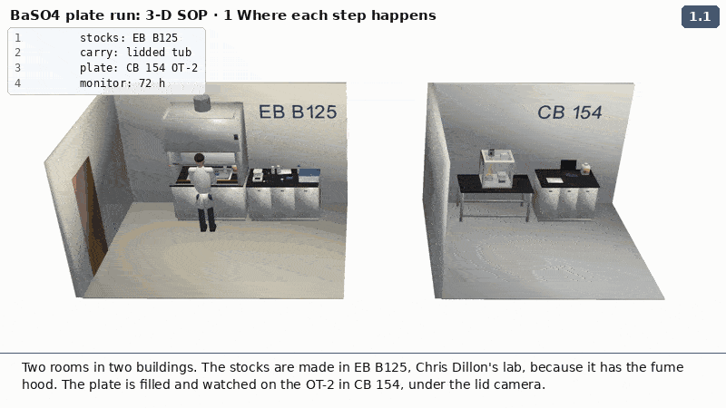
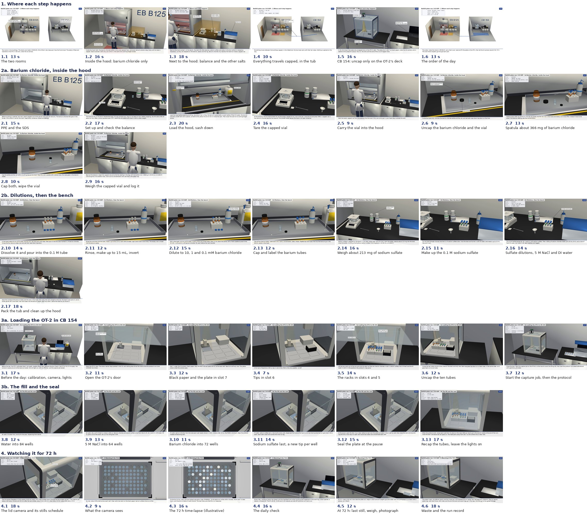

# Barium sulfate plate run: a 3-D animated SOP

Asked on [issue 80](https://github.com/vertical-cloud-lab/digital-wetlab/issues/80) by @sgbaird on 2026-11-02. It shows
what Tim and Michael do for the next barium chloride and sodium sulfate plate, from scratch:
- where each step happens: CB 154, or Chris Dillon's lab (EB B125) with the fume hood; and inside the hood or next to it;
- which containers are opened, and where;
- weighing the powders;
- loading the OT-2;
- the 72 h record from the lid camera.

The procedure is the one already written down:
- [`docs/baso4-extended-monitoring.md`](https://github.com/vertical-cloud-lab/digital-wetlab/blob/ad0b513/docs/baso4-extended-monitoring.md)
  (11-02): plate A, the stocks, the seal, the stills schedule, and the run record;
- the [10-30 practice plate](https://github.com/vertical-cloud-lab/digital-wetlab/blob/127e1db/docs/lead-pbs-materials-and-steps.md#barium-sulfate-practice-plate):
  the stock recipes and the PHREEQC saturation indices;
- the 10-23 lead plan's rule to weigh by difference in a capped vial when the balance is outside the hood;
- the hood threads: [powder-doser 141](https://github.com/vertical-cloud-lab/powder-doser/issues/141) (barium chloride
  in the hood, sodium sulfate on the bench, work 15 cm inside the sash) and
  [byu-vcl 195](https://github.com/vertical-cloud-lab/byu-vcl/issues/195) (Dillon's rules for the room).

It is built the way the lab's other animations are (byu-vcl's `viz3d`, used for the rePowder training, the lid camera and
the vertical lift module): CadQuery and vendor STEP models, rendered off-screen in PyVista, text drawn with PIL, and
written as MP4 and GIF.

Chapters 2 and 3 are in two parts each, so every GIF stays under the ~5 MB GitHub shows inline. Part 2a's GIF runs at 8 fps for the same reason; every MP4 has all its frames.

| Part | GIF (800 × 450, 10 fps) | MP4 (1280 × 720, 15 fps) |
| --- | --- | --- |
| **1. Where each step happens**: the two rooms, with the zones coloured: inside the hood (red), next to it (amber), the OT-2 (blue). Then the walk between them | [`out/sop1_where.gif`](out/sop1_where.gif) | [`out/mp4/sop1_where.mp4`](out/mp4/sop1_where.mp4) |
| **2a. Barium chloride, inside the hood**: PPE, the balance beside the hood, loading the hood, and the capped vial tared at the balance, filled in the hood and weighed again | [`out/sop2a_hood.gif`](out/sop2a_hood.gif) | [`out/mp4/sop2a_hood.mp4`](out/mp4/sop2a_hood.mp4) |
| **2b. Dilutions, then the bench**: the 0.1 M tube and its tenfold series in the hood; sodium sulfate and sodium chloride at the balance; packing the tub and closing the hood | [`out/sop2b_bench.gif`](out/sop2b_bench.gif) | [`out/mp4/sop2b_bench.mp4`](out/mp4/sop2b_bench.mp4) |
| **3a. Loading the OT-2 in CB 154**: the door, the plate on black paper in slot 7, the tips, the racks, uncapping, and the start | [`out/sop3a_load.gif`](out/sop3a_load.gif) | [`out/mp4/sop3a_load.mp4`](out/mp4/sop3a_load.mp4) |
| **3b. The fill and the seal**: water, NaCl, barium chloride, then sodium sulfate last; the seal at the pause; recapping | [`out/sop3b_fill.gif`](out/sop3b_fill.gif) | [`out/mp4/sop3b_fill.mp4`](out/mp4/sop3b_fill.mp4) |
| **4. Watching it for 72 h**: the lid camera's view and stills schedule, daily checks, the end of the run and the waste | [`out/sop4_monitor.gif`](out/sop4_monitor.gif) | [`out/mp4/sop4_monitor.mp4`](out/mp4/sop4_monitor.mp4) |
| **All of it**, one part after another | | [`out/mp4/baso4_sop_full.mp4`](out/mp4/baso4_sop_full.mp4) |

`out/<name>.json` gives the frame range of every sub-step in the MP4, and `out/<name>_still.png` is a still of one
sub-step.



## One MP4 per step

Asked on [issue 80](https://github.com/vertical-cloud-lab/digital-wetlab/issues/80) by @timothy-commins on
2026-11-05, so each step can be paused and replayed on its own. [`out/steps/`](out/steps) has one MP4 per numbered
step, 42 in all, cut from the six part MP4s above by [`split_steps.py`](split_steps.py). Nothing is re-rendered. Each
clip is its step's frames, then its last frame held so the caption stays up long enough to read: at least 15
characters a second, and 2 s past the motion. They come to 9.6 min in all, against 4 min 8 s for the full video.

**To watch them, open the [player page](https://htmlpreview.github.io/?https://github.com/vertical-cloud-lab/digital-wetlab/blob/0819bf7/docs/baso4-sop-3d/out/steps/player.html).** It has every step in order, each in its own video player
(pause, drag back, replay), with the step's text written under it. The ▶ links below open it at that step.
- GitHub can't play an MP4: its file view only offers "View raw", and raw links download the file. The page is
  [`out/steps/player.html`](out/steps/player.html), shown as a web page by [htmlpreview](https://htmlpreview.github.io/).
  Its videos play GitHub's raw files, pinned to commit `15c9430`, with jsDelivr as a fallback.
- Tested in Chrome: all 42 step videos load, and they play and pause. Not tested in Safari.
- The file links download the MP4, to play in any video player.



**1. Where each step happens**

| Step | What | Where | Length | Watch | File |
| --- | --- | --- | --- | --- | --- |
| 1.1 | The two rooms | overview | 13 s | [▶ play](https://htmlpreview.github.io/?https://github.com/vertical-cloud-lab/digital-wetlab/blob/0819bf7/docs/baso4-sop-3d/out/steps/player.html#s1.1) | [`1-01_two-rooms.mp4`](out/steps/1-01_two-rooms.mp4) |
| 1.2 | Inside the hood: barium chloride only | overview | 16 s | [▶ play](https://htmlpreview.github.io/?https://github.com/vertical-cloud-lab/digital-wetlab/blob/0819bf7/docs/baso4-sop-3d/out/steps/player.html#s1.2) | [`1-02_inside-the-hood.mp4`](out/steps/1-02_inside-the-hood.mp4) |
| 1.3 | Next to the hood: balance and the other salts | overview | 18 s | [▶ play](https://htmlpreview.github.io/?https://github.com/vertical-cloud-lab/digital-wetlab/blob/0819bf7/docs/baso4-sop-3d/out/steps/player.html#s1.3) | [`1-03_next-to-the-hood.mp4`](out/steps/1-03_next-to-the-hood.mp4) |
| 1.4 | Everything travels capped, in the tub | overview | 10 s | [▶ play](https://htmlpreview.github.io/?https://github.com/vertical-cloud-lab/digital-wetlab/blob/0819bf7/docs/baso4-sop-3d/out/steps/player.html#s1.4) | [`1-04_carry-in-the-tub.mp4`](out/steps/1-04_carry-in-the-tub.mp4) |
| 1.5 | CB 154: uncap only on the OT-2's deck | overview | 16 s | [▶ play](https://htmlpreview.github.io/?https://github.com/vertical-cloud-lab/digital-wetlab/blob/0819bf7/docs/baso4-sop-3d/out/steps/player.html#s1.5) | [`1-05_cb154-ot2.mp4`](out/steps/1-05_cb154-ot2.mp4) |
| 1.6 | The order of the day | overview | 13 s | [▶ play](https://htmlpreview.github.io/?https://github.com/vertical-cloud-lab/digital-wetlab/blob/0819bf7/docs/baso4-sop-3d/out/steps/player.html#s1.6) | [`1-06_the-order.mp4`](out/steps/1-06_the-order.mp4) |

**2a. Barium chloride, inside the hood**

| Step | What | Where | Length | Watch | File |
| --- | --- | --- | --- | --- | --- |
| 2.1 | PPE and the SDS | EB B125 | 15 s | [▶ play](https://htmlpreview.github.io/?https://github.com/vertical-cloud-lab/digital-wetlab/blob/0819bf7/docs/baso4-sop-3d/out/steps/player.html#s2.1) | [`2-01_ppe-and-sds.mp4`](out/steps/2-01_ppe-and-sds.mp4) |
| 2.2 | Set up and check the balance | EB B125, next to the hood | 17 s | [▶ play](https://htmlpreview.github.io/?https://github.com/vertical-cloud-lab/digital-wetlab/blob/0819bf7/docs/baso4-sop-3d/out/steps/player.html#s2.2) | [`2-02_balance-check.mp4`](out/steps/2-02_balance-check.mp4) |
| 2.3 | Load the hood, sash down | EB B125, inside the hood | 20 s | [▶ play](https://htmlpreview.github.io/?https://github.com/vertical-cloud-lab/digital-wetlab/blob/0819bf7/docs/baso4-sop-3d/out/steps/player.html#s2.3) | [`2-03_load-the-hood.mp4`](out/steps/2-03_load-the-hood.mp4) |
| 2.4 | Tare the capped vial | EB B125, next to the hood | 16 s | [▶ play](https://htmlpreview.github.io/?https://github.com/vertical-cloud-lab/digital-wetlab/blob/0819bf7/docs/baso4-sop-3d/out/steps/player.html#s2.4) | [`2-04_tare-the-vial.mp4`](out/steps/2-04_tare-the-vial.mp4) |
| 2.5 | Carry the vial into the hood | next to, then inside the hood | 9 s | [▶ play](https://htmlpreview.github.io/?https://github.com/vertical-cloud-lab/digital-wetlab/blob/0819bf7/docs/baso4-sop-3d/out/steps/player.html#s2.5) | [`2-05_vial-into-hood.mp4`](out/steps/2-05_vial-into-hood.mp4) |
| 2.6 | Uncap the barium chloride and the vial | EB B125, inside the hood | 9 s | [▶ play](https://htmlpreview.github.io/?https://github.com/vertical-cloud-lab/digital-wetlab/blob/0819bf7/docs/baso4-sop-3d/out/steps/player.html#s2.6) | [`2-06_uncap-bottle-and-vial.mp4`](out/steps/2-06_uncap-bottle-and-vial.mp4) |
| 2.7 | Spatula about 366 mg of barium chloride | EB B125, inside the hood | 13 s | [▶ play](https://htmlpreview.github.io/?https://github.com/vertical-cloud-lab/digital-wetlab/blob/0819bf7/docs/baso4-sop-3d/out/steps/player.html#s2.7) | [`2-07_spatula-barium-chloride.mp4`](out/steps/2-07_spatula-barium-chloride.mp4) |
| 2.8 | Cap both, wipe the vial | EB B125, inside the hood | 10 s | [▶ play](https://htmlpreview.github.io/?https://github.com/vertical-cloud-lab/digital-wetlab/blob/0819bf7/docs/baso4-sop-3d/out/steps/player.html#s2.8) | [`2-08_cap-and-wipe.mp4`](out/steps/2-08_cap-and-wipe.mp4) |
| 2.9 | Weigh the capped vial and log it | EB B125, next to the hood | 16 s | [▶ play](https://htmlpreview.github.io/?https://github.com/vertical-cloud-lab/digital-wetlab/blob/0819bf7/docs/baso4-sop-3d/out/steps/player.html#s2.9) | [`2-09_weigh-the-vial.mp4`](out/steps/2-09_weigh-the-vial.mp4) |

**2b. Dilutions, then the bench**

| Step | What | Where | Length | Watch | File |
| --- | --- | --- | --- | --- | --- |
| 2.10 | Dissolve it and pour into the 0.1 M tube | EB B125, inside the hood | 14 s | [▶ play](https://htmlpreview.github.io/?https://github.com/vertical-cloud-lab/digital-wetlab/blob/0819bf7/docs/baso4-sop-3d/out/steps/player.html#s2.10) | [`2-10_dissolve-barium-chloride.mp4`](out/steps/2-10_dissolve-barium-chloride.mp4) |
| 2.11 | Rinse, make up to 15 mL, invert | EB B125, inside the hood | 12 s | [▶ play](https://htmlpreview.github.io/?https://github.com/vertical-cloud-lab/digital-wetlab/blob/0819bf7/docs/baso4-sop-3d/out/steps/player.html#s2.11) | [`2-11_make-up-barium-0.1M.mp4`](out/steps/2-11_make-up-barium-0.1M.mp4) |
| 2.12 | Dilute to 10, 1 and 0.1 mM barium chloride | EB B125, inside the hood | 15 s | [▶ play](https://htmlpreview.github.io/?https://github.com/vertical-cloud-lab/digital-wetlab/blob/0819bf7/docs/baso4-sop-3d/out/steps/player.html#s2.12) | [`2-12_barium-dilutions.mp4`](out/steps/2-12_barium-dilutions.mp4) |
| 2.13 | Cap and label the barium tubes | EB B125, inside the hood | 12 s | [▶ play](https://htmlpreview.github.io/?https://github.com/vertical-cloud-lab/digital-wetlab/blob/0819bf7/docs/baso4-sop-3d/out/steps/player.html#s2.13) | [`2-13_cap-and-label-barium.mp4`](out/steps/2-13_cap-and-label-barium.mp4) |
| 2.14 | Weigh about 213 mg of sodium sulfate | EB B125, next to the hood | 16 s | [▶ play](https://htmlpreview.github.io/?https://github.com/vertical-cloud-lab/digital-wetlab/blob/0819bf7/docs/baso4-sop-3d/out/steps/player.html#s2.14) | [`2-14_weigh-sodium-sulfate.mp4`](out/steps/2-14_weigh-sodium-sulfate.mp4) |
| 2.15 | Make up the 0.1 M sodium sulfate | EB B125, next to the hood | 11 s | [▶ play](https://htmlpreview.github.io/?https://github.com/vertical-cloud-lab/digital-wetlab/blob/0819bf7/docs/baso4-sop-3d/out/steps/player.html#s2.15) | [`2-15_make-up-sodium-sulfate.mp4`](out/steps/2-15_make-up-sodium-sulfate.mp4) |
| 2.16 | Sulfate dilutions, 5 M NaCl and DI water | EB B125, next to the hood | 14 s | [▶ play](https://htmlpreview.github.io/?https://github.com/vertical-cloud-lab/digital-wetlab/blob/0819bf7/docs/baso4-sop-3d/out/steps/player.html#s2.16) | [`2-16_sulfate-nacl-water.mp4`](out/steps/2-16_sulfate-nacl-water.mp4) |
| 2.17 | Pack the tub and clean up the hood | EB B125, hood then bench | 18 s | [▶ play](https://htmlpreview.github.io/?https://github.com/vertical-cloud-lab/digital-wetlab/blob/0819bf7/docs/baso4-sop-3d/out/steps/player.html#s2.17) | [`2-17_pack-and-clean-up.mp4`](out/steps/2-17_pack-and-clean-up.mp4) |

**3a. Loading the OT-2 in CB 154**

| Step | What | Where | Length | Watch | File |
| --- | --- | --- | --- | --- | --- |
| 3.1 | Before the day: calibration, camera, lights | CB 154 | 17 s | [▶ play](https://htmlpreview.github.io/?https://github.com/vertical-cloud-lab/digital-wetlab/blob/0819bf7/docs/baso4-sop-3d/out/steps/player.html#s3.1) | [`3-01_before-the-day.mp4`](out/steps/3-01_before-the-day.mp4) |
| 3.2 | Open the OT-2's door | CB 154, OT-2 deck | 11 s | [▶ play](https://htmlpreview.github.io/?https://github.com/vertical-cloud-lab/digital-wetlab/blob/0819bf7/docs/baso4-sop-3d/out/steps/player.html#s3.2) | [`3-02_open-the-door.mp4`](out/steps/3-02_open-the-door.mp4) |
| 3.3 | Black paper and the plate in slot 7 | CB 154, OT-2 deck | 12 s | [▶ play](https://htmlpreview.github.io/?https://github.com/vertical-cloud-lab/digital-wetlab/blob/0819bf7/docs/baso4-sop-3d/out/steps/player.html#s3.3) | [`3-03_plate-in-slot-7.mp4`](out/steps/3-03_plate-in-slot-7.mp4) |
| 3.4 | Tips in slot 6 | CB 154, OT-2 deck | 7 s | [▶ play](https://htmlpreview.github.io/?https://github.com/vertical-cloud-lab/digital-wetlab/blob/0819bf7/docs/baso4-sop-3d/out/steps/player.html#s3.4) | [`3-04_tips-in-slot-6.mp4`](out/steps/3-04_tips-in-slot-6.mp4) |
| 3.5 | The racks in slots 4 and 5 | CB 154, OT-2 deck | 14 s | [▶ play](https://htmlpreview.github.io/?https://github.com/vertical-cloud-lab/digital-wetlab/blob/0819bf7/docs/baso4-sop-3d/out/steps/player.html#s3.5) | [`3-05_racks-in-slots-4-5.mp4`](out/steps/3-05_racks-in-slots-4-5.mp4) |
| 3.6 | Uncap the ten tubes | CB 154, OT-2 deck | 12 s | [▶ play](https://htmlpreview.github.io/?https://github.com/vertical-cloud-lab/digital-wetlab/blob/0819bf7/docs/baso4-sop-3d/out/steps/player.html#s3.6) | [`3-06_uncap-the-tubes.mp4`](out/steps/3-06_uncap-the-tubes.mp4) |
| 3.7 | Start the capture job, then the protocol | CB 154 | 12 s | [▶ play](https://htmlpreview.github.io/?https://github.com/vertical-cloud-lab/digital-wetlab/blob/0819bf7/docs/baso4-sop-3d/out/steps/player.html#s3.7) | [`3-07_start-capture-then-protocol.mp4`](out/steps/3-07_start-capture-then-protocol.mp4) |

**3b. The fill and the seal**

| Step | What | Where | Length | Watch | File |
| --- | --- | --- | --- | --- | --- |
| 3.8 | Water into 84 wells | CB 154, OT-2, door closed | 12 s | [▶ play](https://htmlpreview.github.io/?https://github.com/vertical-cloud-lab/digital-wetlab/blob/0819bf7/docs/baso4-sop-3d/out/steps/player.html#s3.8) | [`3-08_fill-water.mp4`](out/steps/3-08_fill-water.mp4) |
| 3.9 | 5 M NaCl into 64 wells | CB 154, OT-2, door closed | 13 s | [▶ play](https://htmlpreview.github.io/?https://github.com/vertical-cloud-lab/digital-wetlab/blob/0819bf7/docs/baso4-sop-3d/out/steps/player.html#s3.9) | [`3-09_fill-nacl.mp4`](out/steps/3-09_fill-nacl.mp4) |
| 3.10 | Barium chloride into 72 wells | CB 154, OT-2, door closed | 11 s | [▶ play](https://htmlpreview.github.io/?https://github.com/vertical-cloud-lab/digital-wetlab/blob/0819bf7/docs/baso4-sop-3d/out/steps/player.html#s3.10) | [`3-10_fill-barium-chloride.mp4`](out/steps/3-10_fill-barium-chloride.mp4) |
| 3.11 | Sodium sulfate last, a new tip per well | CB 154, OT-2, door closed | 14 s | [▶ play](https://htmlpreview.github.io/?https://github.com/vertical-cloud-lab/digital-wetlab/blob/0819bf7/docs/baso4-sop-3d/out/steps/player.html#s3.11) | [`3-11_fill-sodium-sulfate-last.mp4`](out/steps/3-11_fill-sodium-sulfate-last.mp4) |
| 3.12 | Seal the plate at the pause | CB 154, OT-2 deck | 15 s | [▶ play](https://htmlpreview.github.io/?https://github.com/vertical-cloud-lab/digital-wetlab/blob/0819bf7/docs/baso4-sop-3d/out/steps/player.html#s3.12) | [`3-12_seal-at-the-pause.mp4`](out/steps/3-12_seal-at-the-pause.mp4) |
| 3.13 | Recap the tubes, leave the lights on | CB 154, OT-2 deck | 17 s | [▶ play](https://htmlpreview.github.io/?https://github.com/vertical-cloud-lab/digital-wetlab/blob/0819bf7/docs/baso4-sop-3d/out/steps/player.html#s3.13) | [`3-13_recap-the-tubes.mp4`](out/steps/3-13_recap-the-tubes.mp4) |

**4. Watching it for 72 h**

| Step | What | Where | Length | Watch | File |
| --- | --- | --- | --- | --- | --- |
| 4.1 | The lid camera and its stills schedule | CB 154 | 18 s | [▶ play](https://htmlpreview.github.io/?https://github.com/vertical-cloud-lab/digital-wetlab/blob/0819bf7/docs/baso4-sop-3d/out/steps/player.html#s4.1) | [`4-01_lid-camera-schedule.mp4`](out/steps/4-01_lid-camera-schedule.mp4) |
| 4.2 | What the camera sees | CB 154 | 9 s | [▶ play](https://htmlpreview.github.io/?https://github.com/vertical-cloud-lab/digital-wetlab/blob/0819bf7/docs/baso4-sop-3d/out/steps/player.html#s4.2) | [`4-02_camera-view.mp4`](out/steps/4-02_camera-view.mp4) |
| 4.3 | The 72 h time-lapse (illustrative) | CB 154 | 16 s | [▶ play](https://htmlpreview.github.io/?https://github.com/vertical-cloud-lab/digital-wetlab/blob/0819bf7/docs/baso4-sop-3d/out/steps/player.html#s4.3) | [`4-03_timelapse-illustrative.mp4`](out/steps/4-03_timelapse-illustrative.mp4) |
| 4.4 | The daily check | CB 154 | 16 s | [▶ play](https://htmlpreview.github.io/?https://github.com/vertical-cloud-lab/digital-wetlab/blob/0819bf7/docs/baso4-sop-3d/out/steps/player.html#s4.4) | [`4-04_daily-check.mp4`](out/steps/4-04_daily-check.mp4) |
| 4.5 | At 72 h: last still, weigh, photograph | CB 154 | 12 s | [▶ play](https://htmlpreview.github.io/?https://github.com/vertical-cloud-lab/digital-wetlab/blob/0819bf7/docs/baso4-sop-3d/out/steps/player.html#s4.5) | [`4-05_end-of-run.mp4`](out/steps/4-05_end-of-run.mp4) |
| 4.6 | Waste and the run record | CB 154 | 18 s | [▶ play](https://htmlpreview.github.io/?https://github.com/vertical-cloud-lab/digital-wetlab/blob/0819bf7/docs/baso4-sop-3d/out/steps/player.html#s4.6) | [`4-06_waste-and-run-record.mp4`](out/steps/4-06_waste-and-run-record.mp4) |

The six part MP4s and the full video are at the end of the page:
- [▶ 1. Where each step happens](https://htmlpreview.github.io/?https://github.com/vertical-cloud-lab/digital-wetlab/blob/0819bf7/docs/baso4-sop-3d/out/steps/player.html#wsop1_where)
- [▶ 2a. Barium chloride, inside the hood](https://htmlpreview.github.io/?https://github.com/vertical-cloud-lab/digital-wetlab/blob/0819bf7/docs/baso4-sop-3d/out/steps/player.html#wsop2a_hood)
- [▶ 2b. Dilutions, then the bench](https://htmlpreview.github.io/?https://github.com/vertical-cloud-lab/digital-wetlab/blob/0819bf7/docs/baso4-sop-3d/out/steps/player.html#wsop2b_bench)
- [▶ 3a. Loading the OT-2 in CB 154](https://htmlpreview.github.io/?https://github.com/vertical-cloud-lab/digital-wetlab/blob/0819bf7/docs/baso4-sop-3d/out/steps/player.html#wsop3a_load)
- [▶ 3b. The fill and the seal](https://htmlpreview.github.io/?https://github.com/vertical-cloud-lab/digital-wetlab/blob/0819bf7/docs/baso4-sop-3d/out/steps/player.html#wsop3b_fill)
- [▶ 4. Watching it for 72 h](https://htmlpreview.github.io/?https://github.com/vertical-cloud-lab/digital-wetlab/blob/0819bf7/docs/baso4-sop-3d/out/steps/player.html#wsop4_monitor)
- [▶ All of it, 4 min 8 s](https://htmlpreview.github.io/?https://github.com/vertical-cloud-lab/digital-wetlab/blob/0819bf7/docs/baso4-sop-3d/out/steps/player.html#wbaso4_sop_full)

[`out/steps/index.json`](out/steps/index.json) lists each clip's source frames, its motion and hold, and the full caption.

## The steps, and where each one happens

**Rule of thumb:**
- Barium chloride powder is opened only inside the hood, and a barium solution stays there until its tube is capped.
- The balance, sodium sulfate, sodium chloride, labels and the log are next to the hood.
- Every tube is uncapped again only on the OT-2's deck in CB 154.
- In CB 154 too: lab coat, safety glasses or goggles and nitrile gloves whenever the barium tubes or the plate are
  handled. The OT-2 runs outside the hood because nothing comes off the solutions; lead plates are different. See
  [Does the OT-2 need to be in the hood?](#does-the-ot-2-need-to-be-in-the-hood)

| # | Where | What | Opened |
| --- | --- | --- | --- |
| 2.1 | EB B125 | Lab coat, splash goggles, nitrile gloves (two pairs for barium). The barium chloride SDS goes in the binder. Keep every container closed and labelled (Dillon's rule) | - |
| 2.2 | next to the hood | The HR-100A on the bench beside the hood. If it was moved, plug it in at least an hour before weighing: it drifts for about an hour after a move ([powder-doser 157](https://github.com/vertical-cloud-lab/powder-doser/issues/157)). Level it, check it with a check weight | - |
| 2.3 | inside the hood | Sash up to load: liner, tray, barium waste bottle, a wash bottle of fresh DI water, the barium chloride, a tube rack, a spatula, all at least 15 cm (6 in) inside the sash. Sash down to its working-height sticker | - |
| 2.4 | next to the hood | Put the empty capped 20 mL vial on the pan and tare it | balance lid |
| 2.5-2.8 | inside the hood | Open the barium chloride and the vial, and spatula about 366 mg into the vial. Close both, and wipe the vial | barium chloride bottle, vial |
| 2.9 | next to the hood | Weigh the capped vial and log the reading. 0.3664 g in 15.00 mL is 0.1000 M (BaCl₂·2H₂O, 244.26 g/mol); for another mass, work out its concentration | balance lid |
| 2.10-2.11 | inside the hood | About 10 mL of DI water into the vial; swirl until clear. Pour into the 0.1 M tube, rinse the vial twice into it, make up to 15 mL, then cap and invert | vial, barium tubes |
| 2.12-2.13 | inside the hood | 13.5 mL of DI water in each of three tubes, then 1.5 mL down the series with a new tip each time: 10, 1 and 0.1 mM. Cap and label | barium tubes |
| 2.14-2.15 | next to the hood | Sodium sulfate in an open weigh boat: 213.1 mg (anhydrous, 142.04 g/mol) to 15 mL is 0.1 M. Through a funnel into its tube, make up, cap | sodium sulfate bottle, tube |
| 2.16 | next to the hood | The same series for 10, 1 and 0.1 mM sulfate. 4.383 g NaCl to 15 mL (5 M). A tube of fresh DI water. Ten tubes in all | sodium chloride bottle, tubes |
| 2.17 | hood, then bench | Wipe the barium tubes and rack, then put both racks in the tub, lid on. Outer gloves off in the hood; liner and wipes into the barium waste. Sash fully down | tub lid |
| 1.4 | between buildings | Carry the tub closed | nothing |
| 3.1 | CB 154 | Before the day: OT-2 calibrated (deck, tip length, pipette offset, Labware Position Check), Pi 5 on its 27 W supply, camera exposure and white balance locked, rail lights on with no timer, capture job tested. Beside the OT-2: a labelled barium waste bottle, damp wipes and a wash bottle of DI water | - |
| 3.2-3.5 | OT-2 deck | Lab coat, safety glasses or goggles and nitrile gloves on before the tub is opened; they stay on until the tubes are recapped (3.13). Door open. Black paper and the plate in slot 7 under the lid camera (lid off now), 300 µL tips in slot 6 (lid off), the barium rack in slot 4, the sulfate rack in slot 5. The colour sensor stays parked in slot 10 | plate lid, tip-rack lid |
| 3.6 | OT-2 deck | Uncap the ten tubes one at a time; each cap goes top-down on a wipe, in order. A drip or spill: wipe it up while it's wet, wipe into the barium waste, then wipe the spot again with water | tubes |
| 3.7 | CB 154 | Close the door. Start the capture job, then the protocol | - |
| 3.8-3.11 | OT-2, door closed | Water, then 5 M NaCl, then barium chloride. Sodium sulfate goes in last, with a new tip per well, dispensed from above | - |
| 3.12-3.13 | OT-2 deck | At the pause: a clear adhesive seal, pressed down well by well; log the time. Recap the tubes, close the door, rail lights stay on | door |
| 4.1-4.4 | CB 154 | Stills every 1 min to 30 min after the last sulfate, every 5 min to 6 h, then every 15 min (about 400 in 72 h). Check the stream, the heartbeat and the event log once a day | - |
| 4.5-4.6 | CB 154 | Lab coat, glasses or goggles and gloves on again. Last still. Take the plate out, weigh it, and photograph it on black. Wells, leftover stocks and rinses go to barium waste. Wipe the deck with a damp wipe, gloves off, wash your hands. Commit the run record to `experiments/004-baso4-monitoring/<run-id>/` | door, waste |

## Does the OT-2 need to be in the hood?

Asked on [issue 80](https://github.com/vertical-cloud-lab/digital-wetlab/issues/80) by @timothy-commins on
2026-11-05. **Not for this barium sulfate plate. For the lead plates, yes.**

A fume hood protects you from what gets into the air. BYU's
[Laboratory & Chemical Safety Program](https://chem.byu.edu/documents/1767/byu_chemical_hygiene_plan.pdf) (Risk
Management, revision 0.0, January 2013; the copy hosted by BYU Chemistry) says, on page 43: "Use the fume hood for
operations that might result in the release of toxic chemical vapors, fumes or dust", and "Bench-top use of
chemicals that present an inhalation hazard is prohibited."

**Why the barium plate can run on the OT-2 in CB 154:**
- **Barium chloride powder is an inhalation hazard.** Its dust is harmful if inhaled (H332), and the solid is toxic if
  swallowed (H301). That's why the bottle is opened, and the powder weighed and dissolved, only in the hood (2.3-2.13).
- **Once it's dissolved, nothing comes off it.** Barium chloride doesn't evaporate; only the water does. What's left
  is the risk of swallowing it or getting it on skin or in the eyes. Gloves, glasses or goggles, a lab coat, capped
  tubes, the OT-2's closed door, a sealed plate, and no food or drink take care of that.
- **The solutions on the deck are dilute.** The strongest is the 0.1 M stock, about 2.4 % barium chloride dihydrate
  by weight; the rest are 10, 1 and 0.1 mM. Makers' safety data sheets for barium chloride solutions on either side
  of it ask for ordinary ventilation, not a hood:
  - Loba Chemie's [0.05 M solution](https://www.lobachemie.com/lab-chemical-msds/MSDS-BARIUM-CHLORIDE-005M-01N-STANDARDIZED-SOLUTION-traceable-to-NIST-CASNO-R600A-EN.aspx)
    (revised 2026-01-14), half the strength of the 0.1 M stock: "Not classified". Engineering controls: "Ensure good
    ventilation of the work station."
  - AquaPhoenix's [10 % (w/v) solution](https://sds.aquaphoenixsci.com/SDS/Barium%20Chloride%20Solution%2010%20%20(w%20v)%20(BC2010SS)_GHSUnitedStatesSDS_en_2021-02-01.pdf)
    (revised 2021-01-27), 4-5 times stronger: harmful if swallowed or inhaled, and an eye irritant. Engineering
    controls: "Provide adequate ventilation."
  - My estimate by the GHS mixture formula: with an oral LD50 of 150 mg/kg, a 2.4 % solution comes out at about
    6,000 mg/kg, far above the 2,000 mg/kg below which OSHA classes a mixture as harmful if swallowed.
- **It isn't on BYU's list of high-hazard chemicals.** That list (page 5) counts acute toxins by OSHA's former
  "highly toxic" definition, an oral LD50 in rats of 50 mg/kg or less
  ([29 CFR 1910.1200 Appendix A, 2011](https://www.govinfo.gov/content/pkg/CFR-2011-title29-vol6/pdf/CFR-2011-title29-vol6-sec1910-1200.pdf)).
  Barium chloride's is 150 mg/kg ([PubChem, from HSDB](https://pubchem.ncbi.nlm.nih.gov/compound/25204#section=Non-Human-Toxicity-Values)):
  "toxic", not "highly toxic".
- **The other chemicals aren't classed as hazardous:** sodium sulfate, sodium chloride, and the barium sulfate the
  plate makes. Barium sulfate is so insoluble that it is what patients swallow for X-ray imaging.
- **The proposal says the same.** Its [safety plan](../../drafts/safety_explanation.md) puts the OT-2 inside a hood
  for "all sulfide and lead experiments" and doesn't list barium. The 10-30 practice plate was planned for CB 154 for
  this reason ([lead plan](https://github.com/vertical-cloud-lab/digital-wetlab/blob/127e1db/docs/lead-pbs-materials-and-steps.md#barium-sulfate-practice-plate)).

**Where the hood still matters on this run:**
- Anything with barium chloride powder, which the SOP already keeps in the hood.
- A spill: wipe it up while it's wet, so it never dries to a dust.
- Sterling and Risk Management have the last word. If they want all barium work in a hood anyway, the OT-2 and its
  lid camera have to go to a room with one: facilities said in March that CB 154 can't have a fume hood installed
  ([byu-vcl 29](https://github.com/vertical-cloud-lab/byu-vcl/issues/29#issuecomment-4093457224)). In February,
  for silver nitrate with hydrochloric acid, Sterling wrote that "Ideally, the OT-2 should be in a fumehood, or at the
  very least tied into the exhaust" ([issue 1](https://github.com/vertical-cloud-lab/digital-wetlab/issues/1#issuecomment-3925864040)).

**Why the lead plates need the OT-2 inside a hood:**
1. Ammonium sulfide gives off hydrogen sulfide and ammonia. That is an inhalation hazard, so no bench-top use.
2. Lead(II) nitrate is a carcinogen (Category 1B) and a reproductive toxin (Category 1A), so it is a particularly
   hazardous substance. BYU's program (page 21) says to "Use adequate ventilation (such as a fume hood) when
   transferring even a small amount" of one. That covers lead plates without sulfide too. The 11-02
   [first-experiments plan](https://github.com/vertical-cloud-lab/digital-wetlab/blob/10e82b9/docs/first-experiments-v2/README.md?plain=1#L458-L462)
   says aqueous lead salts without sulfide don't need a hood; by this rule they do, unless Risk Management says
   otherwise.

Before the OT-2 goes into a hood ([step 14](https://github.com/vertical-cloud-lab/digital-wetlab/blob/127e1db/docs/lead-pbs-materials-and-steps.md?plain=1#L351-L352)
of the lead plan):
- **Measure the hood.** The OT-2 is about 63-66 cm wide and tall and 57 cm deep, with the lid camera on top. Work is
  meant to sit 15 cm (6 in) behind the sash, so the hood needs about 72 cm of clear depth, and a sash that opens
  above the robot and camera.
- **Ask the hood's owner.** A robot running for days takes over the hood.
- **Ask Risk Management to check the airflow with the robot inside.** BYU's program says not to let what's in a hood
  "block vents or airflow", and Risk Management measures hood face velocity.

## The models

| In the scene | Model | Source |
| --- | --- | --- |
| Opentrons OT-2: frame, deck, windows, door, Z gantry, P300 single on the left mount | Opentrons' reference STEP, "Detailed" | **Vendor CAD**, [github.com/Opentrons/ot2](https://github.com/Opentrons/ot2) at `ef9ede1`. Fetched at run time and SHA-256 checked by `models.py`; not committed. Its solids are named, so the door, head, beam and pipette move separately. The X-gantry beam is part of the frame solid in that file, so `models.py` cuts it out so it can move front to back with the head |
| Lid camera: HQ camera, 8-50 mm zoom, C-CS adapter, Pi 5, printed base and deck | `ot2-overhead-camera/lid-mount/exports/assembly.step` | **The lab's own CAD**, [byu-vcl PR 234](https://github.com/vertical-cloud-lab/byu-vcl/pull/234) at `49677cf`, fetched and hash-checked. It sits on the top window over slot 7, where the monitoring plan puts it. The yellow cone is a 140 × 105 mm view at the plate |
| A&D HR-100A with the FXi-10 breeze break and A&D's lid | `lab_models/labware.py`, `balance(lid="stock")` | byu-vcl `vertical-lab/lab_models` at `516f796` (from byu-vcl 199): built from A&D's drawings and the lab's measurements. The doser's AutoTrickler lid is swapped for the stock one here |
| NEST 96-well plate (200 µL, flat), Opentrons 300 µL tip rack, 15 mL Falcon tubes, AC 6-tube rack, 20 mL vial, weigh boat, spatula, colour sensor | `lab_models/labware.py` | Same copy; built from Opentrons' labware definitions and the makers' drawings |
| Fume hood, benches, OT-2 table, rooms | `models.py` | **Modelled here from typical sizes**: a 5 ft bench hood with a vertical sash, 30 in benches. EB B125's hood and both rooms are not measured or photographed on record, so the layout is a stand-in |
| Reagent bottles, waste bottles, wash bottles, 100-1000 µL pipette, tub, seal, plate lid, stand-in person | `models.py` | Modelled here. The coloured bands on bottles and tubes are only for the animation: orange for barium, green for sulfate, grey for NaCl, blue for water |

`lab_models/common.py` and `labware.py`, and `scene.py`, are verbatim copies from byu-vcl at `516f796`, so each
model and the renderer have one source. `animate.py` overrides one method of `scene.Scene`: it resets the camera's
clipping range every frame, which the lid camera's close view needs.

## Assumptions and gaps

- **The balance's place.** The HR-100A sat on the bench beside the EB B125 hood in mid-September
  ([powder-doser 157](https://github.com/vertical-cloud-lab/powder-doser/issues/157)). The 10-23 plan says the doser
  is back in CB 154, and the balance probably went with it, so it may have to be carried over again. If the Dillon lab
  has its own analytical balance beside the hood, use that one instead.
- **The 15 mL tube is too tall for the balance.** It doesn't fit under the HR-100A's breeze-break lid: there is
  79.4 mm from the pan to the lid. That's why the barium chloride is weighed in a capped 20 mL vial and the other
  powders in a weigh boat.
- **The plate won't fit in the breeze break either.** The run plan weighs the plate at the start and the end, so
  that weighing needs another balance, or the breeze break taken off.
- **Hand pipettes.** The 10-23 list marks the 100-1000 µL pipette as "get". Without one, dilute by weight, as the
  monitoring plan describes.
- **Two racks.** Both racks are the 6-tube AC model from the March run. They carry the tubes over and go onto the
  deck as they are. The March run had only one, so a second rack, or a 15-tube Opentrons rack, is needed.
- **The heater-shaker isn't drawn.** Plate A sits on black paper on the deck, unshaken, and the module's slot isn't on
  record. The colour sensor is drawn parked in slot 10. The monitoring plan takes it off the deck for this run, and the
  10-30 first-experiments plan uses it for sentinel reads. Either way, it doesn't drive the robot while the protocol
  runs.
- **The plate map is one shuffle of plate A:**
  - 48 wells: 16 barium and sulfate pairs in 1 molal NaCl, in triplicate;
  - 16 wells: the same pairs without NaCl;
  - 8 single-salt wells;
  - 8 blanks;
  - 4 positive controls at 10 mM each;
  - 12 wells empty.

  The blank and control counts are my choice; the plan doesn't fix them.
- **The time-lapse is illustrative.** When each well turns white comes from its saturation index (the 10-30 PHREEQC
  table, +1.6 without NaCl), through a made-up curve: SI 2.9 at 1 min, 2.0 at 10 min, 1.0 at 6 h, 0.5 at 48 h, and
  nothing below 0.3. It is not a prediction. That is what the run measures.

## Running it

```bash
pip install cadquery pyvista pillow numpy scipy          # plus ffmpeg and gifsicle on the PATH
xvfb-run -a python3 animate.py sop1 sop2a sop2b sop3a sop3b sop4 full   # full joins the six MP4s
PREVIEW=1 xvfb-run -a python3 animate.py sop2              # the last frame of each sub-step, to /tmp
python3 split_steps.py                                    # one MP4 per step from the six parts (ffmpeg and Pillow only)
python3 split_steps.py --page-only --sha <commit>         # out/steps/player.html, for clips committed at <commit>
```

The first run downloads the two STEP files into `.cache/` and tessellates everything, which takes about 10 s. The
meshes are cached until `models.py` or `lab_models/` changes. To run chapters in parallel, give each its own display
(`xvfb-run --server-num=N`).
