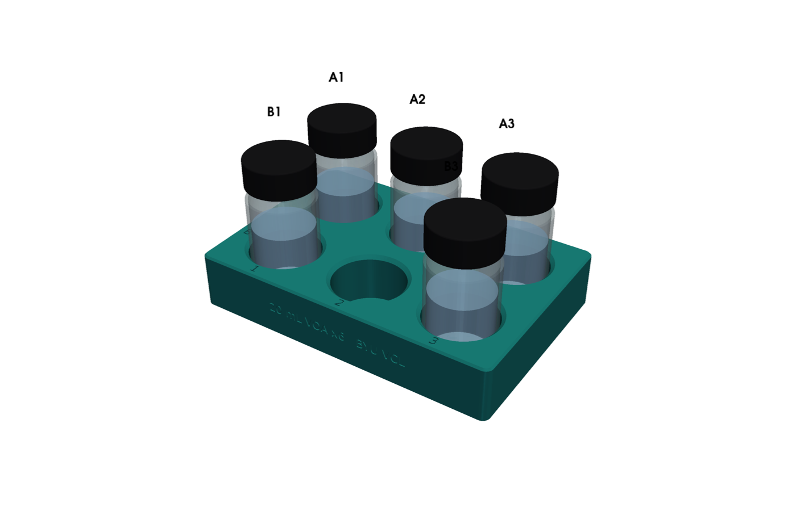

# OT-2 holder for six 20 mL vials

Asked on [PR 84](https://github.com/vertical-cloud-lab/digital-wetlab/pull/84) by @sgbaird on 2026-11-06: put the
stocks in the vials the lab already uses, in a holder that sits in an OT-2 slot. The ten stocks need two holders:
barium chloride in slot 4, and sodium sulfate, the 5 M NaCl and the DI water in slot 5.



| File | What it is |
| --- | --- |
| [`vial_holder_20ml_x6.step`](vial_holder_20ml_x6.step), [`.stl`](vial_holder_20ml_x6.stl) | The holder, in print orientation (upright). Print two |
| [`byuvcl_6_vialholder_20ml/1.json`](byuvcl_6_vialholder_20ml/1.json) | Its Opentrons labware definition (schema 2), wells A1-B3 with the vials uncapped |
| [`../vial_holder.py`](../vial_holder.py) | The CadQuery source of all three. The animation builds its holder from the same function |

## The vials

The lab's 20 mL vials are the **clear VOA vials in the electromagnetic capper's bill of materials**: Fisher
12-100-112, 20 mL, with 24-400 open-top caps and septa (byu-vcl
[`modules/electromagnetic-capper/BOM.md`](https://github.com/vertical-cloud-lab/byu-vcl/blob/main/modules/electromagnetic-capper/BOM.md),
item 11). The same vials sit in the CubXL's 9-vial holder
([`9VialHolder20mL_TightFit.step`](https://github.com/vertical-cloud-lab/byu-vcl/blob/main/modules/electromagnetic-capper/cad/9VialHolder20mL_TightFit.step))
and in its single-vial stirrer, which calls them "20 mL VOA (Ben's)". Fisher lists this family
([12-100-100](https://www.fishersci.com/shop/products/clear-voa-glass-vials-0-125in-septa/12100100)) at **28 mm outside
diameter and 57 mm tall**. Those are the numbers used here.

**Nobody has measured the lab's vials yet.** @timothy-commins was asked to caliper the outside diameter and the height
on 11-06. Rebuild with those numbers and everything follows (the pockets, the labware definition, the exports, the
render):

```bash
python3 vial_holder.py --od <measured OD, mm> --height <measured height without the cap, mm>
```

The open paint jars standing in slot 3 (Sterling's 10-13 photo in
[byu-vcl 81](https://github.com/vertical-cloud-lab/byu-vcl/issues/81#issuecomment-6157219356)) are a different
container: wide-mouth jars, which the 09-30 camera fit put at 23-26 mm across
([results](https://github.com/vertical-cloud-lab/byu-vcl/blob/main/wireless-color-sensor/ot2/results-paint-plate-2026-09-30.md)).
They aren't used for the stocks.

## The design

| | |
| --- | --- |
| Footprint | 127.76 × 85.48 mm with 3.18 mm corners (ANSI/SLAS), so the slot's corner clips locate it |
| Height | 23 mm; the pocket floors are 3 mm thick |
| Pockets | 6, in 3 columns × 2 rows on a 40 × 40 mm pitch: A1 at the back left, as on a plate |
| Pocket size | 29.2 mm across (the vial plus 1.2 mm), 20 mm deep, with a 1.5 mm lead-in chamfer |
| Between vials | 12 mm, room for gloved fingers on the caps |
| Orientation | the A1 corner cut off, as on a plate, so it goes in only one way round |
| Labels | A and B by the rows, 1-3 by the columns, and "20 mL VOA x6 BYU VCL" on the front face, all 0.6 mm deep |
| Vial tops | 60 mm above the deck uncapped, 63 mm capped |

Print it upright with no supports: PETG or PLA, 0.2 mm layers, about 15 % infill. A vial should drop in and lift out
freely. If it is tight, rebuild with a slightly larger `--od`.

## On the OT-2

| Slot | Holder | A1 | A2 | A3 | B1 | B2 | B3 |
| --- | --- | --- | --- | --- | --- | --- | --- |
| 4 | barium chloride | 0.1 M | 10 mM | 1 mM | 0.1 mM | (empty) | (empty) |
| 5 | the rest | 0.1 M sodium sulfate | 10 mM | 1 mM | 0.1 mM | 5 M NaCl | DI water |

Load it in the protocol from the JSON, then run Labware Position Check on it:

```python
import json
with open("byuvcl_6_vialholder_20ml/1.json") as f:
    holder_def = json.load(f)
barium = protocol.load_labware_from_definition(holder_def, 4)
rest = protocol.load_labware_from_definition(holder_def, 5)
```

- The wells are the uncapped vials: bottom 4.5 mm above the deck (the 3 mm floor and the 1.5 mm glass base), depth
  55.5 mm, 20 mL. Their diameter is the 20 mm neck opening, not the 25.6 mm body, because the neck is what a tip has
  to clear.
- 15 mL stands 30.6 mm above a vial's base. Plate A takes about 10 mL of water, 2.6 mL of NaCl, and at most 1.4 mL of
  any one barium or sulfate stock.
- **The heater-shaker in slot 7 limits its neighbours.** Opentrons
  ([Heater-Shaker placement restrictions](https://docs.opentrons.com/v2/modules/heater_shaker.html)) doesn't allow
  labware taller than 53 mm to its left or right, so slot 8 stays empty or short. The holders, with vials 63 mm tall,
  go in front of it (slot 4) and diagonally (slot 5), which the single-channel P300 can reach.
