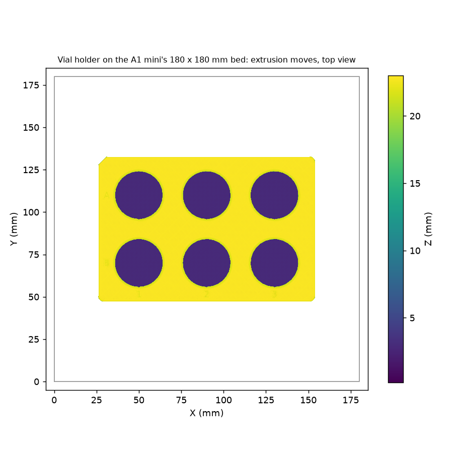

# One vial holder on the A1 mini: sliced, not yet printed (2026-11-11)

@timothy-commins calipered the lab's vials at 27 × 55 mm, then asked for the holder ("the base") on the lab's A1 mini
([PR 84](https://github.com/vertical-cloud-lab/digital-wetlab/pull/84#issuecomment-6804648055)). This folder has it
sliced for that printer. **Nothing has been printed.**

- **The 2026-11-11 print run** sent it to "Thumbelina, the A1 Mini" at 21:04:38 UTC. It stopped the job at 21:11:01, still
  at layer 0, because the plate that had been checked was another printer's. The account has **two A1 minis**,
  "Thumbelina" and "Tinkerbell", so name the one you mean. Record: [`run-2026-11-11/`](run-2026-11-11/README.md).
- **Re-sliced 2026-11-11.** The files sliced earlier that day had a generic start G-code, with prime lines out to
  Y 200 mm on the 180 mm bed. `slice_a1mini.py` now loads Bambu's A1 mini start and end G-code (below).

It is one holder. Try several vials in it before printing the second (see [`../README.md`](../README.md)).



| File | What it is |
| --- | --- |
| [`vial_holder_20ml_x6_A1mini_PETG_0.4.gcode.3mf`](vial_holder_20ml_x6_A1mini_PETG_0.4.gcode.3mf) | Sliced for a **0.4 mm nozzle**, Bambu PETG Basic: **2 h 8 min, 76 g**, 115 layers |
| [`vial_holder_20ml_x6_A1mini_PLA_0.4.gcode.3mf`](vial_holder_20ml_x6_A1mini_PLA_0.4.gcode.3mf) | The same in Bambu PLA Basic, in case no PETG is loaded: **1 h 49 min, 80 g** |
| [`vial_holder_20ml_x6_A1mini_PETG_0.4.3mf`](vial_holder_20ml_x6_A1mini_PETG_0.4.3mf) | The PETG one as an unsliced project, to open in Bambu Studio and slice there |
| [`slice_a1mini.py`](slice_a1mini.py) | Makes all of these from [`../vial_holder_20ml_x6.stl`](../vial_holder_20ml_x6.stl) with Bambu Studio's command line |
| [`check_slice.py`](check_slice.py), [`check_slice_output.txt`](check_slice_output.txt), [`plate_layout.png`](plate_layout.png) | The checks of the G-code below, and the top view above |
| [`print.json`](print.json) | The record: source file and hashes, settings, estimates, checks, the 2026-11-11 print run, and what to check before sending |
| [`run-2026-11-11/`](run-2026-11-11/README.md) | The 2026-11-11 print run: timeline, screenshots and the file Studio sent |

## Settings

| | |
| --- | --- |
| Slicer | Bambu Studio 02.08.02.61 (AppImage), its own profiles, run from the command line |
| Printer | Bambu Lab A1 mini 0.4 nozzle, Textured PEI plate |
| Process | Bambu's `0.20mm Standard @BBL A1M` with three changes: **3 walls** (from 2), **0.15 mm elephant-foot compensation** (from 0) and **no brim** (from auto). The last two keep the bottom edge square, so it drops into the OT-2 slot's corner clips without trimming. The third wall stiffens the pockets |
| Left as Bambu has them | 0.2 mm layers, 15 % grid infill, no supports; PETG at 245 °C with the bed at 70 °C, PLA at 220 °C and 65 °C |
| Part | The STL at `5d9dd9d` (MD5 `90bbb63e…`), upright as exported, centred on the 180 × 180 mm bed |

## Checked in the G-code

[`check_slice.py`](check_slice.py) reads the G-code in each file ([output](check_slice_output.txt)). Sizes are outer-wall
toolpath spans plus one line width; each pocket is a least-squares circle through its wall, minus one line width.
Both files give the same numbers:

| | From the toolpaths | Model |
| --- | --- | --- |
| Footprint at z 1, 10 and 21 mm | 127.76 × 85.48 mm | 127.76 × 85.48 mm (SBS) |
| All six pockets at z 6, 12 and 18 mm | 28.20 mm | 28.2 mm |
| Top layer | z 23.0 mm | 23.0 mm |
| Config block | `printer_settings_id = Bambu Lab A1 mini 0.4 nozzle`, `nozzle_diameter = 0.4`, `curr_bed_type = Textured PEI Plate`, `wall_loops = 3`, `sparse_infill_density = 15%`, `elefant_foot_compensation = 0.15`, `brim_type = no_brim`, `enable_support = 0` | |
| Start, end, filament-change and timelapse G-code | The same as Studio's GUI slice of the same settings, character for character | Bambu's A1 mini templates |
| Per-layer extrusion against Studio's GUI slice | All within 0.05 mm of filament | |

**The start G-code fix.** Bambu's machine profiles bring in their start and end G-code through an `include` list.
Until 2026-11-11, `slice_a1mini.py` flattened the `inherits` chain but skipped `include`, so the command line fell back
to a generic start: `G28`, `M970` lines, `G29`, then two prime lines at X 10 from Y 20 to Y 200 mm at 205 °C. It now
resolves `include`, as `../print-h2d/slice_h2d.py` does.

## Not checked, and what to check first

- **Which A1 mini.** The lab's Bambu account has two: "Thumbelina, the A1 Mini" and "Tinkerbell". Name one in the
  request, and have the person giving the go stand at that printer. On 2026-11-11 Thumbelina's camera didn't load
  from the runner, while Tinkerbell's did.
- **The nozzle.** On 2026-11-11 both A1 minis had 0.4 mm stainless standard-flow nozzles (Studio's *Printer Parts*).
  Read it again before printing:
  - **0.4 mm:** print one of these files.
  - **0.2 mm:** re-slice with `--nozzle 0.2`. That takes about 15 h for this part, so swapping to 0.4 mm may be better.
  - **Anything else** (tensegrity-optimization uses 0.6 mm): don't print. Swap the nozzle first.
- **The filament.** On 2026-11-11 Thumbelina's AMS Lite had dark blue PLA (A1), black PLA (A3) and PETG (A4).
  Tinkerbell had blue PLA on an external spool.
  Use the file for what is loaded now, and map it to that slot when sending. Either material holds up to the aqueous
  stocks at room temperature. PETG is tougher, and is what byu-vcl prints its lab fixtures in.
- **The plate.** The files are sliced for the Textured PEI plate.
- **No plate thumbnails, and a blank printer-model ID.** The command line can't open a display for its thumbnails on
  the runner. It also leaves `printer_model_id` empty in `Metadata/slice_info.config` (the GUI writes `N1` for the
  A1 mini). If Studio objects when sending, open the project `.3mf` (or the STL with the three changes above) in
  Studio and slice it there. Studio also resets the three changes when it opens these files, so set them back
  before slicing (the 2026-11-11 run did, and checked the result against these files).
- **Not bit-for-bit repeatable.** Two command-line runs of the same slice differed in a few gap-fill paths and by
  seconds in the estimate. The files here are the ones `slice_a1mini.py` wrote.

## To print it

- **At the lab:** read the nozzle (above). Open the `.gcode.3mf` for the loaded filament in Bambu Studio, logged in to
  the lab's account, and use *Print plate*, mapping the filament to its AMS Lite slot. Or copy the file to the
  printer's microSD card and start it from the printer's screen.
- **Through the print workflow:** comment on PR 84 with the print trigger, naming the file (branch
  `claude/issue-80-20261105-2203`, path `docs/baso4-sop-3d/cad/print-a1mini/…`) and the printer by its Studio name. A
  member of `bambu-print-approvers` approves the run. The run posts a fresh camera frame and reads the plate and the
  nozzle itself before it sends anything.

To slice again (for example for a 0.2 mm nozzle, or after a change to the holder):

```bash
# Bambu Studio 02.08.02.61's AppImage, extracted (byu-vcl's bambu/studio/setup_runner.sh downloads and checks it)
xvfb-run -a python3 slice_a1mini.py --studio ~/bambu/squashfs-root --nozzle 0.4
xvfb-run -a python3 slice_a1mini.py --studio ~/bambu/squashfs-root --nozzle 0.4 --filament "Bambu PLA Basic"
python3 check_slice.py vial_holder_20ml_x6_A1mini_PETG_0.4.gcode.3mf plate_layout.png     # needs numpy, matplotlib
```
