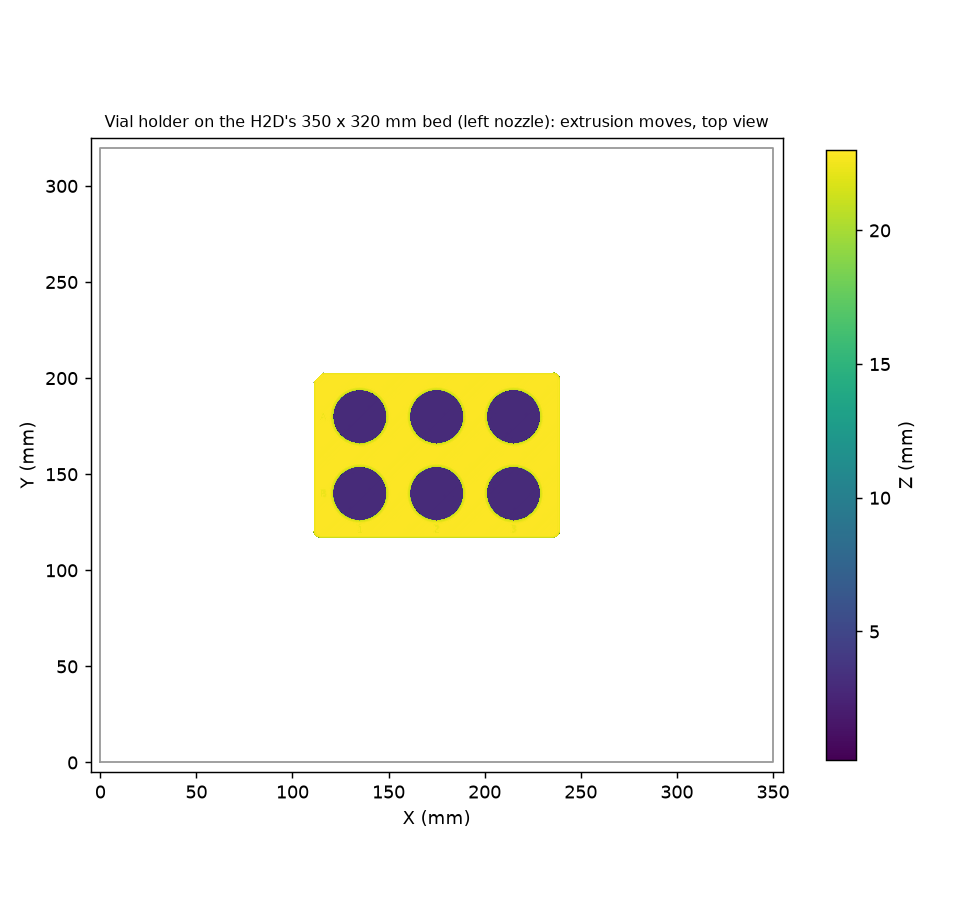

# One vial holder on the H2D: sliced, not yet printed (2026-11-11)

The holder was first sliced for the lab's A1 mini ([`../print-a1mini/`](../print-a1mini/README.md)), and a print run sent
it there at 21:04:38 UTC. Five minutes later @timothy-commins reported that the A1 mini is unplugged and asked for the
H2D instead ([PR 84](https://github.com/vertical-cloud-lab/digital-wetlab/pull/84#issuecomment-6807101110)). The print
run stopped the A1 mini's job before layer 1. This folder has the same holder sliced for the H2D. **Nothing has been
sent to the H2D.** The run that sliced it had no login to the lab's Bambu account, and only the approval-gated print
workflow (`claude-print.yml`) or a person at the lab can send a print.

It is one holder. Try several vials in it before printing the second (see [`../README.md`](../README.md)).

## The H2D at 21:12–21:13 UTC, as the print run read it

The print run that was still logged in read the H2D ("BYU VCL H2D - Théoden") in Studio
([its comment](https://github.com/vertical-cloud-lab/digital-wetlab/pull/84#issuecomment-6805057536); screenshots in
[`../print-a1mini/run-2026-11-11/`](../print-a1mini/run-2026-11-11/), `h2d_*`):

| | |
| --- | --- |
| State | Idle, last job finished, heaters off |
| Nozzles | **0.4 mm** hardened steel, standard flow, and **0.6 mm** hardened steel, TPU high flow. Studio's dialog doesn't name the sides, but its H2D profiles offer TPU high flow only on the right, so the 0.6 mm is the right nozzle and the 0.4 mm the left |
| Filament | Left AMS: PLA in A2 (black), A3 (white) and A4 (blue). No PETG |
| Plate | Textured, with no parts on it, but with faint light outlines of rectangles in the middle |
| HMS | A maintenance reminder (clean and lubricate the rails), not an error |

**So the PLA file here matches the left side as it is:** 0.4 mm standard nozzle, PLA in the left AMS. **What blocks it is
the right nozzle.** This repo's rule is 0.2 or 0.4 mm in both nozzles, and the right one is 0.6 mm (tensegrity-optimization
prints with 0.6 mm). Someone has to swap it before this holder can be sent.



| File | What it is |
| --- | --- |
| [`vial_holder_20ml_x6_H2D_PETG_0.4.gcode.3mf`](vial_holder_20ml_x6_H2D_PETG_0.4.gcode.3mf) | Sliced for **0.4 mm nozzles**, Bambu PETG Basic, printed by the **left nozzle**: **1 h 45 min, 77 g**, 115 layers |
| [`vial_holder_20ml_x6_H2D_PLA_0.4.gcode.3mf`](vial_holder_20ml_x6_H2D_PLA_0.4.gcode.3mf) | The same in Bambu PLA Basic, in case no PETG is loaded: **1 h 37 min, 80 g** |
| [`vial_holder_20ml_x6_H2D_PETG_0.4.3mf`](vial_holder_20ml_x6_H2D_PETG_0.4.3mf), [`vial_holder_20ml_x6_H2D_PLA_0.4.3mf`](vial_holder_20ml_x6_H2D_PLA_0.4.3mf) | The same as unsliced projects, to open in Bambu Studio and slice there |
| [`slice_h2d.py`](slice_h2d.py) | Makes all of these from [`../vial_holder_20ml_x6.stl`](../vial_holder_20ml_x6.stl) with Bambu Studio's command line |
| [`check_slice.py`](check_slice.py), [`check_slice_output.txt`](check_slice_output.txt), [`plate_layout.png`](plate_layout.png) | The checks of the G-code below, and the top view above |
| [`print.json`](print.json) | The record: source file and hashes, settings, estimates, checks, and what still has to be read off the printer |

## Settings

| | |
| --- | --- |
| Slicer | Bambu Studio 02.08.02.61 (AppImage, SHA-256 checked), its own profiles, run from the command line |
| Printer | Bambu Lab H2D 0.4 nozzle (both nozzles 0.4 mm, standard flow), Textured PEI plate, Studio's default for the H2D |
| Nozzle that prints | **Left.** With one filament, Studio's default grouping puts it on the left nozzle (`filament_map = 1`, and the start G-code heats `T1`) |
| Process | Bambu's `0.20mm Standard @BBL H2D` with the A1 mini's three changes: **3 walls** (from 2), **0.15 mm elephant-foot compensation** (from 0) and **no brim** (from auto). The last two keep the bottom edge square, so it drops into the OT-2 slot's corner clips without trimming. The third wall stiffens the pockets |
| Left as Bambu has them | 0.2 mm layers, 15 % grid infill, no supports; PETG at 250 °C (245 °C for the first layer) with the bed at 70 °C, PLA at 220 °C and 55 °C |
| Start and end G-code | Bambu's own H2D sequences (start dated 2026-06-05, end 2026-07-29). `slice_h2d.py` resolves the machine profile's `include` templates. `slice_a1mini.py` drops them, so the CLI falls back to a generic start sequence; the print run found that in the A1 mini files. Checked here: no `G0 Z20`, `G29` or `M970 Q1` before layer 1 |
| Part | The STL at `3a82993` (MD5 `90bbb63e…`, the same file the A1 mini slice used), upright as exported, centred on the 350 × 320 mm bed |

## Checked in the G-code

[`check_slice.py`](check_slice.py) is the A1 mini's check, reading the bed from the G-code and with three H2D checks added
([output](check_slice_output.txt)). Both files give the same numbers:

| | From the toolpaths | Model |
| --- | --- | --- |
| Footprint at z 1, 10 and 21 mm | 127.76 × 85.48 mm | 127.76 × 85.48 mm (SBS) |
| All six pockets at z 6, 12 and 18 mm | 28.20 mm | 28.2 mm |
| Top layer | z 23.0 mm | 23.0 mm |
| Nozzle | left (`filament_map = 1`, `T1` heated first) | |
| Part on the bed | x 111.3–238.7 mm, y 117.5–202.5 mm: inside both nozzles' reach (left 0–325 mm, right 25–350 mm) | |
| Prime tower | none | |
| Config block | `printer_settings_id = Bambu Lab H2D 0.4 nozzle`, `nozzle_diameter = 0.4,0.4`, `nozzle_volume_type = Standard,Standard`, `curr_bed_type = Textured PEI Plate`, `wall_loops = 3`, `sparse_infill_density = 15%`, `elefant_foot_compensation = 0.15`, `brim_type = no_brim`, `enable_support = 0` | |

## Not checked, and what to check first

- **Both nozzles.** This run couldn't read them off the printer: it had no Bambu login, and this repo has no LAN access
  code for the H2D. The print run read them at 21:13 UTC (above): **0.4 mm on the left, 0.6 mm on the right.** Read
  both again before printing (Studio's Device page, or the printer's screen):
  - **Both 0.4 mm:** print one of these files.
  - **0.2 mm:** re-slice with `--nozzle 0.2`. That takes about 14 h 52 min for this part (230 layers, 60 g of PETG), so
    swapping to 0.4 mm may be better.
  - **Either one 0.6 mm or anything else:** don't print. This repo's rule is 0.2 or 0.4 mm in both nozzles, even
    though only one prints. Swap first.
  - **High-flow nozzles:** these files are for standard flow. Re-slice in Studio with the nozzle's flow type set.
- **Which side has the filament.** These files print with the left nozzle, so they need the PETG (or PLA) on the left
  side: an AMS attached to the left nozzle, or the left spool holder. At 21:12 UTC the left AMS had PLA and no PETG.
  If the filament is only on the right, slice the project in Studio with the filament grouped on the right nozzle (or
  *Auto For Match*), with the same settings. The command line can't make a right-nozzle slice: it ignores a manual map
  in the profiles and stops with "No valid nozzle found" when a project sets one.
- **The filament.** Use the PETG file if PETG is loaded on the printing side; PLA otherwise. Either material holds up to
  the aqueous stocks at room temperature. PETG is tougher, and is what byu-vcl prints its lab fixtures in. If TPU is
  loaded (tensegrity-optimization prints PLA with TPU), don't print the holder in TPU.
- **The plate.** The files are sliced for the Textured PEI plate. If another plate is on the H2D, re-slice for it.
- **No plate thumbnails, and a blank printer-model ID.** As with the A1 mini, the command line can't open a display for
  the thumbnails on the runner, and it leaves `printer_model_id` empty in `Metadata/slice_info.config` (the GUI writes
  `O1D` for the H2D). If Studio objects when sending, open the project `.3mf` (or the STL with the three changes above)
  in Studio and slice it there.

## To print it

- **At the lab:** read both nozzles and which side has the filament (above). Open the `.gcode.3mf` for the loaded
  filament in Bambu Studio, logged in to the lab's account, and use *Print plate*, mapping the filament to its slot on
  the left side.
- **Through the print workflow:** comment on PR 84 with the print trigger, naming the file (branch
  `claude/issue-80-20261105-2203`, path `docs/baso4-sop-3d/cad/print-h2d/…`) and the printer (the H2D). A member of
  `bambu-print-approvers` approves the run. The run reads both nozzles, posts a fresh camera frame and reads the plate
  itself before it sends anything.

To slice again (for example for 0.2 mm nozzles, or after a change to the holder):

```bash
# Bambu Studio 02.08.02.61's AppImage, extracted (byu-vcl's bambu/studio/setup_runner.sh downloads and checks it)
xvfb-run -a python3 slice_h2d.py --studio ~/bambu/squashfs-root --nozzle 0.4
xvfb-run -a python3 slice_h2d.py --studio ~/bambu/squashfs-root --nozzle 0.4 --filament "Bambu PLA Basic"
python3 check_slice.py vial_holder_20ml_x6_H2D_PETG_0.4.gcode.3mf plate_layout.png     # needs numpy, matplotlib
```
