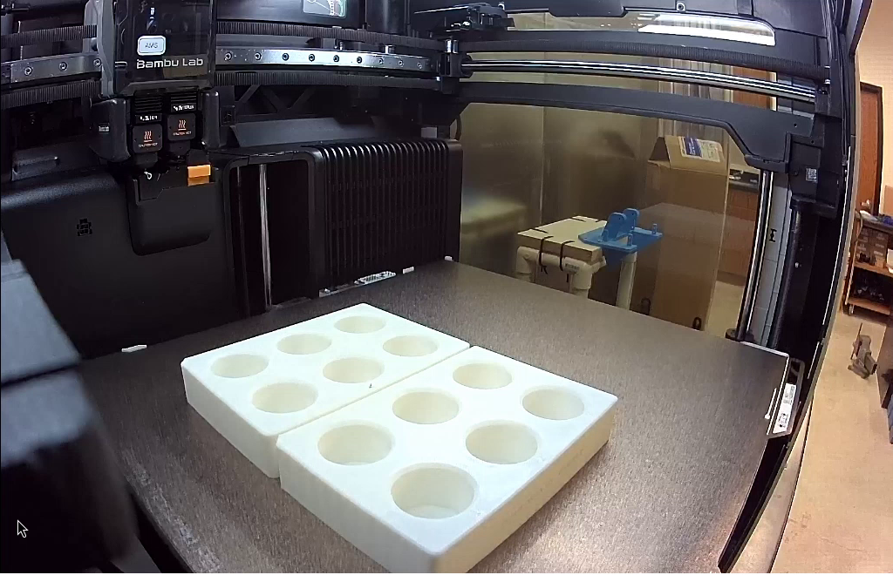

# Print run, 2026-11-16: both vial holders on the H2D, left nozzle

@timothy-commins asked for "the 2 vial holders on the h2d" with the print trigger on
[PR 84](https://github.com/vertical-cloud-lab/digital-wetlab/pull/84#issuecomment-6923281825) (17:04 UTC) and approved
the run himself. The run logged in to the lab's Bambu account in Bambu Studio on the runner and read the H2D
("BYU VCL H2D - Théoden"). It sliced both holders on one plate for the **left 0.4 mm nozzle** in PLA, and sent them at
**17:30:53 UTC**. The right nozzle was still the 0.6 mm TPU high-flow one, and the print doesn't use it.

**Outcome: printed.** Both holders finished at about 20:52:20 UTC, 3 h 21 min after Send (Studio estimated 3 h 15 min,
plus about 9 min of Bambu's start routine). There was no HMS error or dialog, and the nozzle and bed held 220 °C and
55 °C throughout. About a minute later, someone at the printer took both holders off the plate, whole
([`h2d_finished_2052Z.png`](h2d_finished_2052Z.png) is the last frame before that). **The fit of the vials in the
printed pockets hasn't been checked yet.**

## What was new

- **The 2026-11-13 nozzle rule.** Only the nozzles a print uses have to be 0.2 or 0.4 mm. On 11-11 the H2D's right
  0.6 mm nozzle blocked this holder, because the rule then covered both nozzles. Today the same nozzles were in:
  **left 0.4 mm** hardened steel, standard flow; **right 0.6 mm** hardened steel, TPU high flow
  ([`h2d_nozzles_1718Z.png`](h2d_nozzles_1718Z.png)).
- **Studio can't slice for two nozzle sizes at once.** *Sync info* first set both nozzles to 0.6 mm and picked
  `0.30mm Standard @BBL H2D 0.6 nozzle`. Then a *Switch diameter* dialog said: "The software does not support using
  different diameter of nozzles for one print. If the left and right nozzles are inconsistent, we can only proceed with
  single-head printing. Please confirm which nozzle you would like to use for this project", with *Left nozzle: 0.4mm*
  and *Right nozzle: 0.6mm*. After *Left nozzle: 0.4mm*, the printer preset was `Bambu Lab H2D 0.4 nozzle`, and the
  G-code records `nozzle_diameter = 0.4,0.4`, `nozzle_type = hardened_steel,hardened_steel` and
  `nozzle_volume_type = Standard,TPU High Flow`.
- **The sync prompt comes back.** At *Slice plate*, Studio warned that "the nozzle type and AMS quantity information
  has not been synced". *Sync now* opened *Switch diameter* again, and after *Left nozzle: 0.4mm* the same warning came
  back. *Later* let the slice go on. The slice already had the right nozzle types.
- **The Send dialog raised no nozzle warning.** It listed the printer as "Bambu Lab H2D 0.4/0.6mm" and offered only the
  left nozzle for the filament ([`send_dialog_1730Z.png`](send_dialog_1730Z.png)).
- **The first frame couldn't show the whole plate.** The last job (`doser_baseplate_auger_H2D_PLA`, 1250 layers)
  had left the bed lowered, so only the back strip of the plate was in view. That strip was empty, but the run couldn't
  tell about the rest, so it asked a person, as the plate rule says. Once the bed came up after Send, the whole plate
  was in view and empty ([`h2d_camera_bed_up_1732Z.png`](h2d_camera_bed_up_1732Z.png)).
- **Studio turned arc fitting off by itself:** "Curve planning enhancement support detected on your printer. The
  software has automatically disabled arc fitting". The G-code has `enable_arc_fitting = 0`. That changes how curves
  are written (straight segments instead of arcs), not the part.
- **Two copies:** *Clone* in the object's right-click menu (one copy), then *Arrange all objects*, which put them one
  behind the other on the left half of the bed, about 2 mm apart. The `+` key did nothing on the runner.
- **The live view dropped once** right after Send ("Loading failed … [2:2]"). Pressing ▶ brought it back.

## Timeline (UTC)

| Time | What |
| --- | --- |
| 17:04:03 | Request, "please print out the 2 vial holders on the h2d"; approved by the requester |
| 17:12–17:14 | Studio 02.08.02.61 set up on the runner (byu-vcl `bambu/studio/setup_runner.sh` at `703f941`); recording started |
| 17:15:00–17:15:17 | Login: password, then Bambu asked for the authenticator code, and the first `bambu-totp` code worked. *No* to syncing personal data |
| 17:16:02 | Device page, H2D selected: idle, last job `doser_baseplate_auger_H2D_PLA` Finished (100 %, layer 1250/1250). Nozzles 27 and 25 °C, bed 24 °C, chamber 26 °C, all targets 0 |
| 17:17:10 | Live frame ([`h2d_camera_1717Z.png`](h2d_camera_1717Z.png)): the bed lowered, the back strip of the plate empty, the rest out of view |
| 17:18:03 | Nozzles: left 0.4 mm hardened steel, standard; right 0.6 mm hardened steel, TPU high flow |
| 17:18:19 | HMS: only the reminder to clean and lubricate the X rail, the YZ rods and the extruder lift rail ([`h2d_hms_1718Z.png`](h2d_hms_1718Z.png)). Left AMS: A1 empty, A2 black PLA, A3 white PLA, A4 blue PLA; right AMS HT empty |
| 17:19:45 | Frame, state and nozzles posted at the top of the [tracking comment](https://github.com/vertical-cloud-lab/digital-wetlab/pull/84#issuecomment-6923485503), with a request for a person to check the plate |
| 17:21:04 | "plate clear" (timothy-commins) |
| 17:21–17:28 | *Sync info*, *Switch diameter* → left 0.4 mm; the STL imported and cloned; 3 walls, no brim (0.15 mm elephant-foot compensation was already the preset's); sliced |
| 17:26:35 | "`@claude` the plate is clear" (timothy-commins). The mention started a separate `@claude` run, which only replied in the thread |
| 17:27:15 | Studio's slice: 3 h 14 min 49 s, 160.18 g, 115 layers; checked with [`../check_slice_x2.py`](../check_slice_x2.py) ([output](check_slice_x2_output.txt)) |
| 17:29:49 | Second frame, just before Send ([`h2d_camera_presend_1729Z.png`](h2d_camera_presend_1729Z.png)): the same as the first |
| **17:30:53** | **Send**: job `vial_holder_20ml_x6`, PLA from A3 (white) on the left nozzle, Textured PEI plate, timelapse off, bed levelling on, flow dynamics calibration on, nozzle offset calibration off. Uploaded "with LAN acceleration" |
| 17:31:32 | Printing: homing, then the foreign-object check of the bed. Left nozzle 67/140 °C, bed 28/55 °C |
| 17:32:39 | The bed up at the nozzle: the whole plate in view, empty ([`h2d_camera_bed_up_1732Z.png`](h2d_camera_bed_up_1732Z.png)) |
| 17:33–17:39 | Changing filament, flow calibration, nozzle cleaning, bed levelling, vibration compensation |
| 17:40:05 | Layer 1 of 115. Left nozzle 220/220 °C, bed 55/55 °C ([`h2d_layer1_1743Z.jpg`](h2d_layer1_1743Z.jpg) at 17:43:27) |
| 17:51:39 | Layer 2 (layer 1 took about 11.5 min) |
| 17:56:12 | Layer 3 |
| 18:00:10 | Layer 4, 12 %, estimated finish 20:50 |
| 18:02:00 | Layer 6: both bases flat and stuck ([`h2d_layer6_1802Z.jpg`](h2d_layer6_1802Z.jpg)) |
| 18:29:38 | Layer 15, 26 %: the solid bases done, corners flat ([`h2d_layer15_1829Z.jpg`](h2d_layer15_1829Z.jpg)) |
| 19:00:41 | Layer 40, 41 %: the 12 pockets open and round ([`h2d_layer40_1900Z.jpg`](h2d_layer40_1900Z.jpg)) |
| 19:37:31 | Layer 68, 59 % ([`h2d_layer68_1937Z.jpg`](h2d_layer68_1937Z.jpg)) |
| 20:08:52 | Layer 95, 74 % ([`h2d_layer95_2008Z.jpg`](h2d_layer95_2008Z.jpg)) |
| 20:47:15 | Layer 115 of 115, 97 % |
| 20:51:27 | 99 %; Studio already writes "Finished" in place of the estimated finish time (the quirk byu-vcl's runbook describes) |
| ~20:52:20 | The print ends and the bed lowers. Both holders complete on the plate at 20:52:49 ([`h2d_finished_2052Z.png`](h2d_finished_2052Z.png)) |
| 20:52:56–20:53:19 | Someone at the printer takes both holders off the plate (in the raw recording; not published) |
| 20:53:32 | Studio: 100 %, Finished; heater targets 0 |
| 20:57:08 | The plate empty ([`h2d_camera_after_removal_2057Z.png`](h2d_camera_after_removal_2057Z.png)) |
| 20:58:45 | HMS: two maintenance reminders, the one from before and a new "Threaded rods need lubrication now" ([`h2d_hms_after_2058Z.png`](h2d_hms_after_2058Z.png)). No error |
| 20:59:00 | Device page: idle, 100 %, layer 115/115, Finished; left nozzle 67 °C, bed 48 °C, cooling ([`h2d_device_page_final_2059Z.png`](h2d_device_page_final_2059Z.png)). The live view had closed itself ("no printing for a while") |
| 20:59:34 | Signed out of the Bambu account. Studio closed without saving the project. Its config (with the printers' access codes), its WebKit cache and storage, and its temporary slices were deleted |
| 21:00:15 | Recording stopped. The published cut below was made, then the raw recording, which shows the login, was deleted |

## Files

- [`vial_holder_20ml_x6_x2_H2D_PLA_0.4_sent.gcode.3mf`](vial_holder_20ml_x6_x2_H2D_PLA_0.4_sent.gcode.3mf): the 3MF Studio
  uploaded at Send (`/tmp/bamboo_model/…/Metadata/.<pid>.0.3mf`), with the account's `DesignerUserId` blanked. Its plate
  G-code (MD5 `982b5d22920d81c2571e709138dbb96f`) is byte-identical to Studio's slice. It opens in Studio as a project
  with the same settings, so it can be printed again from there.
- [`check_slice_x2_output.txt`](check_slice_x2_output.txt) and [`plate_layout_x2.png`](plate_layout_x2.png): the checks
  below, and a top view of every extrusion move.
- [`send_to_finish_1715-2052Z.mp4`](send_to_finish_1715-2052Z.mp4) (4 min 42 s, 960 × 540, 5.4 MB): the screen recording, cut by
  wall-clock time with byu-vcl's `cut_recording.py`, changed to blur its own boxes per stretch and to scale to 960 px.
  It starts after the login and ends before the holders were taken off. Wherever the camera is on screen, the chamber's
  window onto the room is blurred. A scan for skin tones found no person in it. Chapters:
  - 0:00 Studio: the H2D's frame, nozzles and HMS; slicing two holders; Send (6×)
  - 2:32 Bambu's start routine and layer 1 (12×)
  - 3:22 the print, layers 1 to 115 (180×)
  - 4:26 finished: the bed lowers (2×)
- The frames and screenshots linked above. None shows the login, a serial number or a person.

## Checked in the G-code that was sent

| | Holder 1 (back) | Holder 2 (front) | Model |
| --- | --- | --- | --- |
| Footprint at z 1, 10 and 21 mm | 127.76 × 85.48 mm | 127.76 × 85.48 mm | 127.76 × 85.48 mm (SBS) |
| Pockets at z 6, 12 and 18 mm | all six 28.20 mm | all six 28.20 mm | 28.2 mm |
| On the bed (toolpaths) | x 51.3–178.7, y 161.2–246.3 mm | x 51.3–178.7, y 73.7–158.8 mm | |
| Inside the left nozzle's reach (x 0–325 mm) | yes | yes | |

- **Top layer** at z 23.0 mm; 115 layers.
- **Only the left nozzle prints:** `filament_map = 1`. The hotend commands are `M104 S220 T1`, `M104 S220`,
  `M109 S140 A`, `M104 S220 A` and `M104 S220`, then `M104 S0 T0` and `M104 S0 T1` at the end. Nothing heats `T0`, the
  right nozzle.
- **No prime tower and no wipe** (`enable_prime_tower = 0`, no such features), and no extrusion outside the two objects.
- **Settings:** `Bambu Lab H2D 0.4 nozzle`, `0.20mm Standard @BBL H2D`, `Bambu PLA Basic @BBL H2D`, Textured PEI plate.
  `wall_loops = 3`, `elefant_foot_compensation = 0.15`, `brim_type = no_brim`, 15 % infill, no supports, 220 °C nozzle
  and 55 °C bed: the same as the committed single-holder file
  [`../vial_holder_20ml_x6_H2D_PLA_0.4.gcode.3mf`](../vial_holder_20ml_x6_H2D_PLA_0.4.gcode.3mf), but with two copies
  and arc fitting off.

## Still to check

- **The vials in the pockets.** Try several in each of the 12 pockets before the holders go on the OT-2. The pockets
  were sliced at 28.20 mm for vials calipered at 27 mm across and 55 mm tall.
- **The new vials are a different kind.** The six bought on 2026-11-16 (ChemStores 0011486, "VIAL, W/NECK 5 DRAM W/CAP",
  [photo](https://github.com/vertical-cloud-lab/digital-wetlab/pull/84#issuecomment-6927268329)) are 5-dram vials with
  a neck and a snap cap, not the 20 mL screw-cap vials the holder and its labware definition were built around. Caliper
  one (outside diameter, and height without the cap) and try it in a pocket. If it differs, the holder's `VIAL` in
  [`../../../vial_holder.py`](../../../vial_holder.py) and the labware definition need the new numbers, even if the
  vial drops in: the robot takes the height of the vial tops from the definition.
- **The H2D's maintenance reminders.** HMS now asks for the X rail, the YZ rods and the extruder lift rail to be cleaned
  and lubricated, and for the threaded rods to be lubricated.
