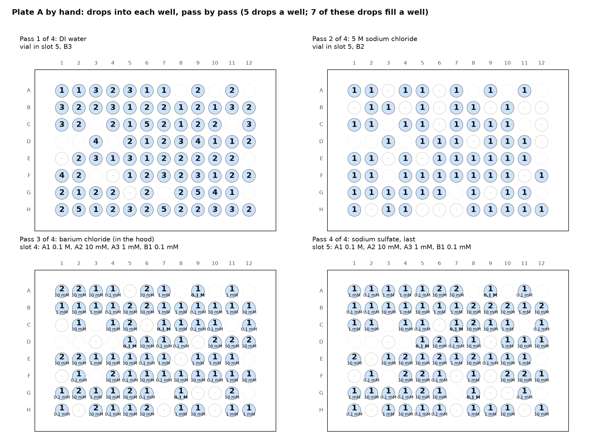

# Plate A by hand, in drops

Asked on [PR 84](https://github.com/vertical-cloud-lab/digital-wetlab/pull/84) by @timothy-commins on 2026-11-17:
can the plate be filled by hand, counting drops from a pipette, and which wells get which solution? Then, the same
night: **7 of his drops fill a well**, so the first version's 10 drops a well would overflow. This version gives
**each well 5 drops**. The 10-drop version, for drops of 30 µL or less, is at
[`747a208`](https://github.com/vertical-cloud-lab/digital-wetlab/blob/747a208/docs/baso4-sop-3d/protocol/fill-by-hand.md),
and `python hand_fill.py --drops-per-well 10` makes its sheets again.

**5 drops a well, from the same ten vials.** With 7 drops to a full well, 5 fill it about three-quarters of the way:

| The robot puts in (200 µL a well) | By hand (5 drops a well) | In the well |
| --- | --- | --- |
| 40 µL of 5 M NaCl | 1 drop | 1 M, as planned |
| 20 µL of a barium or sulfate vial | 1 drop | a fifth of the vial's strength (the robot's: a tenth) |
| 60 µL of the 10 mM vial | 2 drops | 4 mM (the robot's: 3 mM) |
| water, up to 200 µL | water, up to 5 drops | |

- **Why 5.** It's the fewest drops that still fit the strongest wells. E1, F4 and G5 get 1 drop of NaCl, 2 of barium and
  2 of sulfate, and no water. Six drops would leave too little room above the liquid to stir and seal.
- **The drop size still cancels out.** A well's barium, sulfate and NaCl depend only on how many of its 5 drops came
  from each vial. What matters is that all the drops are **the same size**, and that you count right.

| File | What it is |
| --- | --- |
| [`hand_fill_sheets.pdf`](hand_fill_sheets.pdf) | **Print this.** Four pages, one per pass, with the plate drawn at its real size and the number of drops in each well. Stand the plate on the outline and each well's number shows through its clear bottom. The lists under the plate are to tick off; the sulfate page has a blank for each well's time |
| [`hand_fill_overview.png`](hand_fill_overview.png) | The four pages' plates on one image |
| [`hand_fill_drops.csv`](hand_fill_drops.csv) | Every well: drops of each liquid and which vial, the barium, sulfate and NaCl they give, barite's saturation index, and the robot's barium and sulfate for comparison |
| [`hand_fill.py`](hand_fill.py) | Makes the three files above from [`plate_map.csv`](plate_map.csv), and checks every well's concentrations |

## What changes from the robot's plate

**Every barium and sulfate level doubles.** One drop is now a fifth of the well, not a tenth. The "3 mM" level
becomes 4 mM, because 2 drops is the most that fits. The NaCl stays at 1 M.

| Vial | The robot: 20 µL in 200 | By hand: 1 drop in 5 |
| --- | --- | --- |
| 0.1 mM | 0.01 mM | 0.02 mM |
| 1 mM | 0.1 mM | 0.2 mM |
| 10 mM | 1 mM | 2 mM |
| 10 mM, the high level | 3 mM (60 µL) | 4 mM (2 drops) |
| 0.1 M, the four controls | 10 mM | 20 mM |
| 5 M NaCl | 1 M (40 µL) | 1 M (1 drop) |

**So every well is more supersaturated.** Barite's saturation index (SI) in the 1 M NaCl wells, from PHREEQC's
`pitzer.dat` at 25 °C, as in the 10-30 table (barium down, sulfate across; the robot's value in brackets):

| Barium \ sulfate | 0.02 mM (0.01) | 0.2 mM (0.1) | 2 mM (1) | 4 mM (3) |
| --- | --- | --- | --- | --- |
| **0.02 mM (0.01)** | −1.4 (−2.0) | −0.4 (−1.0) | +0.6 (0.0) | +0.9 (+0.5) |
| **0.2 mM (0.1)** | −0.4 (−1.0) | +0.6 (0.0) | +1.6 (+1.0) | +1.9 (+1.5) |
| **2 mM (1)** | +0.6 (0.0) | +1.6 (+1.0) | +2.6 (+2.0) | +2.9 (+2.5) |
| **4 mM (3)** | +0.9 (+0.5) | +1.9 (+1.5) | +2.9 (+2.5) | +3.2 (+2.9) |

- **The nine wells meant to sit right at saturation (SI 0) are now at +0.6:** B2, G4, F6, B7, E7, H8, H4, G6 and C9.
  They may turn white within the 72 h.
- **Nine wells are still undersaturated,** at −1.4 and −0.4: H1, F2, D7, G1, A4, C10, G3, E9 and A11. They should stay
  clear. If one turns white, suspect a miscount or a stray drop.
- **The 16 wells without NaCl are all supersaturated now,** from +0.4 (C12, which was −0.2) to +4.6.
- **The controls** (D5, C7, G8, A9) are at 20 mM each, SI +4.5.
- **Use [`hand_fill_drops.csv`](hand_fill_drops.csv) for the analysis,** not `plate_map.csv`. It has each well's
  concentrations and SI as filled by hand. The SI there takes 1 M NaCl as 1 mol/kg, as the 10-30 table did.
- **To keep the robot's concentrations,** fill the plate with the robot, with a 20-200 µL hand pipette, or with
  fine-tip transfer pipettes (drops of about 20 µL) and the 10-drop sheets.

## 1. Check your drops first (about 10 minutes)

**First, 5 drops should leave room at the top.** Put 5 drops of DI water into one well of a spare plate. If you have no
spare plate, use one of plate A's empty wells (A12, say). The water should come about three-quarters of the way up,
with a few millimetres of clear wall above it.
- If it's nearly full, your drops are bigger than 7 to a well. Stop and post a photo on PR 84.
- If this test, or your 7-drop test, went into one of plate A's wells, draw the water back out with the same pipette
  and dab the well dry with the corner of a wipe.

**Then check that your drops are even. Weigh 5 drops of DI water, three times:**
1. On the HR-100A, put an empty weigh boat on the pan, close the lid and press RE-ZERO. This tares the boat, as in
   2.14.
2. Hold the pipette upright, its end about 1 cm above the boat, and squeeze slowly, so each drop forms and falls on
   its own. Count 5.
3. Close the lid, wait for the small circle and write the reading down. Then RE-ZERO again with the same boat and
   repeat, twice more.

| The three readings (5 drops each) | What it means |
| --- | --- |
| **within 0.02 g of each other** | **Go ahead.** A drop is the reading ÷ 5 in mL: 0.27 g is 54 µL a drop, and each well ends at about 270 µL |
| more than 0.02 g apart | Your drops are uneven. Hold the pipette upright, squeeze more slowly, and weigh again |

Use the same kind of pipette for every liquid. Write the three readings and the pipette's make in the log.

## 2. The rules for every drop

- **One pipette for each vial:** ten in all. Lay each one on a wipe labelled with its vial, or write the vial on its
  bulb with a marker, so they can't get swapped.
- **Hold it upright, its end just above the well's opening and centred over it.** Don't touch the plate or the
  liquid in the well. Squeeze slowly, one drop at a time, and let each one fall on its own. Count out loud. Rest your
  wrist on something if it helps.
- **The pipette never touches a well or what's in it.** Then it can go back into its own vial for more. If it does
  touch, put it in the barium solid waste and take a new one before you draw again.
- **Refill before the stem runs low.** The last drop out of a nearly empty pipette comes with air and is smaller.
- **Don't fix a mistake.** If a drop lands on the rim or between wells, or you lose count, don't try to take liquid
  out of a well. Dab the plate dry with the corner of a dry wipe, and write the well and what happened in the log.
  Its real contents can be worked out afterwards.
- **Practise first:** a few drops into a spare plate, until they land in the middle of the well every time.

## 3. Set up

1. **Print [`hand_fill_sheets.pdf`](hand_fill_sheets.pdf) at 100 %** ("Actual size", not "Fit to page"). Check the
   bar under the plate with a ruler: it should measure 100 mm. Slip each page into a clear sheet protector. Each page
   says "5 drops in all" at the top. If it says 10, it's the old version.
2. **Gloves, lab coat and safety glasses** on. Cap the ten vials and take them, in their two holders, and the plate
   out of the OT-2, to the hood. There you can look straight down into the wells, and the barium goes into the plate
   in the hood, as in 2.12.
3. **In the hood:** the liner and the tray, the barium waste, the ten pipettes, a full rack of Opentrons 300 µL tips
   (84 of them stir the wells), dry wipes, the printed pages and a pen, and a clock you can see, with minutes.
4. **The DI water vial (slot 5, B3)** gives 178 drops, about 10 mL at 55 µL a drop. It holds about 15 mL, so it
   should last. Top it up from the bottle that has only held DI water if it gets low.
5. **Put the page for pass 1 under the plate,** the plate on the outline with A1 at the top left. Uncap only the vial
   you're using.

## 4. The four passes

Water, then NaCl, then barium chloride, then sodium sulfate last, the same order as the robot. Before each pass, swap
the page under the plate for that pass's page. Tick each well off on the page as you go.

| Pass | Vial | Drops | About |
| --- | --- | --- | --- |
| 1 | DI water, slot 5 B3 | 1-5 a well (none in E1, F4 and G5), 178 in all | 10 min |
| 2 | 5 M NaCl, slot 5 B2 | 1 in each of 64 wells | 5 min |
| 3 | barium chloride, slot 4 (four vials, one pipette each) | 1 or 2 a well, 89 in all | 10 min |
| 4 | sodium sulfate, slot 5 (four vials, one pipette each), then a stir | 1 or 2 a well, 89 in all | 25 min |

The times are my guesses.

**Pass 1, DI water** (slot 5, B3):
- 5 drops: H2, C6, H7, G9
- 4 drops: F1, D3, D9, G10
- 3 drops: B1, C1, A3, E3, B4, A5, E5, H5, F7, D8, F9, H10, B11, H11, C12
- 2 drops: G1, H1, B2, C2, E2, F2, B3, G3, A4, C4, G4, H4, D5, B6, F6, G6, H6, B7, C7, D7, E7, E8, F8, G8, H8, A9,
  B9, C9, E9, H9, C10, E10, A11, E11, F11, B12, D12, F12, H12
- 1 drop: A1, A2, G2, H3, E4, B5, C5, F5, A6, D6, E6, A7, B8, C8, B10, D10, F10, D11, G11
- no water: E1, F4, G5

**Pass 2, 5 M NaCl** (slot 5, B2), 1 drop each: A1, C1, E1, F1, G1, H1, A2, B2, C2, E2, F2, G2, B3, D3, G3, H3, A4,
C4, E4, F4, G4, H4, A5, B5, C5, D5, F5, G5, D6, E6, F6, G6, A7, B7, C7, D7, E7, F7, B8, C8, E8, F8, G8, H8, A9, C9, D9,
E9, F9, H9, B10, C10, D10, E10, F10, G10, H10, A11, D11, E11, G11, H11, F12, H12

**Pass 3, barium chloride** (slot 4), weakest vial first, one pipette per vial:
- **0.1 mM** (B1), 1 drop: G1, H1, F2, A4, B4, H4, F5, E6, G6, D7, F7, D8, B9, C9, C10, F10, C12
- **1 mM** (A3), 1 drop: B1, B3, E3, G3, A7, B7, E7, B8, C8, H8, E9, E10, A11, B11, F11, H11, H12
- **10 mM** (A2), 1 drop: B2, C2, A3, C4, E4, G4, E5, H5, D6, F6, F8, F9, H9, B10, E11, B12, F12
- **10 mM** (A2), **2 drops**: A1, E1, A2, E2, G2, H3, F4, B5, C5, G5, A6, B6, H6, D10, D11, G11, D12
- **0.1 M** (A1), 1 drop: D5, C7, G8, A9

Cap each barium vial when you're done with it.

**Pass 4, sodium sulfate, last** (slot 5), weakest vial first, one pipette per vial. **Each well's clock starts with
its sulfate.** For each well, in this order:
1. its drops;
2. stand the pipette back in its own vial, and write the time next to the well's box on the page (a helper who
   writes the times as you call them out makes this quicker);
3. **stir it:** hold a fresh 300 µL tip by its wide end, put its point into the liquid without touching the bottom,
   stir 5 small circles and lift it out. It goes in the barium solid waste. The wells are fuller than before, so
   stir gently.

- **0.1 mM** (B1), 1 drop: B1, H1, A2, B2, F2, G3, G4, A5, C5, H5, F6, H6, D7, E9, A11, G11, C12
- **1 mM** (A3), 1 drop: A1, C1, G1, A3, H3, A4, B4, B6, B7, E7, F8, H8, H9, C10, D10, B11, E11
- **10 mM** (A2), 1 drop: C2, G2, B3, E3, C4, H4, B5, E5, G6, D8, C9, E10, H10, D11, D12, F12, H12
- **10 mM** (A2), **2 drops**: E1, E4, F4, F5, G5, A6, D6, E6, A7, B8, C8, E8, B9, B10, F10, F11, B12
- **0.1 M** (A1), 1 drop: D5, C7, G8, A9

**Then stir the 12 wells that get no sulfate,** the same way, so every well has been stirred once: E2, F7, F9 and H11
(barium only), F1, D3, D9 and G10 (NaCl blanks), and H2, C6, H7 and G9 (water blanks). That's 84 tips in all.

**Why weakest first.** The strongest pairs and the controls turn white within minutes. Going weakest first gives
them their sulfate last, so they start closest to when the phone does. Each well's own time is on the page, so the
order doesn't change the results.

**Why stir.** Without it, the sulfate drop sits as a layer on top: in the NaCl wells it's lighter than the brine
under it, and diffusion takes hours to even it out. The robot protocol mixes by default for the same reason (see
[the mixing](README.md#the-mixing)). Stirring by hand isn't the robot's mix, but every well gets the same, and the
log says how it was done.

## 5. After the fill

1. **Seal the plate:** lay the clear seal on and press it down well by well.
2. **Carry it level to the OT-2.** The wells are about three-quarters full, so walk slowly. The black paper goes on
   the Heater-Shaker's adapter, and the plate on top, A1 at the back left.
3. **Turn the rail lights on and leave them on** (in the OT-2 App: the robot's ⋮ menu → Lights). The photos need the
   same light day and night. If the App isn't connected, say so on PR 84.
4. **Set up the phone** on its tripod: every 2 minutes, as on 11-16. Write down the time of the first photo.
5. **Recap the vials**, each with its own cap. Used pipettes, tips and wipes go in the barium solid waste.
6. **The log:** "by hand, 5 drops a well"; your three drop weighings and the pipette's make; when each pass started
   and ended; any slip (which well, what happened); "stirred by hand, 5 circles with a 300 µL tip"; and the sulfate
   page with every well's time. Post a photo of the pages on PR 84.

## How accurate it is

| | The robot | Drops by hand |
| --- | --- | --- |
| Concentrations | the plan's | twice the plan's barium and sulfate (4 mM for the plan's 3), the same NaCl. See [what changes](#what-changes-from-the-robots-plate) |
| Each dose | the P300's accuracy at 20 µL | as even as your drops. With drops within about 5 % of each other, a well's barium and sulfate are within about 5 % of [`hand_fill_drops.csv`](hand_fill_drops.csv), and its SI within about ±0.04 (my estimate) |
| The 5 M NaCl | 1.00 M in the well | about 0.95 M. Its drops are about 5 % smaller than water's, because it's denser and has a higher surface tension (my estimate). That barely changes anything |
| A slip | rare | **the big risk.** An extra drop in a 1-drop well doubles that ion. One water drop too many or too few changes the whole well by a fifth or so |
| Start times | to the second, in the run log | to the minute, as written |
| Mixing | 3 × 80 µL, the same in every well | a stir by hand, nearly the same in every well |

**What's the same either way:** the vials, the plate's layout, the order (sulfate last), the seal, and the phone
going in after the fill.

**Not tried:** nobody here has filled a plate this way. The 7-drop figure is Timothy's; the accuracy figures are my
estimates. Your three weighings tell you what your pipette really does.
