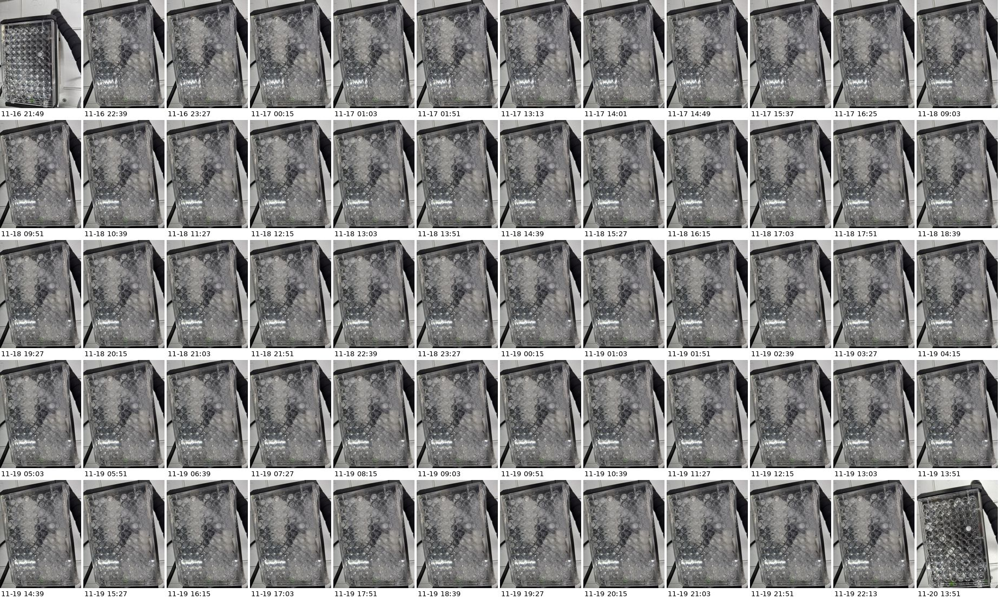

# Plate A's phone photos

The photos themselves are in the **draft release `plate-a-photos`** of this repo, not in git: 1,382 JPEGs,
5.16 GB. Only people with write access to the repo can see a draft. Find it on the
[releases page](https://github.com/vertical-cloud-lab/digital-wetlab/releases), or download it with:

```
gh release download plate-a-photos --repo vertical-cloud-lab/digital-wetlab --dir plate-a-photos
```

This folder has only the list of the photos and a few small previews, with no metadata in the previews.

## What's in the release

- **Four zips** of 1.26–1.31 GB, each under GitHub's 2 GB limit for one file. They hold the photos uncompressed,
  in time order. Extract all four into one folder to get back the folder `ot-2 experiment pics/` from Tim's zip.
- **The photos are byte for byte as Tim uploaded them.** Tim zipped them on 11-20 and put the zip on Google Drive
  ("ot-2 experiment pics.zip", 5,148,954,747 bytes, sha256 `56abc2b8…2811a7d`). A Claude run downloaded it
  at 22:17 UTC on 11-20 and repacked the photos into the four zips. It then downloaded the zips back from the
  release and checked every photo's sha256 against the Drive zip. All 1,382 matched. The share link isn't
  recorded here, because this repo is public.
- [`photos.csv`](photos.csv) has one row per photo: which zip it's in, its size and sha256, when it was taken
  (from its own EXIF, local and UTC), its exposure, and notes. [`SHA256SUMS.txt`](SHA256SUMS.txt) has the sha256
  of each zip and each photo.
- **The camera:** a Samsung Galaxy A12 (SM-A125U) on a tripod, 4608 × 3456 px, EXIF rotation 6 (portrait). The
  times are the phone's clock, with its UTC offset (−07:00) stored in each photo. **No photo has a GPS location.**

## When there are photos

Every 2 minutes, but only for 46 of the 72.4 hours. The app took no photos during two long gaps:

| | Local time (UTC−7) | UTC | Hours from the first photo of the plate | Photos |
| --- | --- | --- | --- | --- |
| Test shot | 11-16 21:45:09 | (no offset stored) | −0.07 | 1, of a bench, not the plate |
| **Run 1** | 11-16 21:49:33 – 11-17 02:29:30 | 11-17 04:49 – 09:29 | 0 – 4.7 | 140 |
| *Gap* | 11-17 02:29 – 13:05 | 09:29 – 20:05 | 4.7 – 15.3 | **none for 10.6 h** |
| **Run 2** | 11-17 13:05:30 – 17:05:30 | 11-17 20:05 – 11-18 00:05 | 15.3 – 19.3 | 121 |
| *Gap* | 11-17 17:05 – 11-18 08:57 | 11-18 00:05 – 15:57 | 19.3 – 35.1 | **none for 15.9 h** |
| **Run 3** | 11-18 08:57:30 – 11-19 22:13:30 | 11-18 15:57 – 11-20 05:13 | 35.1 – 72.4 | 1,119 |
| After the run | 11-20 13:51:38 | 11-20 20:51 | 88.0 | 1, wrap off |

At one photo every 2 minutes, 72.4 hours would be about 2,173 photos; there are 1,380. Within each run the
spacing is 2 minutes, except for two 4-minute steps in the first 10 minutes. Both gaps end in working hours
(13:05 and 08:57), so perhaps the app stopped and someone restarted it. The photos can't show why it stopped.



*Every 24th photo, 48 minutes apart, then the last of the series and the 11-20 photo. Each is labelled with its
local time.*

## What the photos show

- **Rows A–H run left to right and columns 1–12 run bottom to top** (the plate's own labels are moulded along its
  bottom and left edges in the pictures). So A1 is at the bottom left and H12 at the top right.
- **The first two photos of the plate (21:49 and 21:51) have no plastic wrap.** From 21:55 on, every photo of the
  series is taken through the wrap. The wrap reflects the room's light, so a band across the plate looks washed
  out, and by 11-19 many wells have **drops of condensation on the wrap above them**.
- **The 11-20 photo was taken with the wrap off,** and it's the clearest picture of how the plate ended up.


- **The picture jumps at nine points in the series** (`view_jump` in `photos.csv`): four times while the phone
  was being set up on 11-16 (21:51–21:59), then at 11-17 13:05, 15:23 and 16:45, and at 11-18 08:57 and 11:07.
  At each, the photo differs from the one before by more than 5 grey levels on average (on a 0–255 scale, at
  1/8 size). The median difference between consecutive photos is 0.7. Which moved, the phone, the plate or the
  light, isn't checked.
- **Exposure:** every photo of the series from 21:55 on is 1/120 s at ISO 50. White balance is automatic.

## For the analysis

- **Register the plate again after every jump** above. The phone's position isn't the same in runs 1, 2 and 3.
- **Condensation and glare change the brightness of a well** without any barium sulfate. Compare each well with
  itself and with the blank wells near it, not with a fixed threshold, and check a well that seems to turn
  against the 11-20 photo.
- **Each well's time zero is its sulfate time** on Tim's pass-4 sheet. Those times and the clock they came from
  aren't in the repo yet.
- **The wells that turn within minutes are lost anyway.** The first photo of the plate was taken after the fill.

## How this folder was made

The scripts are in [`tools/`](tools/). Run them with `python3 -E -P`; they need Pillow and numpy.
- `exif_inventory.py` reads each photo's EXIF into a CSV.
- `make_parts.py` repacks the Drive zip into the four zips.
- `verify_parts.py` checks every photo in the downloaded zips against the sha256 list made from the Drive zip.
- `frame_diffs.py` finds the jumps.
- `manifest.py` writes `photos.csv` and `SHA256SUMS.txt`.
- `previews.py` makes the three pictures, with no EXIF.
