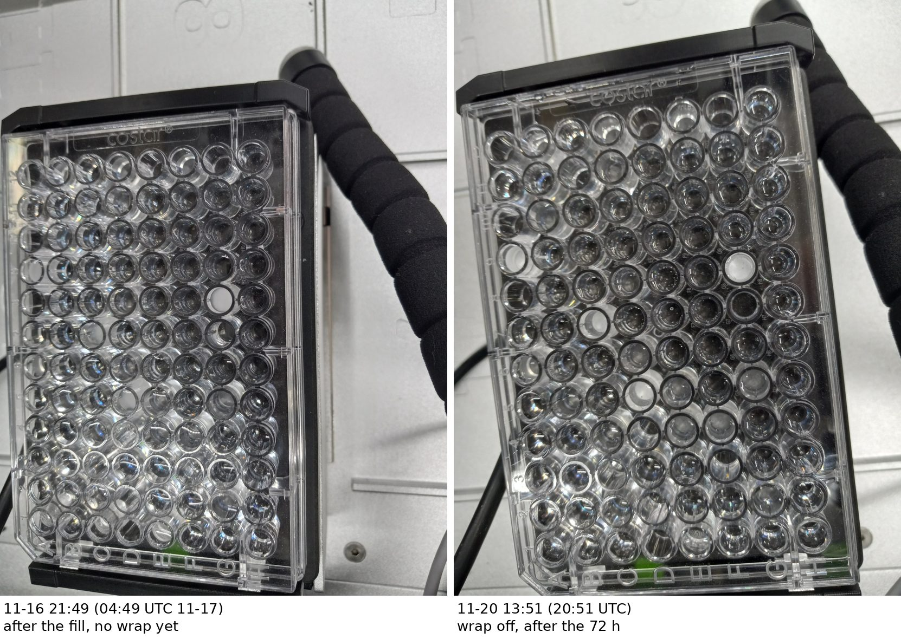
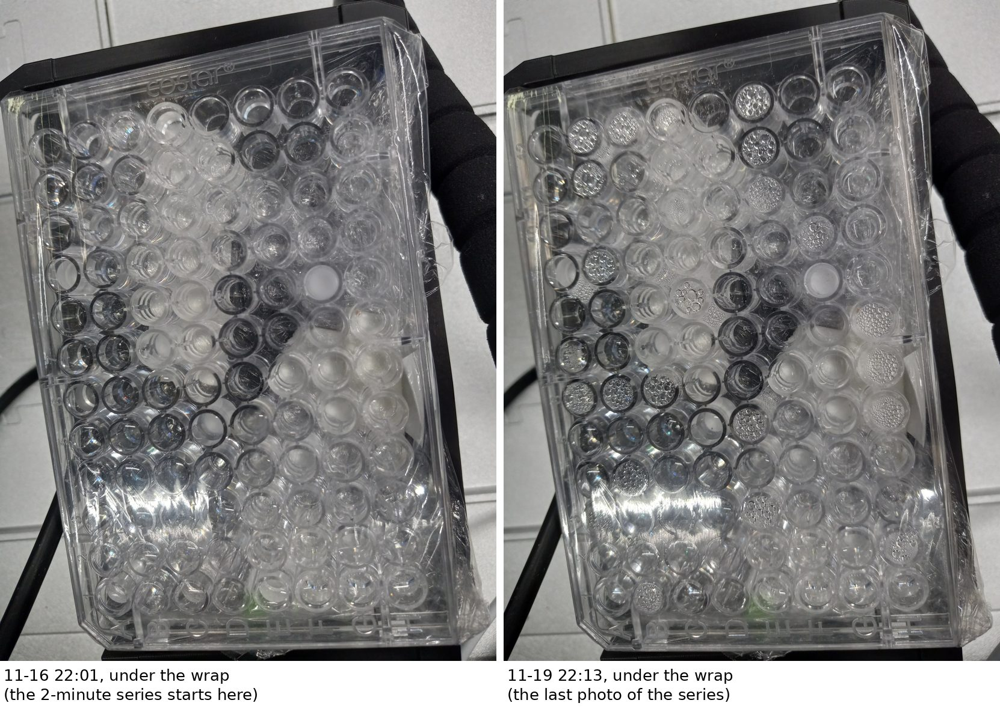
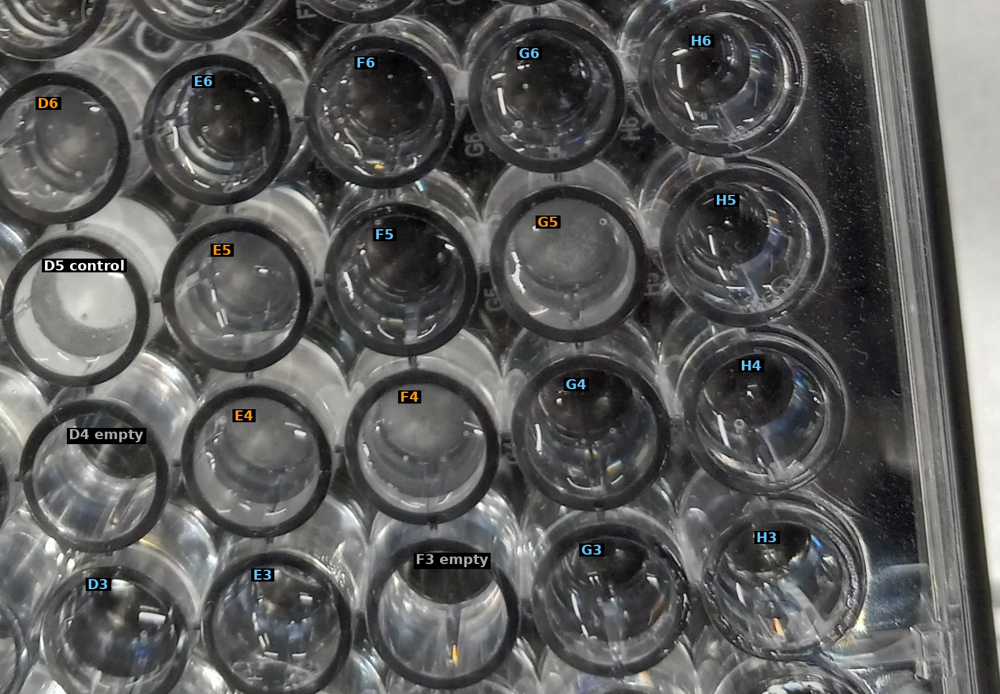
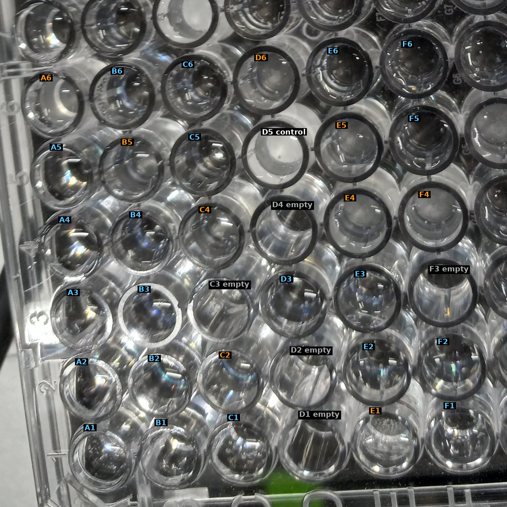

# Plate A's phone photos

The photos themselves are in the **draft release `plate-a-photos`** of this repo, not in git: 1,382 JPEGs,
5.16 GB. Only people with write access to the repo can see a draft. Find it on the
[releases page](https://github.com/vertical-cloud-lab/digital-wetlab/releases), or download it with:

```
gh release download plate-a-photos --repo vertical-cloud-lab/digital-wetlab --dir plate-a-photos
```

This folder has only the list of the photos and a few small previews, with no metadata in the previews.

## What's in the release

- **Four zips** of 1.26–1.31 GB, each under GitHub's 2 GB limit for one file. They hold the photos uncompressed,
  in time order. Extract all four into one folder to get back the folder `ot-2 experiment pics/` from Tim's zip.
- **The photos are byte for byte as Tim uploaded them.** Tim zipped them on 11-20 and put the zip on Google Drive
  ("ot-2 experiment pics.zip", 5,148,954,747 bytes, sha256 `56abc2b8…2811a7d`). A Claude run downloaded it
  at 22:17 UTC on 11-20 and repacked the photos into the four zips. It then downloaded the zips back from the
  release and checked every photo's sha256 against the Drive zip. All 1,382 matched. The share link isn't
  recorded here, because this repo is public.
- [`photos.csv`](photos.csv) has one row per photo: which zip it's in, its size and sha256, when it was taken
  (from its own EXIF, local and UTC), its exposure, and notes. [`SHA256SUMS.txt`](SHA256SUMS.txt) has the sha256
  of each zip and each photo.
- **The camera:** a Samsung Galaxy A12 (SM-A125U) on a tripod, 4608 × 3456 px, EXIF rotation 6 (portrait). The
  times are the phone's clock, with its UTC offset (−07:00) stored in each photo. **No photo has a GPS location.**

## Where the photos are kept

- **Once Tim deletes the Google Drive copy (Tim asked on 11-20), this draft release is the only copy on record.**
  Tim can't keep a copy on a personal device or a personal Drive, so the second copy has to go in one of the lab's
  accounts ([below](#a-second-copy-outside-github-not-made-yet)). Before the Drive copy goes, a Claude run checked
  everything again at 22:44–22:49 UTC on 11-20 ([output](recheck_2026-11-20.txt)):
  - **The release:** downloaded again, all four zips and all 1,382 photos match `SHA256SUMS.txt` and `photos.csv`,
    and every photo opens as a complete 4608 × 3456 JPEG.
  - **The Drive zip:** downloaded again, it was still the same 5,148,954,747 bytes, with the same sha256. Every one
    of its 1,382 files is in the release, byte for byte, with the same file date.
- **A draft release doesn't expire, but anyone with write access to this repo can delete it,** and GitHub's docs
  give no way to restore a deleted release. So **don't delete the release, or any file in it,** without asking
  Sterling. At 23:03 UTC on 11-20 it still had all six files, 5,163,071,280 bytes in all.
- **Only what was in Tim's zip is here.** If the phone saved any photos during the two gaps below, they aren't in
  the release.
- **To check the release again:** download it as above, then run `tools/recheck_release.py` (standard library only)
  and `tools/decode_all.py` (needs Pillow).
- **To edit the draft through the API, pass `tag_name=plate-a-photos` as well.** On 11-20 an edit of only its
  description reset the tag name to an `untagged-…` placeholder, and `gh release download plate-a-photos` stopped
  finding it until the name was set back.

### A second copy outside GitHub: not made yet

Where the photos are kept for good is Sterling's call (decision 5 of the
[monitoring plan](https://github.com/vertical-cloud-lab/digital-wetlab/blob/ad0b513/docs/baso4-extended-monitoring.md#decisions-before-the-first-run),
which suggests AWS, Box or Drive). On 11-20 a Claude run looked for lab storage it could copy them to, and found
none that this repo's runs can reach. Their only keys are for GitHub, Edison, Onshape and the stream-camera Pi.

| Where | Can a run in this repo write to it? | Notes |
| --- | --- | --- |
| **Zenodo**, the lab's account | No. `ZENODO_API_TOKEN` (deposit:write and deposit:actions) is only given to byu-vcl's runs | Made for keeping research data. A published record is kept for the lifetime of the repository, which is tied to CERN's (at least 20 years), and can be withdrawn but not deleted ([policies](https://about.zenodo.org/policies)). Its files can be restricted, but its title, description and authors are always public ([help](https://help.zenodo.org/docs/deposit/about-records)). A draft is seen only by its owner and whoever it's shared with ([sharing](https://help.zenodo.org/docs/share/link-sharing/)). A record takes up to 50 GB and 100 files, so the release's six files fit in one |
| **Hugging Face**, the `byu-vcl` account | No. `HF_TOKEN` is only given to byu-vcl's runs | A private dataset shows nothing publicly. A free account has 100 GB of private storage ([limits](https://huggingface.co/docs/hub/storage-limits)). Anyone with the token can delete it, so it's a second copy, not an archive |
| Sterling's OneDrive | No | Where byu-vcl archived the lid-camera Pi's files on 11-10 |
| Box | No | byu-vcl lists "a Box share link for image backup" as not yet set up |
| AWS | No | Seth had "software/AWS stuff" ready for the lid camera in June ([byu-vcl 34](https://github.com/vertical-cloud-lab/byu-vcl/issues/34#issuecomment-4791750994)). Neither repo's workflow has an AWS key |
| MongoDB Atlas, database `digital-wetlab` | No | Meant for one record per still or reading, not for photos. The cluster is Atlas's free M0 tier |

**For a run here to make the copy:**

1. Sterling adds `ZENODO_API_TOKEN` (or `HF_TOKEN`) as a secret of this repo, with the value byu-vcl uses, and adds
   the line `ZENODO_API_TOKEN: ${{ secrets.ZENODO_API_TOKEN }}` (or the `HF_TOKEN` one) to the job `env:` in
   `.github/workflows/claude.yml` on `main`, next to `GH_READ_PAT_STAGING`. A Claude run can't edit workflow files.
2. Then a `@claude` comment here asks for the copy. That run should:
   - download the release's six files into a new folder under `/tmp` and check them with `tools/recheck_release.py`;
   - upload the six files unchanged, either to a Zenodo draft or to a private Hugging Face dataset in the
     `byu-vcl` account. Publish a Zenodo record only if Sterling says so, with the files restricted, since
     publishing makes the title and description public for good;
   - download them back from there into a fresh folder and check every sha256 again;
   - record here where the copy is (the Zenodo record ID or the dataset name) and when it was checked. Don't post
     a share link.

## When there are photos

Every 2 minutes, but only for 46 of the 72.4 hours. The app took no photos during two long gaps:

| | Local time (UTC−7) | UTC | Hours from the first photo of the plate | Photos |
| --- | --- | --- | --- | --- |
| Test shot | 11-16 21:45:09 | (no offset stored) | −0.07 | 1, of a bench, not the plate |
| **Run 1** | 11-16 21:49:33 – 11-17 02:29:30 | 11-17 04:49 – 09:29 | 0 – 4.7 | 140 |
| *Gap* | 11-17 02:29 – 13:05 | 09:29 – 20:05 | 4.7 – 15.3 | **none for 10.6 h** |
| **Run 2** | 11-17 13:05:30 – 17:05:30 | 11-17 20:05 – 11-18 00:05 | 15.3 – 19.3 | 121 |
| *Gap* | 11-17 17:05 – 11-18 08:57 | 11-18 00:05 – 15:57 | 19.3 – 35.1 | **none for 15.9 h** |
| **Run 3** | 11-18 08:57:30 – 11-19 22:13:30 | 11-18 15:57 – 11-20 05:13 | 35.1 – 72.4 | 1,119 |
| After the run | 11-20 13:51:38 | 11-20 20:51 | 88.0 | 1, wrap off |

At one photo every 2 minutes, 72.4 hours would be about 2,173 photos; there are 1,380. Within each run the
spacing is 2 minutes, except for two 4-minute steps in the first 10 minutes. Both gaps end in working hours
(13:05 and 08:57), so perhaps the app stopped and someone restarted it. The photos can't show why it stopped.


*Every 24th photo, 48 minutes apart, then the last of the series and the 11-20 photo. Each is labelled with its
local time.*

## What the photos show

- **Rows A–H run left to right and columns 1–12 run bottom to top** (the plate's own labels are moulded along its
  bottom and left edges in the pictures). So A1 is at the bottom left and H12 at the top right.
- **The first two photos of the plate (21:49 and 21:51) have no plastic wrap.** From 21:55 on, every photo of the
  series is taken through the wrap. The wrap reflects the room's light, so a band across the plate looks washed
  out, and by 11-19 many wells have **drops of condensation on the wrap above them**.
- **The 11-20 photo was taken with the wrap off,** and it's the clearest picture of how the plate ended up.





- **The picture jumps at nine points in the series** (`view_jump` in `photos.csv`): four times while the phone
  was being set up on 11-16 (21:51–21:59), then at 11-17 13:05, 15:23 and 16:45, and at 11-18 08:57 and 11:07.
  At each, the photo differs from the one before by more than 5 grey levels on average (on a 0–255 scale, at
  1/8 size). The median difference between consecutive photos is 0.7. Which moved, the phone, the plate or the
  light, isn't checked.
- **Exposure:** every photo of the series from 21:55 on is 1/120 s at ISO 50. White balance is automatic.

## A first look, by eye, at the 11-20 photo

On 11-20 Tim saw white only in the four 20 mM controls (A9, C7, D5, G8). The plan expected the 16 wells with at
least 2 mM of both barium and sulfate to precipitate too
([PR comment](https://github.com/vertical-cloud-lab/digital-wetlab/pull/84#issuecomment-7051678819)). Here are
those wells (orange labels) in close-ups of the 11-20 photo, which was taken without the wrap. The labels were
placed by eye using the plate's moulded row and column labels. The empty wells D1, D2, C3, D4 and F3 look empty
in the photo, as the plate map says, which confirms the grid.





- **E4, F4, G5, E5 and D6 have a grey haze in them,** not the white of the D5 control. Wells with 0.02 mM of either
  ion look dark, among them F5, G4, H4, H5, F6 and G6. Each of those can make only about 1 µg of barium sulfate.
- **E1 has a grey, grainy patch on its floor.**
- **A6 looks paler than its neighbours,** but it's at the edge of the plate, where the plate's side reflects light.
- **Can't tell from this photo:** B5, C4 and C2 (glare), G2, and B10, D11, D12, B12 and F12. The phone looks
  into columns 10–12 at a slant, so it sees their walls, not their floors.

This is one look at one photo, by eye. Measuring every well in every photo against its own start, and against
the blanks, is the analysis still to do.

## For the analysis

- **Register the plate again after every jump** above. Runs 2 and 3 each start with one, so don't assume the
  plate sits on the same pixels in all three runs.
- **Condensation and glare change the brightness of a well** without any barium sulfate. Compare each well with
  itself and with the blank wells near it, not with a fixed threshold, and check a well that seems to turn
  against the 11-20 photo.
- **Each well's time zero is its sulfate time** on Tim's pass-4 sheet. Those times and the clock they came from
  aren't in the repo yet.
- **The wells that turn within minutes are lost anyway.** The first photo of the plate was taken after the fill.

## How this folder was made

The scripts are in [`tools/`](tools/). Run them with `python3 -E -P`; they need Pillow and numpy.
- `exif_inventory.py` reads each photo's EXIF into a CSV.
- `make_parts.py` repacks the Drive zip into the four zips.
- `verify_parts.py` checks every photo in the downloaded zips against the sha256 list made from the Drive zip.
- `frame_diffs.py` finds the jumps.
- `manifest.py` writes `photos.csv` and `SHA256SUMS.txt`.
- `previews.py` makes the three pictures, with no EXIF.
- `labelled_zooms.py` makes the two labelled close-ups of the 11-20 photo. The well positions in it were read by eye.
- `recheck_release.py` checks a fresh download of the release against `SHA256SUMS.txt` and `photos.csv`.
- `decode_all.py` decodes every photo in full, to catch one that's cut short (needs Pillow).
- `compare_drive.py` compares every file in the Drive zip with the release, byte for byte.
